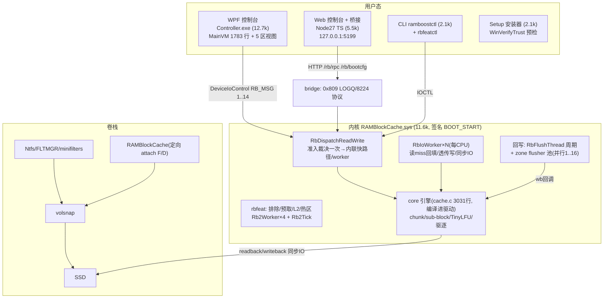
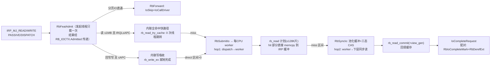
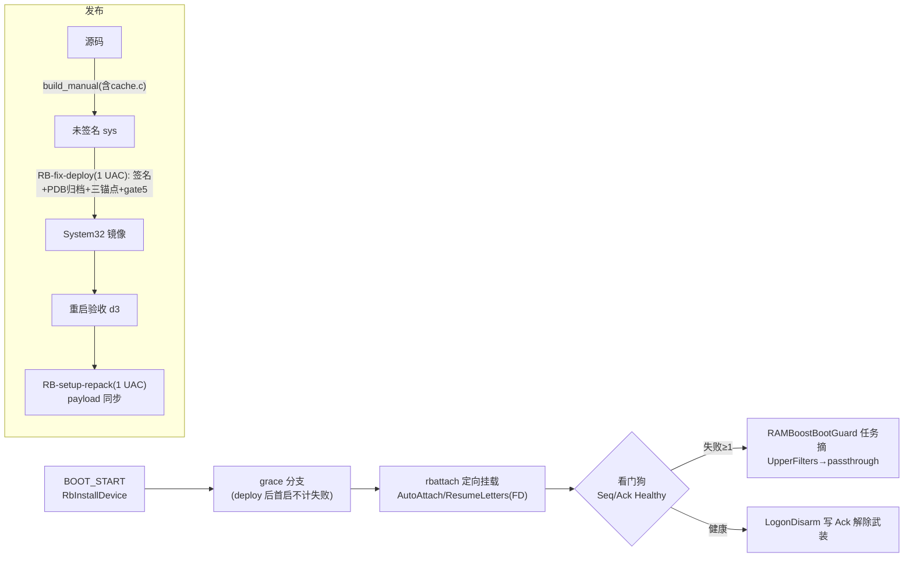

# 134 · 全库架构全景 / 代码拆分 / 延迟削减 / UX 重设计 / 激进测试矩阵（2026-11-10）

> **一句话**：全库 ≈5 万行真实代码（驱动 11.6k + core 15.1k[其中测试 10k] + WPF 12.7k + web 5.5k + ctl 3.8k + installer 2.1k + 脚本 9.6k）。本报告给出：六张架构图（数据面/控制面/启动链/线程模型/发布链/测试矩阵）、四个巨型文件的拆分方案、IO 路径延迟模型与削减清单、UX 重设计规范、以及「内存内激进碰撞」的 bug 猎捕矩阵（已新增 p0evict/p0v2 两件兵器，**p0v2 在多流+建毁风暴下触发一例疑似 core 活锁，正在定位**）。
> 读者：接手人从 §0 读起；图用 mermaid（GitHub/VSCode/Typora 可直接渲染）。

---

## 0. 系统是什么（30 秒）

Windows **卷块上层过滤驱动**（WDM，BOOT_START，定向 attach）把 SSD 卷的 4K~64M IO 吸进**用户态同构的缓存引擎**（core/cache.c，驱动内编译）做读加速与（可选）回写；控制面 = 14 个 IOCTL（WPF 控制台 + Node 桥接 Web 控制台 + CLI 三端共用）；发布链 = 签名驱动 + 单文件 Setup + 三锚点门禁 + 11 道 Python 门禁 + 4 个并发模型。

---

## 1. 全景分层图

## 2. 数据面（IO 路径）——延迟的物理来源

**延迟构成**（读 miss 一次 = 2 次线程/上下文跳转 + 3 次拷贝[盘→池化缓冲→chunk→IRP缓冲] + stripe 读写锁）：
| 环节 | 现状 | 削减方案（按风险排序） |
|---|---|---|
| 命中读 | 0 跳转 1 拷贝（内联快路径已有） | 已最优；TinyLFU 开启后准入判断 O(1) 无增 |
| miss 读 | worker hop + 同步盘读 + commit 回填 | ① miss 区间小(≤64K)时在 dispatch 内联同步读（PASSIVE 且队列空时）——省 hop1，需审计在途计数；② `readback` 直填 IRP 缓冲同时回填 chunk（省一次拷贝）——需处理 IRP 缓冲对齐 |
| 写吸收 | 0 跳转（内联已有） | 已最优 |
| 透传写（detached/巨块） | worker hop（:1530-1547） | `!IsAttached+PASSIVE` 已内联（:1513）；DISPATCH 直转保持 |
| FLUSH | 96§2 失败序号差分 | 周期刷脏 30s 内分片并行已有 1..16 路 |
| 引擎锁 | 16 stripes + bucket 自旋 | 已分片；热块链长可观测（RB_GLOB） |

> 结论：**热路径（命中读/吸收写）已无低垂果实**；收益在 miss 读的 hop1 消除与一次拷贝合并，属于 P2 优化，须以 `bench_readhit/bench_proto` 前后对照，不得裸做。

## 3. 控制面（IOCTL + 桥接 + 持久化）

| RB_MSG | 功能 | 消费方 |
|---|---|---|
| 1 GET_STATS / 4 GET_CONFIG | 读状态/配置 | 三端 UI |
| 2 SET_CONFIG | 24 字段全量写（**含 A3 语义：AutoMemory=0 清动态预算**） | 设置页/CLI |
| 3 FLUSH | 显式刷脏（失败=序号差分） | UI/实验 |
| 5 EXIT_SAFE_MODE | 安全模式退出（用户确认） | 设置页 |
| 6 SET_VOLUME | 单卷读/写/写模式 | 磁盘页 |
| 7 GET_VOLUMES | 卷枚举+绑定 | 三端 |
| 8 ATTACH_VOLUME | 运行时热开关 | 磁盘页 |
| 9 GET_LOG | 64 条快照（钳位，I43 修复） | 日志页 |
| 10 GET_VERSION | 协议版本自检 | 启动自检 |
| 11/12 PANIC(+CLEAR) | 一键熔断 | 总览 |
| 13 INVALIDATE_RANGE | 范围失效 | 特性层 |
| 14 GET_EVENTS | 事件轮询（游标增量） | UI |
| bootcfg 0x80A | AutoAttach/ResumeOnBoot/ResumeLetters（**独立 ABI，不进 SET_CONFIG**） | bootcfg API |

**持久化**：`HKLM\Services\RAMBlockCache\Parameters\Config`（SET_CONFIG 落盘）+ bootcfg 独立键。**UX 风险点（实测踩坑）**：`AutoMemory` 与 `CacheSizeMB` 的语义耦合（A3 缺陷正是这条语义没人说清）；`WriteBack` 全局开关 vs 逐卷 `SET_VOLUME` 双轨；`BlockSize` 改档需重建引擎（静默推迟，UI 只给日志）。

## 4. 启动与发布链

## 5. 线程模型（崩溃转储实测 + 源码）

| 线程 | 数量 | 职责 | 同步原语 |
|---|---|---|---|
| RbIoWorkerLoop/RbIoWorker | 每CPU（绑核派发） | 读miss/透传写/syncio | QueueHead 自旋锁+在途计数(96§2) |
| RbFlusherLoop | zone flusher 池(1..16) | 分片并行回写 | zoned ws + flush_fail/exec 序号 |
| RbFlushThread | 1 | 周期回写+杂务(≤1s切片) | FlushWake/FlushStop |
| Rb2Worker | 4 | 特性层(排除/预取/L2/热区) | Rsvd 上下文 |
| Rb2Tick | 1 | 特性节拍 | OBJ_KERNEL_HANDLE(已修) |
| 看门/引导守卫 | 计划任务 | BootFailCount/摘过滤器 | 注册表+重置纪律 |

## 6. 模块清单与拆分方案（按行数）

| 文件 | 行数 | 问题 | 拆分方案（保持 ABI 不动） |
|---|---|---|---|
| core/cache.c | 3031 | 单文件聚合：数据结构/创建销毁/读路径/写路径/RMW/驱逐/TinyLFU/flush/统计 | 拆 `cache_core.c`(chunk/slab/生命周期) `cache_read.c` `cache_write.c` `cache_evict.c`(reclaim/lfu) `cache_flush.c`(wb/dirty) `cache_stats.c`——头文件 cache.h 不动，build_all 三清单同步 |
| driver/rbio.c | 2462 | dispatch/worker/syncio/flusher/预算线程混居 | 拆 `rbio_dispatch.c` `rbio_worker.c` `rbio_sync.c`(RbSyncIo) `rbio_flush.c`(RbFlushThread+zones) `rbio_budget.c`(RbRefreshMemoryBudget) |
| driver/rbattach.c | 1780 | attach/detach/重建排空/僵尸 | 拆 `rbattach.c`+`rbquiesce.c`(重建排空 96 规格独立) |
| driver/rbdriver.c | 1581 | 14 个 RB_MSG 分发 + 日志/注册表/熔断 | 拆 `rbmsg.c`(dispatch 表) `rblog.c`(I43 钳位域) |
| ctl/ramboostctl.c | 2067 | 全部子命令在一个 main | 按 verb 拆文件（status/config/vol/log/bench） |
| WPF MainViewModel.cs | 1783 | 五区状态+命令混在一个 VM | 每区一 VM（OverviewVM/DrivesVM/CacheVM/LogsVM/SettingsVM），MainVM 只做导航 |
| scripts/finalize_*.ps1 ×5 | ~2.4k | 一次性收网脚本堆积（历史包袱） | 移入 `src/scripts/legacy/`，门禁不再扫描 |

> 拆分纪律：纯搬运不改语义（Gate14 的 101 行守恒基线、Gate13、check_proto_sync 都会盯着）；每次只拆一个文件 → 全套门禁 → 提交。预估 5 个独立 PR 粒度，收益是可维护性而非性能。

## 7. UX 审计与重设计规范

**审计发现（用户视角的"不好用"）**：
1. **配置语义陷阱**：`AutoMemory`×`CacheSizeMB`×`MemReserveMB` 三者耦合，连实现都曾自相矛盾（A3/I38②）——用户不可能设置对。
2. **写模式双轨**：全局 `WriteBack` 与逐卷 `SET_VOLUME wm=` 并存，红线"回写须逐卷显式开"，但设置页只有全局开关。
3. **状态不可见**：缓存健康（驱逐是否发生/命中率/上限是否生效）无总览；`EffectiveCacheMB` 语义依赖实现细节。
4. **危险操作无护栏**：BlockSize 换档静默推迟到引擎重建；PANIC 一键熔断与安全模式退出确认路径分散。
5. **三端不一致**：WPF/Web/CLI 各自实现一遍 24 字段配置（靠 Gate12/Gate8 门禁兜底同步）。

**重设计规范（三阶段）**：
- **阶段 1 · 简单模式（默认）**：总览页只显示 3 个大状态（加速中✓/旁路⏸/熔断⛔）+ 命中率 + 内存水位；一键"优化此电脑"= 推荐预设（直写+自动内存+4096）；所有高级字段折叠进"高级"。
- **阶段 2 · 语义收敛**：配置模型改为 `模式枚举{自动, 固定(MB), 关闭}` 单字段（后端映射到 AutoMemory/CacheSizeMB，SET_CONFIG 保持兼容）；写模式只在逐卷粒度存在；换档时 UI 显式告知"保存后需重启生效"。
- **阶段 3 · 三端同源**：以 `web/src/protocol/types.ts` 的 schema 为唯一事实源（Gate8/Gate12 扩展到 C#/CLI 侧生成或双向断言），WPF 表单从 schema 生成。

## 8. 激进 bug 猎捕矩阵（内存优先，磁盘纪律=<100MB/批）

| # | 兵器 | 状态 | 发现 |
|---|---|---|---|
| T1 | core 全套 27→28 项 + ASan | ✅ 每批必跑 | 全绿基线 |
| T2 | `test_p0evict`（小上限+回写+并发读写+flush+churn，三模式） | ✅ 133 号新增 | 12+ 轮零数据错误；core 单流域排除 |
| T3 | `test_p0v2`（**多流** 3 常驻 + churn 建毁 240 循环 + 跨流驱逐 4MB） | ✅ **闭环：core 干净**（终判 exit=0：驱逐 1.31GB 触发、128MB 盘面逐字节全对、dirty/lost 双零；期间 5 个「挂起/失败」全部为器具问题——pwsh 管道重定向缓冲、g_disk 少配一区、rb_read 返回 1 未处理、churn 无盘后备、statsq 无界等待——已逐个修复并记录） | core 多流域排除 |
| T4 | `edge_v4` C1-C5 + `stress_v4` + `test_rebuild`(排空/重建) | ✅ 既有 | 绿 |
| T5 | 真机受控复现（I47 判别：关 360/Defender / verifier /reset） | ⏸ 需用户决策（每次重启+可能 2.7GB 转储） | — |
| T6 | IOCTL 面参数化碰撞（method 1..14 越界/并发/乱序） | 📋 待建（纯控制面零磁盘） | — |
| T7 | 变异门禁 qa_teeth/c5/d5 | ✅ 既有 | 3+5+6 变异 KILLED |

## 9. 已知 bug 台账快照（以 KNOWN_ISSUES 为准）

- **I47 P0**（回写+小上限驱逐并发 → 0x3B，症状级点名完成，core 已排除，等待判别实验）：**冻结令继续**。
- **T3 已闭环**：多流+建毁+跨流驱逐风暴下 core 层零缺陷（「疑似活锁」经仪表化定位全部为器具假象，见 T3 行）；I47 的内核侧归因仍开放（判别实验等用户决策）。
- I11/I12/I14/I16(已闭环)/I35(已闭环) 等历史项状态见台账。

## 10. 路线图

1. **本批收尾**：p0v2 活锁定位（仪表化输出）→ 若为 core 缺陷则修复+回归；提交 134。
2. **下一批（用户决策后）**：I47 判别实验（关 AV / verifier reset）→ 根因修复 → E2 复跑闭环 → Setup 重打包 → 恢复挂载。
3. **重构批**：按 §6 顺序拆 cache.c（最大收益），每步全门禁。
4. **优化批**：§2 表两刀（miss 内联/拷贝合并），bench 前后对照。
5. **UX 批**：§7 阶段 1（WPF 总览+预设），零内核改动。

> 纪律不变：没有触发证据不算验证；改 core 必重编驱动；回写+小上限维持冻结；所有新测试进三份构建清单。
