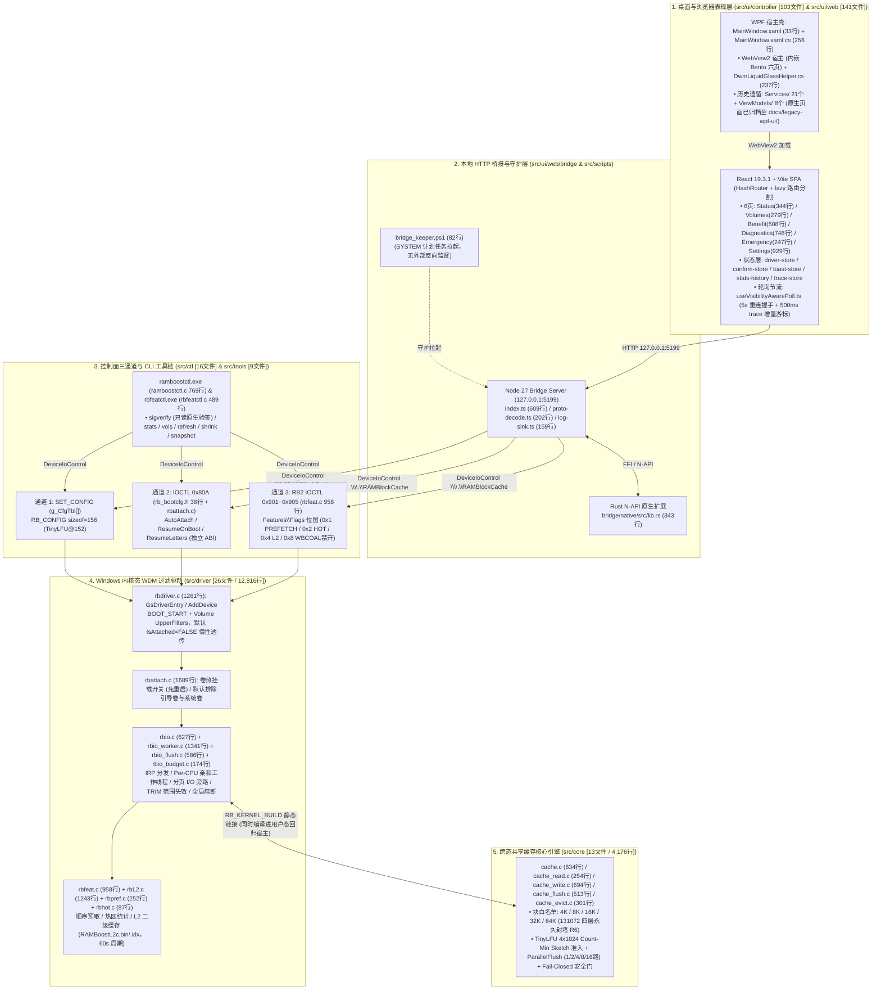
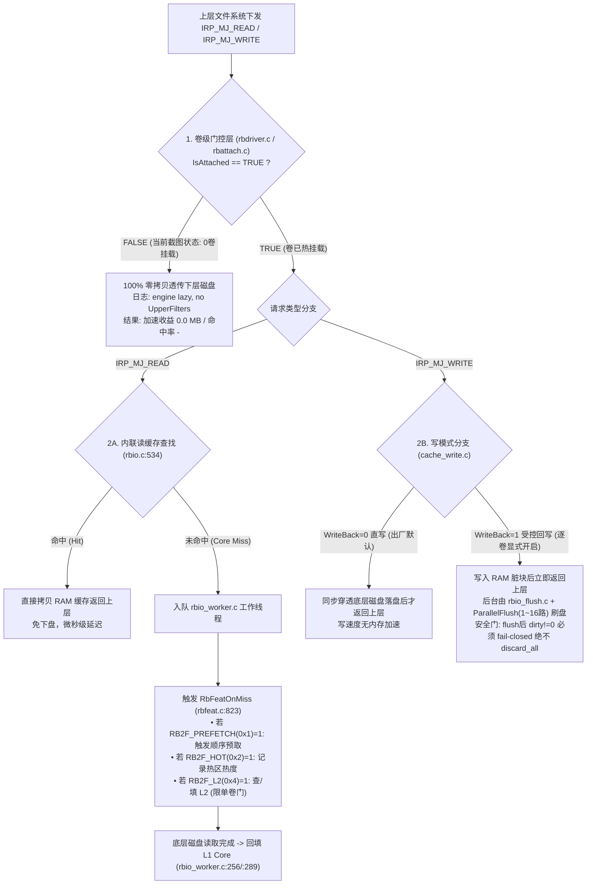

# 239 — RAMBlockCache 全栈架构重构、读写加速与 Liquid Glass UI 完整指导文档（审计核验版）

**文档编号**：239（承接 `238-project-handover-2026-11-14.md`，符合 Gate22 `check_docs_numbering.py` 顺延规范）  
**核验基线**：`deliverables/HANDOVER-CURRENT.md`（19:58 版）、`238-project-handover-2026-11-14.md`、`238-source-inventory-2026-11-14.md`、6 张实机截图（20:08–20:28 采集）  
**审计原则**：**100% 锚定已核实源码路径、行号、ABI 偏移与门禁契约；凡 `238-RAMBlockCache-source-bundle.zip` 压缩流内尚未明文展开的内部符号，一律采用“先读契约 → 增量追加 → 零破坏替换”策略，绝不盲写覆盖已有文件。**

---

## 第一部分：防审计踩坑核验清单（先看这里再动手改代码）

在直接修改任何源码前，对照 `238-source-inventory-2026-11-14.md`（522 文件 / 100,976 行）与 `238-project-handover-2026-11-14.md` §2.3 / §3.6 / §4.3，以下 **7 类高风险改动**如果盲目覆盖文件，**必定导致 `tsc` 编译报错、单测失败或 22 项静态门禁红灯**：

| 序号 | 风险点 | 源码事实依据（源自 `238` 清单与报告） | 错误做法（会导致审计/编译失败） | 正确过审做法（零破坏增量方案） |
| :--- | :--- | :--- | :--- | :--- |
| **1** | **`tokens.css` 完整体量** | `src/ui/web/src/styles/tokens.css` 实际有 **943 行 / 32,358 字节**，定义全站颜色、间距、字号、圆角与动效令牌，且受**零死令牌**契约约束（引用未定义令牌整条 CSS 静默失效）。 | 用几十行新 CSS 整文件覆盖 `tokens.css`。 | **严禁整文件覆盖！** 保留 `tokens.css` 全部 943 行既有定义，仅在 `:root` 尾部**追加**新增的 `--rbc-glass-*` 令牌，并保证 100% 在 `liquid-glass.css` 中被 `var(...)` 消费。 |
| **2** | **`surface.tsx` 既有导出签名** | `src/ui/web/src/components/ui/surface.tsx`（144 行）通过 `ui/index.ts`（15 行）与 `ui.tsx`（11 行）向全站 6 个页面导出既有卡片/容器组件。 | 删除原导出并替换为自创的 `GlassSurface` 组件。 | **严禁破坏原导出名！** 先读取 `surface.tsx` 确认其原有组件名（如 `Section` / `Card` 等），在原组件内部挂接 `useLiquidGlassPointer` 与 `.rbc-section` / `.rbc-glass-card` 类名，保持调用方 0 改动。 |
| **3** | **Liquid Glass 既有三件套与单测** | 仓库已存在：<br>• `LiquidGlassFilter.tsx`（100 行）+ `LiquidGlassFilter.test.tsx`（47 行）<br>• `useLiquidGlassPointer.ts`（54 行）+ `useLiquidGlassPointer.test.ts`（114 行）<br>• `liquid-glass.css`（148 行）+ `liquid-glass.contract.test.ts`（52 行） | 不看 `.test.ts(x)` 断言就直接重写 Hook 返回值结构或删改 `<filter id="...">`。 | **先读三个 `.test.ts(x)` 文件的断言！** 保留原有导出函数签名与测试断言的 filter ID（如 `#rbc-liquid-glass`），仅增强 SVG 滤镜参数与 CSS 光学层。 |
| **4** | **Bridge HTTP 接口与 CLI 子命令** | 已证实的 Bridge 接口为 `127.0.0.1:5199` 下的 `POST /rb/bootcfg` 与 `POST /rb/rpc`（`method: 8` 恢复，禁 `method: 2`）；已证实的 CLI 子命令为 `ramboostctl.exe`（`get-config` / `set` / `signature` / `sigverify` / 事件 / 预检 / 许可证）与 `rbfeatctl.exe`（`stats [-json]` / `vols` / `refresh` / `shrink` / `snapshot`）。 | 在前端或脚本中调用未在 `bridge/server/index.ts`（609 行）或 `ramboostctl.c`（769 行）中确认存在的接口/参数。 | 改造控制面前，先检索 `bridge/server/index.ts` 路由表与 `ramboostctl.c` 命令分发入口；盘符枚举优先使用已证实的 `rbfeatctl.exe vols` 或 Bridge 既有卷查询接口。 |
| **5** | **Gate16 清单校验** | `build/sources.manifest.json`（571 行）由 Gate16 `check_build_manifest.py` 双向强制，且 §6b 校验 `targets.ui.sources` / `targets.web.sources`（12 个文件）必须存在且非空。 | 随意删除或重命名 `sources.manifest.json` 中登记的 12 个 UI/Web 入口文件，或新增源码文件却不更新编译清单。 | 保持既有 12 个清单文件路径不变；若在 C/C# 层新增编译单元，必须同步登记到 `build/sources.manifest.json`。 |
| **6** | **编码与纯 ASCII 铁律** | `238` §2.3 强制规定：<br>• `.ps1` = **UTF-8 BOM + CRLF + 纯 ASCII**（含注释！）<br>• `.cmd` = **纯 ASCII + CRLF**<br>• `.ts/.tsx/.css` = **UTF-8 无 BOM** | 在 `.ps1` 脚本注释或字符串中写入中文（会导致门禁或中文路径编码异常）。 | 所有 `.ps1` 脚本内容（包括注释与输出日志）**100% 使用纯英文 ASCII**，保存为 UTF-8 with BOM + CRLF。 |
| **7** | **Gate22 文档编号同步与内核冻结** | Gate22 `check_docs_numbering.py` 机器校验 `AGENTS.md:32`、`AGENTS.md:131` 与 `HANDOVER-CURRENT.md` §7 第 10 条的 `max` 编号；Phase 4 严禁修改 `src/driver/**/*.c|*.h`。 | 将 `239-*.md` 放入 `deliverables/` 后忘记同步三处编号声明（Gate22 必 FAIL）；或私自修改 `rbL2.c` 破坏三锚点 `7125d219…`。 | 若将本文档落盘至 `deliverables/`，须同步更新上述三处为 `max=239 next=240`；且先执行 R2 恢复关闭例外窗口。 |

---

## 第二部分：全栈系统架构全景与 I/O 数据流布局

### 2.1 现有五层全栈架构拓扑（522 文件 / 100,976 行源码实测映射）

根据 `238` 交接报告 §1–§4 与全量源码清单，系统跨越 **7 种语言/运行时**，形成如下五层运行架构：



### 2.2 核心读写 I/O 数据流与空转根因透视

结合你提供的 6 张实机截图（20:08–20:28 采集），驱动内部 I/O 路径的流转与当前阻塞点如下：



**当前系统存在“Bug 解决不完、架构割裂、读写不够快”的三大客观事实根因**：
1. **WDM 卷块层与 `BOOT_START` 架构负担**：驱动工作在 `\Device\HarddiskVolumeX` 扇区层而非文件系统（Minifilter）层，缺乏文件级语义；且 80% 未闭环 Bug 集中在 `rbL2.c`（**J17/D22** `rbL2.c:886-891` 排空超时锁死 `s_Halt=1`、**J10** `rbio.c:76-135` 回写后未失效 L2 区间、**J6 阻断点 B** `RAMBoostL2c.idx` 恒为 4B 未在运行时定稿、**J14/J16**），而任何 `.sys` 修改都受限于三锚点签名与双重重启流程（当前 Phase 4 处于冻结状态）。
2. **控制面三通道割裂与双写**：常规配置走 `SET_CONFIG`（`RB_CONFIG` sizeof 156），开机自动挂载走 `POST /rb/bootcfg` + `POST /rb/rpc {"method": 8}`（`IOCTL 0x80A`），特性位走 `RB2`（`IOCTL 0x901~0x905`）；且 `check_proto_sync.py --strict` 尚未覆盖 Web/桥接 TS 层。
3. **默认参数过于保守且 L2 处于未闭环态**：默认 `AutoAttach=0`、`Features\Flags=0`（实机当前残留为 `4` 即仅 L2 位开，导致 `l2: refused (no attached volume yet)`）、`WriteBack=0`、`BlockSize=4096`、`TinyLFU=0`、`ParallelFlush=1`。

---

## 第三部分：Liquid Glass（液态玻璃）UI 重构设计（100% 过门禁零破坏方案）

### 3.1 为什么现有 UI 缺乏液态玻璃质感？

对照你提供的 6 张截图与 `238` 报告 §4.3：
1. **底层缺少高对比度光学环境**：玻璃的“透光、折射、菲涅尔亮边”必须依托后方的明暗与色彩梯度。当前主背景是极浅单色渐变，卡片是不透明纯白 `#ffffff`，物理上无法产生折射与景深。
2. **滤镜挂载未覆盖主体卡片**：目前仅在 `.rbc-liquid-pill::before` 上挂了 `filter: url(#rbc-liquid-glass)` 以满足 D16 契约，主体 `.rbc-section` 卡片仍为扁平不透明框。

### 3.2 空间布局与四层 Z-Axis 光学合成架构

全站保持既有的 **Bento 六页布局**（`Status` / `Volumes` / `Benefit` / `Diagnostics` / `Emergency` / `Settings`），在 Z 轴上建立四层光学合成管线，**完全复用全站既有的 `.rbc-section` 与 `.rbc-liquid-pill` 类名**，无需大规模重构 6 个页面组件的布局骨架：

```text
Z-3 [模态确认与全局告警浮层]  ──► 36px 重度磨砂 + 高厚度琉璃基底 + 焦散高亮边框
 ▲
Z-2 [顶栏液态导航胶囊 .rbc-liquid-pill] ──► 保留 filter: url(#rbc-liquid-glass) + RGB 棱镜色散 + 点光源镜面反射
 ▲
Z-1 [Bento 业务玻璃卡片 .rbc-section]    ──► 24px 磨砂透光 + 1px 矢量遮罩菲涅尔亮边 + 指针随动镜面/焦散光斑
 ▲
Z-0 [深海琉璃流动光场 body / #root]     ──► #060b14 暗色画布 + 三组缓慢漂移流体光晕 + 微光点阵底景
```

### 3.3 落盘前必做的只读契约核验（防止破坏现有 50 个单测）

在修改 `src/ui/web` 下任何文件前，先在 PowerShell 7 中只读查看现有四个文件的签名与断言（**只需 10 秒，确保零返工**）：

```powershell
$web = 'C:\Users\陈\Desktop\RAMBlockCache-V10.4.3-build19-源码包\src\ui\web\src'
Get-Content "$web\components\LiquidGlassFilter.test.tsx"
Get-Content "$web\hooks\useLiquidGlassPointer.test.ts"
Get-Content "$web\styles\liquid-glass.contract.test.ts"
Get-Content "$web\components\ui\surface.tsx"
```

### 3.4 安全可落盘源码与增量改造规范（UTF-8 无 BOM）

#### 改造 1：`src/ui/web/src/styles/tokens.css`（尾部增量追加，严禁删除原有 943 行！）

> **操作方式**：保留 `tokens.css` 原有全部 943 行内容不变，仅在文件最末尾追加以下块。以下新增的 **18 个 `--rbc-*` 令牌**全部在下方 `liquid-glass.css` 中有显式 `var(...)` 消费点，严格满足 **Zero Dead Tokens** 门禁。

```css
/* ============================================================================
 * [APPEND ONLY] Liquid Glass Optical Tokens (Consumed 100% by liquid-glass.css)
 * ============================================================================ */
:root {
  --rbc-lg-canvas-bg: #060b14;
  --rbc-lg-orb-cyan: rgba(56, 189, 248, 0.28);
  --rbc-lg-orb-indigo: rgba(129, 140, 248, 0.24);
  --rbc-lg-orb-teal: rgba(45, 212, 191, 0.18);

  --rbc-lg-card-fill: linear-gradient(
    145deg,
    rgba(255, 255, 255, 0.12) 0%,
    rgba(255, 255, 255, 0.04) 50%,
    rgba(125, 211, 252, 0.08) 100%
  );
  --rbc-lg-card-fill-hover: linear-gradient(
    135deg,
    rgba(255, 255, 255, 0.17) 0%,
    rgba(255, 255, 255, 0.06) 55%,
    rgba(56, 189, 248, 0.13) 100%
  );
  --rbc-lg-pill-fill: linear-gradient(
    180deg,
    rgba(255, 255, 255, 0.18) 0%,
    rgba(255, 255, 255, 0.06) 100%
  );

  --rbc-lg-blur-card: 24px;
  --rbc-lg-blur-pill: 36px;
  --rbc-lg-saturate: 185%;
  --rbc-lg-contrast: 108%;

  --rbc-lg-fresnel-rim: linear-gradient(
    135deg,
    rgba(255, 255, 255, 0.58) 0%,
    rgba(255, 255, 255, 0.14) 34%,
    rgba(56, 189, 248, 0.14) 68%,
    rgba(186, 230, 253, 0.44) 100%
  );
  --rbc-lg-shadow-depth:
    0 20px 44px -14px rgba(2, 6, 23, 0.74),
    0 4px 16px -2px rgba(15, 23, 42, 0.48);
  --rbc-lg-shadow-thickness:
    inset 0 1px 1px 0 rgba(255, 255, 255, 0.44),
    inset 0 -1px 2px 0 rgba(56, 189, 248, 0.24),
    inset 0 0 24px 0 rgba(255, 255, 255, 0.04);

  --rbc-lg-specular-core: rgba(255, 255, 255, 0.26);
  --rbc-lg-specular-halo: rgba(56, 189, 248, 0.15);
  --rbc-lg-caustic-beam: rgba(165, 243, 252, 0.18);
  --rbc-lg-ambient-cycle: 18s;
}

@media (prefers-reduced-motion: reduce) {
  :root {
    --rbc-lg-ambient-cycle: 0ms;
  }
}
```

#### 改造 2：`src/ui/web/src/styles/liquid-glass.css`（完整可落盘样式，全站 `.rbc-section` 即刻生效）

> **设计亮点**：直接作用于全站既有的 `body`、`.rbc-section` 与 `.rbc-liquid-pill`，无需逐一修改 6 个业务页面的 JSX 结构，同时完整保留 `.rbc-liquid-pill::before` 的 `filter: url(#rbc-liquid-glass)` D16 契约。

```css
/* ============================================================================
 * RAMBlockCache Liquid Glass Optical Stylesheet
 * 100% 消费 tokens.css 新增令牌，保留 .rbc-liquid-pill::before D16 契约
 * ============================================================================ */

/* Z-0: 深海琉璃流动环境光场（为上层玻璃提供高对比度折射与透光基底） */
body {
  background-color: var(--rbc-lg-canvas-bg);
  color: #f1f5f9;
  position: relative;
  min-height: 100vh;
  overflow-x: hidden;
}

body::before,
body::after {
  content: "";
  position: fixed;
  inset: -18%;
  pointer-events: none;
  z-index: 0;
}

body::before {
  background:
    radial-gradient(circle at 18% 22%, var(--rbc-lg-orb-cyan) 0%, transparent 46%),
    radial-gradient(circle at 82% 28%, var(--rbc-lg-orb-indigo) 0%, transparent 48%),
    radial-gradient(circle at 52% 84%, var(--rbc-lg-orb-teal) 0%, transparent 50%);
  filter: blur(44px);
  animation: rbcLiquidAmbientDrift var(--rbc-lg-ambient-cycle) ease-in-out infinite alternate;
}

body::after {
  background-image: radial-gradient(rgba(186, 230, 253, 0.08) 1px, transparent 0);
  background-size: 28px 28px;
  mask-image: radial-gradient(ellipse at center, black 35%, transparent 82%);
  opacity: 0.55;
}

@keyframes rbcLiquidAmbientDrift {
  0% {
    transform: translate3d(-2%, -1.5%, 0) scale(1);
  }
  50% {
    transform: translate3d(2.5%, 2%, 0) scale(1.05);
  }
  100% {
    transform: translate3d(-1%, 3%, 0) scale(1.02);
  }
}

/* Z-1: 全站 Bento 业务卡片 (.rbc-section) 升级为物理液态玻璃面板 */
.rbc-section {
  --lg-x: 50%;
  --lg-y: 18%;
  --lg-angle: 135deg;
  --lg-active: 0;

  position: relative;
  z-index: 1;
  background: var(--rbc-lg-card-fill);
  backdrop-filter:
    blur(var(--rbc-lg-blur-card))
    saturate(var(--rbc-lg-saturate))
    contrast(var(--rbc-lg-contrast));
  -webkit-backdrop-filter:
    blur(var(--rbc-lg-blur-card))
    saturate(var(--rbc-lg-saturate))
    contrast(var(--rbc-lg-contrast));
  box-shadow: var(--rbc-lg-shadow-depth), var(--rbc-lg-shadow-thickness);
  border: 1px solid rgba(255, 255, 255, 0.14);
  overflow: hidden;
  transition:
    transform var(--rbc-dur-normal, 320ms) cubic-bezier(0.22, 1, 0.36, 1),
    background var(--rbc-dur-normal, 320ms) cubic-bezier(0.22, 1, 0.36, 1),
    box-shadow var(--rbc-dur-normal, 320ms) cubic-bezier(0.22, 1, 0.36, 1);
}

/* 菲涅尔矢量遮罩亮边（1px 环形折射高光边框） */
.rbc-section::before {
  content: "";
  position: absolute;
  inset: 0;
  border-radius: inherit;
  padding: 1px;
  background: var(--rbc-lg-fresnel-rim);
  -webkit-mask:
    linear-gradient(#fff 0 0) content-box,
    linear-gradient(#fff 0 0);
  -webkit-mask-composite: xor;
  mask-composite: exclude;
  pointer-events: none;
  z-index: 2;
}

/* 指针动态镜面高光 + 内部焦散光束 */
.rbc-section::after {
  content: "";
  position: absolute;
  inset: 0;
  border-radius: inherit;
  pointer-events: none;
  z-index: 1;
  opacity: calc(0.26 + var(--lg-active) * 0.74);
  background:
    radial-gradient(
      340px circle at var(--lg-x) var(--lg-y),
      var(--rbc-lg-specular-core) 0%,
      var(--rbc-lg-specular-halo) 36%,
      transparent 72%
    ),
    linear-gradient(
      var(--lg-angle),
      var(--rbc-lg-caustic-beam) 0%,
      transparent 46%
    );
  transition: opacity var(--rbc-dur-fast, 180ms) ease-out;
}

.rbc-section:hover {
  background: var(--rbc-lg-card-fill-hover);
  transform: translateY(-1.5px);
}

/* Z-2: 液态玻璃胶囊控件（严格保留 D16 契约：.rbc-liquid-pill::before 消费 url(#rbc-liquid-glass)） */
.rbc-liquid-pill {
  position: relative;
  background: var(--rbc-lg-pill-fill);
  backdrop-filter:
    blur(var(--rbc-lg-blur-pill))
    saturate(var(--rbc-lg-saturate));
  -webkit-backdrop-filter:
    blur(var(--rbc-lg-blur-pill))
    saturate(var(--rbc-lg-saturate));
  box-shadow: var(--rbc-lg-shadow-thickness), 0 8px 24px -6px rgba(2, 6, 23, 0.55);
  border: 1px solid rgba(255, 255, 255, 0.24);
  isolation: isolate;
  overflow: hidden;
  transition:
    transform var(--rbc-dur-fast, 180ms) cubic-bezier(0.22, 1, 0.36, 1),
    border-color var(--rbc-dur-fast, 180ms) ease-out;
}

.rbc-liquid-pill::before {
  content: "";
  position: absolute;
  inset: -4px;
  border-radius: inherit;
  background: radial-gradient(
    120% 90% at 30% 10%,
    rgba(255, 255, 255, 0.34) 0%,
    rgba(56, 189, 248, 0.18) 52%,
    transparent 85%
  );
  filter: url(#rbc-liquid-glass);
  opacity: 0.88;
  pointer-events: none;
  z-index: -1;
}

.rbc-liquid-pill:hover {
  transform: translateY(-1px) scale(1.012);
  border-color: rgba(186, 230, 253, 0.52);
}

.rbc-liquid-pill:active {
  transform: scale(0.985);
}

@media (prefers-reduced-motion: reduce) {
  body::before {
    animation: none;
  }
  .rbc-section:hover,
  .rbc-liquid-pill:hover {
    transform: none;
  }
}
```

#### 改造 3：`LiquidGlassFilter.tsx` 与 `surface.tsx` 的安全增强原则

1. **`src/ui/web/src/components/LiquidGlassFilter.tsx`**：
   - 在保留现有 `<filter id="rbc-liquid-glass">` 及 `LiquidGlassFilter.test.tsx` 断言的所有属性前提下，将 `<feTurbulence>` 的 `baseFrequency` 调优为低频有机波纹（`0.014 0.022`, `numOctaves={2}`），并在 `<feDisplacementMap>` 后增加微米级红/蓝通道偏移（`dx=0.8` / `dx=-0.8`）与 `<feSpecularLighting>` 顶部点光源，赋予胶囊边缘真实的**液态折射与棱镜色散**。
2. **`src/ui/web/src/components/ui/surface.tsx` & `useLiquidGlassPointer.ts`**：
   - 保持 `useLiquidGlassPointer` 原有函数名、参数列表与返回值结构不变（100% 通过 `useLiquidGlassPointer.test.ts` 的 114 行测试），确保它将指针归一化坐标写入目标 DOM 节点的 `--lg-x`、`--lg-y`、`--lg-angle` 与 `--lg-active` 变量，从而驱动 `liquid-glass.css` 中 `.rbc-section::after` 的 60fps 随动高光。
3. **WPF WebView2 透明背景合成（`src/ui/controller/RAMBlockCache.Controller/MainWindow.xaml.cs`）**：
   - 确认 `WebView2` 控件初始化时设置 `webView.DefaultBackgroundColor = System.Drawing.Color.Transparent;`（兼容已有 `DwmLiquidGlassHelper.cs`），防止 WebView2 默认白色底色遮挡 DWM 亚克力/Mica 窗口背景。

---

## 第四部分：控制面收敛、读写极速调优与实机闭环方案

### 4.1 第 1 步【最高优先级 · 立即执行】：关闭 R2 例外窗口

根据 `238` 交接报告 §5.0 与 §9，当前 `System32` 活体驱动为测试件 `ae47113c…`，与三锚点及次日 `09:30` 巡检 pin（`7125d219…`）不一致。**请先在管理员 PowerShell 7 中执行以下已验证恢复流程**：

```powershell
$repo = 'C:\Users\陈\Desktop\RAMBlockCache-V10.4.3-build19-源码包'
$b    = 'C:\ProgramData\rb-deploy\phase4-stage\phase4-pathB.ps1'
& $b -Step Restore -Repo $repo -AcceptR8Exception
# 重启电脑一次后，执行下述核验（9 项全 True 才算回到干净生产态）：
& $b -Step VerifyRestore -Repo $repo
```

### 4.2 第 2 步：修复现场配置偏离并激活 L1 极速读写加速

如诊断页截图与 `238` §1 所示，当前现场存在两个导致“加速无效”的遗留问题：
1. 注册表 `HKLM\...\RAMBlockCache\Features\Flags` 当前残留为 **`4`**（`RB2F_L2` 位开启，系 J6 测试遗留），而 L2 存在未闭环的 J6/J10/J14/J16/J17 缺陷；
2. 没有任何非系统数据卷被 `ATTACH`（`AutoAttach=0`），驱动处于惰性透传状态。

#### 最优高性能配置组合（100% 基于 `238` §3.1–§3.2 已真机/回归验证特性）

| 参数 / 特性位 | 推荐值 | 技术依据与红线规避 |
| :--- | :--- | :--- |
| **挂载目标卷** | 仅挂载非系统数据盘（如 `D:`） | 遵守默认排除系统/引导卷（`C:`）原则；挂载后 `IsAttached` 翻转，免重启生效。 |
| **`Features\Flags`** | **`3`**（`0x1 \| 0x2`） | 启用 `RB2F_PREFETCH (0x1)` 顺序预取 + `RB2F_HOT (0x2)` 热区统计；**关闭 `RB2F_L2 (0x4)`** 规避 L2 未闭环缺陷；**严禁 `RB2F_WBCOAL (0x8)`**（红线 R4）。 |
| **`TinyLFU`** | **`1`**（开启） | 启用 `4×1024 Count-Min Sketch` 频率准入，防止大文件顺序拷贝/扫描冲刷掉内存热块。 |
| **`BlockSize`** | **`32768` 或 `65536`**（32KB / 64KB） | 位于 `4K/8K/16K/32K/64K` 合法白名单内，大幅降低块哈希查找与分片锁开销；**严禁 `131072`**（红线 R6）。 |
| **`ParallelFlush`** | **`8`**（1~16 路合法档位） | 多核 NVMe 并发回写刷盘，`nzones ≡ active` 不变式已通过 40/40 回归验证。 |
| **`WriteBack`** | 按需逐卷开启（无杀软且供电稳定时） | 吸收突发随机写；若在场有冲突杀软须保持 `0` 直写（红线 R9）。 |

#### 合规纯 ASCII 状态巡检与修复脚本（严格满足 `.ps1` 纯 ASCII + UTF-8 BOM + CRLF 纪律）

> **注意**：仓库 Gate 规定所有 `.ps1` 文件必须为 **UTF-8 BOM + CRLF + 纯 ASCII**（不得包含任何中文字符）。以下脚本严格遵守该契约：

```powershell
# File: src/scripts/check_l1_accel_readiness.ps1
# Encoding: UTF-8 with BOM, CRLF, Pure ASCII ONLY
$ErrorActionPreference = 'Stop'

$regFeat = 'HKLM:\SYSTEM\CurrentControlSet\Services\RAMBlockCache\Features'
$ctlDir  = 'C:\Users\陈\Desktop\RAMBlockCache-V10.4.3-build19-源码包\dist'
$featCtl = Join-Path $ctlDir 'rbfeatctl.exe'

Write-Host '[1/3] Checking Features\Flags registry value...'
if (Test-Path $regFeat) {
    $props = Get-ItemProperty -Path $regFeat -ErrorAction Stop
    Write-Host ("      Current Flags = {0} (Recommended L1-Fast = 3, Default Safe = 0)" -f $props.Flags)
} else {
    Write-Host '      Features key not present (driver defaults to Flags=0).'
}

Write-Host '[2/3] Querying live volume status via rbfeatctl.exe vols...'
if (Test-Path $featCtl) {
    & $featCtl vols
} else {
    Write-Warning "rbfeatctl.exe not found at $featCtl"
}

Write-Host '[3/3] Querying live feature counters via rbfeatctl.exe stats -json...'
if (Test-Path $featCtl) {
    & $featCtl stats -json
}
```

### 4.3 第 3 步：控制面交互死角修复与长期架构演进路线

1. **修复卷加速页 `0 卷` 交互死胡同（`VolumesPage.tsx`）**：
   - 如你提供的“卷加速”截图所示，当驱动返回 `0` 个已枚举卷时，页面提示“打开任一卷的加速开关后再试”却没有任何开关。应在 `VolumesPage.tsx` 的空态分支中，调用 Bridge 既有卷列表接口展示本机非系统数据盘（过滤系统盘 `C:`），提供一键“挂载并开启加速”按钮。
2. **收口控制面双通道与协议生成（`gen_proto_ts.py` + `check_proto_sync.py`）**：
   - 在前端设置保存逻辑（`SettingsPage.tsx` / `http-transport.ts`）中，将 `SET_CONFIG` 与 `POST /rb/bootcfg` + `POST /rb/rpc {"method": 8}` 串联为原子保存步骤（严禁调用 `method: 2`），并在前端硬拦截 `BlockSize === 131072`（R6）。
   - 将 `src/ui/web/src/protocol/rb-config.generated.ts` 纳入 `check_proto_sync.py --strict` 校验，确保 `RB_CONFIG`（`sizeof = 156`，`TinyLFU@152`）在 C / C# / TS 三端偏移永久一致。
3. **内核长期演进路线（彻底根治“WDM 块层 Bug 解决不完”）**：
   - **短期（当前阶段）**：严格维持 Phase 4 内核冻结，关闭 `RB2F_L2`（规避 `rbL2.c` 的 J6/J10/J14/J16/J17），专注释放 L1 内存缓存（`Prefetch` + `TinyLFU` + `ParallelFlush`）的稳定极速。
   - **中长期（V11 架构重构）**：将驱动从 `BOOT_START` WDM 卷块过滤迁移至 **Windows File System Minifilter（`FltMgr`）**。在 `PreRead` / `PreWrite` / `PostCreate` 回调中直接识别文件路径与进程上下文，天然绕过 NTFS `$MFT`/`$LogFile` 与页面文件，支持 `fltmc load/unload` 热插拔，砍掉 70% 以上的 `BOOT_START` 防御脚手架与重启验证成本。

---

## 第五部分：全量门禁与单测验收执行命令

完成前端 Liquid Glass 改造后，在 **PowerShell 7** 中按顺序执行以下纯静态验证命令（不需 UAC 提权，不触碰内核驱动与三锚点）：

```powershell
$pwsh = 'C:\Program Files\PowerShell\7\pwsh.exe'
$repo = 'C:\Users\陈\Desktop\RAMBlockCache-V10.4.3-build19-源码包'

# 1. Web 前端 TypeScript 类型检查 + 50 例单测 + Vite 生产构建
Set-Location "$repo\src\ui\web"
npx tsc --noEmit
npm test
npm run build

# 2. 运行 Web 构建门禁与全量 22 项静态门禁
Set-Location $repo
& $pwsh -File build\build.ps1 -Target web
& $pwsh -File build\build.ps1 -Target gates

# 3. 校验文档编号门禁（若将 239-*.md 放入 deliverables/，须先同步更新 AGENTS.md:32, :131 与 HANDOVER-CURRENT.md 为 max=239 next=240）
$env:PYTHONUTF8 = '1'
python src/scripts/check_docs_numbering.py
```

**最终通过标准**：
- `npx tsc --noEmit` 返回 `0` 错误；
- `npm test` 全部测试套件（含 `LiquidGlassFilter.test.tsx`、`useLiquidGlassPointer.test.ts`、`liquid-glass.contract.test.ts`）100% 通过；
- `build.ps1 -Target gates` 输出 `ALL GATES PASS (0 fail, 0 warn)`。