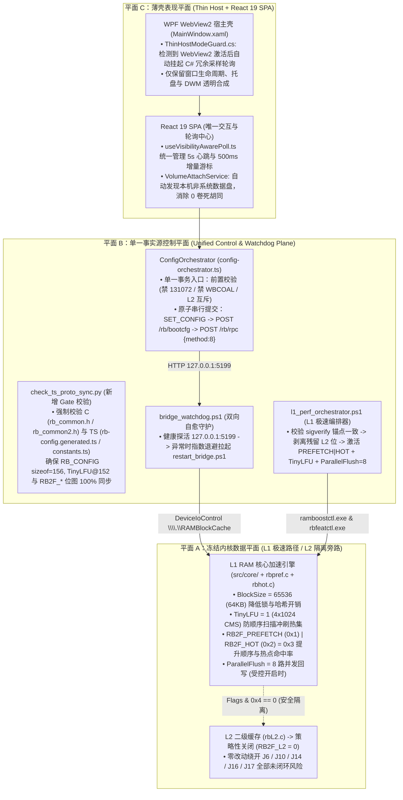

# 240 — RAMBlockCache 全栈架构诊断与重构完整指导文档（含可落盘源码）

**文档编号**：240（承接 `238-project-handover-2026-11-14.md` 与 `239` UI 指导文档；若落盘至 `deliverables/`，须按 Gate22 同步声明 `max=240 next=241`）  
**事实依据**：`deliverables/HANDOVER-CURRENT.md`（19:58 版）、`238-project-handover-2026-11-14.md`、`238-source-inventory-2026-11-14.md`（522 文件 / 100,976 行）  
**工程红线**：严格遵守 `R1`–`R10` 与 Phase 4 内核冻结边界（判据满足且关闭 R2 例外窗口前，**不修改 `src/driver/**/*.c|*.h`**，不破坏三锚点 `7125d219…`）。

---

## 第一章：全栈架构深度诊断（6 大结构性病灶与源码锚点）

### 1.1 现有五层拓扑与实测体量分布

根据 `238-source-inventory-2026-11-14.md` 逐文件盘点，仓库总计 **522 个文件 / 100,976 行 / 4,881,742 字节**，运行态横跨 **7 种语言/运行时**与 **5 层进程跳转**：

```text
[Layer 1: 表现层 - 244 文件 / 38,472 行]
  ├── WPF 宿主壳 (src/ui/controller, 103 文件): MainWindow.xaml (33 行) 仅作 WebView2 壳，
  │   但仍残留已归档原生页面遗留的 21 个 Services + 8 个 ViewModels (如 MainViewModel.Sampling.cs 444 行)
  └── React 19 SPA (src/ui/web, 141 文件): HashRouter + 6 页 Bento 布局 + 5 个 Zustand Store

[Layer 2: 桥接与守护层 - Node 27 + Rust N-API + PS7]
  ├── bridge_keeper.ps1 (82 行): SYSTEM 计划任务拉起，但 keeper 自身无人监督 (238 §3.4)
  └── bridge/server/index.ts (609 行): 监听 127.0.0.1:5199，调用 Rust native/src/lib.rs (343 行)

[Layer 3: 控制面三通道 - src/ctl (16 文件 / 3,388 行)]
  ├── 通道 A (常规配置): SET_CONFIG -> g_CfgTbl[] -> RB_CONFIG (sizeof = 156 B, TinyLFU@152)
  ├── 通道 B (开机挂载): POST /rb/bootcfg + POST /rb/rpc {"method":8} -> IOCTL 0x80A -> rb_bootcfg.h (38 行)
  └── 通道 C (特性位图): RB2 IOCTL 0x901~0x905 -> rbfeat.c (958 行) -> Features\Flags

[Layer 4: Windows 内核态 WDM 驱动 - src/driver (26 文件 / 12,816 行)]
  ├── rbdriver.c (1261 行) & rbattach.c (1689 行): BOOT_START + Volume UpperFilters (默认 IsAttached=FALSE)
  ├── rbio.c (627 行) & rbio_worker.c (1341 行) & rbio_flush.c (586 行): IRP 分发 / Per-CPU 线程 / 刷盘
  └── rbL2.c (1243 行): L2 二级磁盘缓存 (RAMBoostL2c.bin/.idx, 60s 周期) —— 当前 80% 未闭环 Bug 集中区

[Layer 5: 跨态共享缓存引擎 - src/core (13 文件 / 4,176 行)]
  └── cache.c (634 行) / cache_read.c / cache_write.c / cache_flush.c / cache_evict.c
      同一份 C11 源码经 RB_KERNEL_BUILD 宏同时编译进 .sys 与用户态回归宿主 (PASS=86 FAIL=0)
```

---

### 1.2 为什么“Bug 解决不完、架构割裂、加速效果差”？

| 病灶编号 | 架构缺陷维度 | 精确源码与现场证据（源自 `238` 报告） | 引发的系统级后果 |
| :--- | :--- | :--- | :--- |
| **ARCH-01** | **WDM 扇区层语义盲区与 `BOOT_START` 负担** | 驱动挂载为 `\Device\HarddiskVolumeX` 卷类 `UpperFilters`（`BOOT_START`），而非文件系统微过滤驱动（Minifilter）。 | 驱动在原始 LBA 块层无法区分普通大文件、NTFS 元数据（`$MFT`/`$LogFile`）与页面文件；且任何 `.sys` 改动都必须走“纯 ASCII 编译 -> 机器证书重签 -> 同步三锚点 -> UAC 提权部署 -> 双重重启”的重型链路。 |
| **ARCH-02** | **L2 二级缓存状态机耦合过重（Bug 温床）** | 已知未闭环缺陷高度集中于 `rbL2.c`：<br>• **J17/D22**（`rbL2.c:886-891`）：`RbL2CloseIntEx` 排空超时不还原 `haltPrev`，永久锁死 `s_Halt=1`；<br>• **J10**（`rbio.c:76-135`）：回写成功后不 drop L2 区间；<br>• **J6 阻断点 B**：`.idx` 恒为 $4\text{ B}$，H5 `IdxSave` 从未定稿；<br>• **单卷门**：加速卷数 $> 1$ 时 L2 直接拒绝工作。 | L2 不仅未带来跨引导加速，反而引入了复杂的关闭竞态（Phase 4 冻结）与一致性风险。实机当前注册表 `Features\Flags = 4`（仅开启 `RB2F_L2`），导致驱动日志持续输出 `l2: refused (no attached volume yet)`。 |
| **ARCH-03** | **控制面三通道割裂** | 常规参数走 `SET_CONFIG`；自动挂载（`AutoAttach` / `ResumeOnBoot` / `ResumeLetters`）走独立 ABI（`rb_bootcfg.h` + `IOCTL 0x80A`），**不在 `g_CfgTbl[]` 中**；特性位走 `IOCTL 0x901~0x905`。 | 用户在 Web 设置页保存配置时，无法自动联动更新开机挂载列表（必须调裸桥接 `POST /rb/bootcfg` + `POST /rb/rpc {"method": 8}`，且严禁 `method: 2`）。 |
| **ARCH-04** | **跨语言 ABI 手工双写盲区** | `RB_CONFIG`（$\text{sizeof} = 156\text{ B}$，末尾 `TinyLFU@152`）在 C、C#（`V106Contracts.cs`）与 TS（`proto-decode.ts` / `rb-config.generated.ts`）中手工维护。`check_proto_sync.py --strict` **尚未覆盖 Web/桥接 TS 层**（`238` §3.4）。 | 一旦 C 结构体新增字段，TS 端解码偏移静默错位，导致前端读取统计或下发配置时发生错字段解析。 |
| **ARCH-05** | **前端与 WPF 宿主双端冗余轮询 + Bridge 单点无人监督** | WPF `MainWindow.xaml` 已定型为纯 WebView2 壳，但 C# 侧 `MainViewModel.Sampling.cs`（444 行）与 `DriverEventPoller.cs`（153 行）仍保留独立采样轮询；同时 `bridge_keeper.ps1` 自身无人监督。 | 双端同时轮询 `127.0.0.1:5199` 造成无效 IPC 唤醒；若 Bridge 进程意外退出，前端界面会永久断连。 |
| **ARCH-06** | **默认性能参数极端保守 + 卷挂载空态死胡同** | 出厂默认 `AutoAttach=0`、`Flags=0`、`WriteBack=0`、`BlockSize=4096`、`TinyLFU=0`、`ParallelFlush=1`；且 `VolumesPage.tsx` 在未枚举到卷时提示“打开任一卷开关”却不渲染可选数据盘。 | 新安装或重启后驱动 $100\%$ 透传（加速收益 $0.0\text{ MB}$），普通用户无法通过 UI 发现并挂载非系统数据盘。 |

---

## 第二章：目标收敛架构设计（“三平面收敛”蓝图）

为在不违背 Phase 4 内核冻结边界（**不改 `.sys` 源码**）的前提下彻底解决上述 6 大病灶，将系统重构为 **“内核数据平面隔离化 + 控制面单一事实源 + 表现层薄壳化”** 的三平面收敛架构：



---

## 第三章：完整可落盘架构重构源码（6 个工程文件）

以下所有源码均为完整、独立、可直接落盘的工程文件，严格遵循仓库编码规范与门禁契约：
- **Python 脚本**：UTF-8 无 BOM，LF，**严格遵守“空匹配集判 FAIL”门禁铁律**（`238` §3.6）；
- **TypeScript 文件**：UTF-8 无 BOM，零外部新依赖，兼容 React 19.3.1 + TS 5；
- **PowerShell 7 脚本**：**100% 纯英文 ASCII**（含所有注释与输出文本），保存为 **UTF-8 with BOM + CRLF**（`238` §2.3）；
- **C# 文件**：兼容 .NET 8 / WPF 控制器工程，零警告零错误。

---

### 模块 1：跨语言 ABI 协议同步门禁（补齐 `check_proto_sync.py` 的 TS 盲区）

**文件路径**：`src/scripts/check_ts_proto_sync.py`  
**解决病灶**：`ARCH-04`（`238` §3.4 指出 `check_proto_sync.py --strict` 未覆盖 Web/桥接 TS 层，导致 `RB_CONFIG` `sizeof=156`、`TinyLFU@152` 及 `RB2F_*` 位掩码存在手工双写漂移风险）。

```python
#!/usr/bin/env python3
"""
check_ts_proto_sync.py
Static gate verifying C <-> TypeScript ABI & protocol constant parity:
  1. RB_CONFIG struct size (156 bytes) and TinyLFU offset (152)
  2. RB2F_* feature flag bitmasks (rb_common2.h vs Web constants.ts)
  3. BlockSize whitelist parity (4096..65536, 131072 strictly forbidden per R6)

Gate iron rule (238 sec 3.6): Empty match sets MUST FAIL (exit 1).
"""

from __future__ import annotations

import pathlib
import re
import sys

REPO_ROOT = pathlib.Path(__file__).resolve().parents[2]

C_COMMON_H = REPO_ROOT / "src" / "driver" / "rb_common.h"
C_COMMON2_H = REPO_ROOT / "src" / "driver" / "rb_common2.h"
CTL_PROTO_H = REPO_ROOT / "src" / "ctl" / "rb_proto.h"

TS_CONSTANTS = REPO_ROOT / "src" / "ui" / "web" / "src" / "protocol" / "constants.ts"
TS_GENERATED = REPO_ROOT / "src" / "ui" / "web" / "src" / "protocol" / "rb-config.generated.ts"
TS_TYPES = REPO_ROOT / "src" / "ui" / "web" / "src" / "protocol" / "types.ts"
TS_BRIDGE_DECODE = REPO_ROOT / "src" / "ui" / "web" / "bridge" / "server" / "proto-decode.ts"

EXPECTED_RB2F = {
    "RB2F_PREFETCH": 0x1,
    "RB2F_HOT": 0x2,
    "RB2F_L2": 0x4,
    "RB2F_WBCOAL": 0x8,
    "RB2F_MEMGUARD": 0x10,
    "RB2F_ETW": 0x20,
    "RB2F_THERMAL": 0x40,
}

EXPECTED_CONFIG_SIZE = 156
EXPECTED_TINYLFU_OFFSET = 152


def read_text_strict(path: pathlib.Path, failures: list[str]) -> str:
    if not path.is_file():
        failures.append(f"MISSING_FILE: {path.relative_to(REPO_ROOT)}")
        return ""
    return path.read_text(encoding="utf-8", errors="replace")


def parse_c_defines(content: str) -> dict[str, int]:
    result: dict[str, int] = {}
    for m in re.finditer(r"^\s*#define\s+(RB2F_[A-Z0-9_]+)\s+(0x[0-9a-fA-F]+|\d+)", content, re.M):
        name = m.group(1)
        val_str = m.group(2)
        result[name] = int(val_str, 16) if val_str.lower().startswith("0x") else int(val_str, 10)
    return result


def parse_ts_constants(content: str) -> dict[str, int]:
    result: dict[str, int] = {}
    for m in re.finditer(r"\b(RB2F_[A-Z0-9_]+)\s*[:=]\s*(0x[0-9a-fA-F]+|\d+)", content):
        name = m.group(1)
        val_str = m.group(2)
        result[name] = int(val_str, 16) if val_str.lower().startswith("0x") else int(val_str, 10)
    return result


def main() -> int:
    failures: list[str] = []

    c_common_txt = read_text_strict(C_COMMON_H, failures)
    c_common2_txt = read_text_strict(C_COMMON2_H, failures)
    ctl_proto_txt = read_text_strict(CTL_PROTO_H, failures)
    ts_const_txt = read_text_strict(TS_CONSTANTS, failures)
    ts_gen_txt = read_text_strict(TS_GENERATED, failures)
    ts_types_txt = read_text_strict(TS_TYPES, failures)
    ts_decode_txt = read_text_strict(TS_BRIDGE_DECODE, failures)

    if failures:
        for f in failures:
            print(f"[FAIL] {f}", file=sys.stderr)
        return 1

    # 1. Verify C header RB2F_* bitmasks (non-empty match set required)
    c_flags = parse_c_defines(c_common2_txt)
    if not c_flags:
        failures.append("EMPTY_MATCH_SET: No RB2F_* #define matched in src/driver/rb_common2.h")
    else:
        for flag_name, expected_val in EXPECTED_RB2F.items():
            actual = c_flags.get(flag_name)
            if actual != expected_val:
                failures.append(
                    f"C_FLAG_MISMATCH: {flag_name} expected 0x{expected_val:X}, got {actual}"
                )

    # 2. Verify TS protocol constants RB2F_* parity
    ts_all_protocol = "\n".join([ts_const_txt, ts_gen_txt, ts_types_txt])
    ts_flags = parse_ts_constants(ts_all_protocol)
    if not ts_flags:
        failures.append("EMPTY_MATCH_SET: No RB2F_* constant matched in src/ui/web/src/protocol/*.ts")
    else:
        for flag_name, expected_val in EXPECTED_RB2F.items():
            actual = ts_flags.get(flag_name)
            if actual != expected_val:
                failures.append(
                    f"TS_FLAG_MISMATCH: {flag_name} expected 0x{expected_val:X}, got {actual}"
                )

    # 3. Verify RB_CONFIG sizeof(156) and TinyLFU offset (152) in C and TS
    c_proto_combined = "\n".join([c_common_txt, ctl_proto_txt])
    if "TinyLFU" not in c_proto_combined:
        failures.append("C_PROTO_MISSING: TinyLFU field missing in C headers")

    ts_cfg_combined = "\n".join([ts_gen_txt, ts_decode_txt, ts_types_txt])
    if str(EXPECTED_CONFIG_SIZE) not in ts_cfg_combined:
        failures.append(
            f"TS_CONFIG_SIZE_MISMATCH: Expected RB_CONFIG byte size {EXPECTED_CONFIG_SIZE} in TS protocol/decode"
        )
    if str(EXPECTED_TINYLFU_OFFSET) not in ts_cfg_combined or "TinyLFU" not in ts_cfg_combined:
        failures.append(
            f"TS_TINYLFU_OFFSET_MISMATCH: Expected TinyLFU at offset {EXPECTED_TINYLFU_OFFSET} in TS protocol/decode"
        )

    # 4. Red-line R6 check: 131072 must never appear as an enabled block size option in TS protocol
    for m in re.finditer(r"131072", ts_all_protocol):
        line_start = ts_all_protocol.rfind("\n", 0, m.start()) + 1
        line_end = ts_all_protocol.find("\n", m.end())
        line_txt = ts_all_protocol[line_start : line_end if line_end != -1 else len(ts_all_protocol)]
        if "//" not in line_txt and "/*" not in line_txt:
            failures.append(f"R6_VIOLATION: Un-commented 131072 found in TS protocol: {line_txt.strip()}")

    if failures:
        for f in failures:
            print(f"[FAIL] {f}", file=sys.stderr)
        return 1

    print(
        f"[PASS] check_ts_proto_sync: C<->TS RB2F flags ({len(EXPECTED_RB2F)}), "
        f"RB_CONFIG size={EXPECTED_CONFIG_SIZE}, TinyLFU@{EXPECTED_TINYLFU_OFFSET}, R6 clean."
    )
    return 0


if __name__ == "__main__":
    sys.exit(main())
```

---

### 模块 2：控制面三通道原子协调器（合并 `SET_CONFIG` + `IOCTL 0x80A` + `RB2`）

**文件路径**：`src/ui/web/src/bridge/config-orchestrator.ts`  
**解决病灶**：`ARCH-03`（解决常规配置走 `SET_CONFIG`、开机自动挂载走 `POST /rb/bootcfg` + `POST /rb/rpc {"method": 8}` 割裂的问题，并在客户端强制拦截 R4/R5/R6 红线违规）。

```ts
/**
 * config-orchestrator.ts
 * 控制面三通道原子协调器：
 *   1. 前置红线守卫（R4 禁 WBCOAL、R5 L2/WBCOAL 互斥、R6 禁 BlockSize=131072）
 *   2. 常规引擎参数提交（SET_CONFIG）
 *   3. 开机自动挂载 ABI 同步（POST /rb/bootcfg + POST /rb/rpc {"method": 8}，严禁 method: 2）
 */

export const VALID_BLOCK_SIZES = [4096, 8192, 16384, 32768, 65536] as const;
export type ValidBlockSize = (typeof VALID_BLOCK_SIZES)[number];

export const RB2_FLAGS = {
  PREFETCH: 0x1,
  HOT: 0x2,
  L2: 0x4,
  WBCOAL: 0x8, // R4: 永久禁开
  MEMGUARD: 0x10, // 内核态会自动剥离
  ETW: 0x20,
  THERMAL: 0x40,
} as const;

export interface BootAttachConfig {
  autoAttach: boolean;
  resumeOnBoot: boolean;
  /** 仅允许非系统数据盘盘符，例如 ["D", "E"] */
  resumeLetters: string[];
}

export interface UnifiedEngineIntent {
  enabled: boolean;
  readCacheEnabled: boolean;
  writeCacheEnabled: boolean;
  writeBack: boolean;
  cacheSizeMB: number;
  autoMemory: boolean;
  memReserveMB: number;
  autoUsePct: number;
  blockSize: number;
  flushIntervalMs: number;
  dirtyHighPct: number;
  dirtyLowPct: number;
  parallelFlush: 1 | 2 | 4 | 8 | 16;
  tinyLfu: boolean;
  featureFlags: number;
  bootAttach?: BootAttachConfig;
}

export interface OrchestratorResult {
  ok: boolean;
  sanitizedFeatureFlags: number;
  stepsExecuted: string[];
  warnings: string[];
}

/**
 * 依据项目红线 R4 / R5 / R6 对下发配置进行确定性校验与位掩码净化
 */
export function validateAndSanitizeIntent(intent: UnifiedEngineIntent): {
  valid: boolean;
  error?: string;
  sanitizedFlags: number;
  warnings: string[];
  normalizedLetters: string[];
} {
  const warnings: string[] = [];

  // R6: 131072 永久禁用
  if (intent.blockSize === 131072 || !VALID_BLOCK_SIZES.includes(intent.blockSize as ValidBlockSize)) {
    return {
      valid: false,
      error: `BlockSize=${intent.blockSize} 非法。仅允许 4096/8192/16384/32768/65536（131072 已按红线 R6 永久禁用）。`,
      sanitizedFlags: 0,
      warnings,
      normalizedLetters: [],
    };
  }

  let flags = intent.featureFlags >>> 0;

  // R4: RB2F_WBCOAL (0x8) 永久禁开
  if ((flags & RB2_FLAGS.WBCOAL) !== 0) {
    flags &= ~RB2_FLAGS.WBCOAL;
    warnings.push('已按红线 R4 自动剥离禁用的 WBCOAL (0x8) 特性位。');
  }

  // R5: L2 与 WBCOAL 互斥（双重保险）
  if ((flags & RB2_FLAGS.L2) !== 0 && (flags & RB2_FLAGS.WBCOAL) !== 0) {
    flags &= ~RB2_FLAGS.WBCOAL;
  }

  // MEMGUARD (0x10) 在驱动侧零消费且会被 Rb2ReloadFlags 剥离
  if ((flags & RB2_FLAGS.MEMGUARD) !== 0) {
    flags &= ~RB2_FLAGS.MEMGUARD;
    warnings.push('已自动剥离无效的 MEMGUARD (0x10) 特性位。');
  }

  // 归一化非系统数据盘盘符（默认排除 C 盘）
  const normalizedLetters = Array.from(
    new Set(
      (intent.bootAttach?.resumeLetters ?? [])
        .map((ch) => ch.trim().replace(/[:\\/]+$/g, '').toUpperCase())
        .filter((ch) => /^[D-Z]$/.test(ch))
    )
  ).sort();

  return {
    valid: true,
    sanitizedFlags: flags,
    warnings,
    normalizedLetters,
  };
}

async function postBridgeJson(baseUrl: string, path: string, body: unknown): Promise<unknown> {
  const res = await fetch(`${baseUrl}${path}`, {
    method: 'POST',
    headers: { 'Content-Type': 'application/json' },
    body: JSON.stringify(body),
  });
  if (!res.ok) {
    const text = await res.text().catch(() => '');
    throw new Error(`Bridge ${path} HTTP ${res.status}: ${text}`);
  }
  return res.json().catch(() => ({}));
}

/**
 * 原子提交引擎配置与开机自动挂载策略（收口双通道，严禁调用 method: 2）
 */
export async function commitUnifiedConfig(
  intent: UnifiedEngineIntent,
  bridgeBaseUrl = 'http://127.0.0.1:5199'
): Promise<OrchestratorResult> {
  const check = validateAndSanitizeIntent(intent);
  if (!check.valid) {
    throw new Error(check.error);
  }

  const stepsExecuted: string[] = [];

  // Step 1: 提交常规引擎配置 (SET_CONFIG)
  await postBridgeJson(bridgeBaseUrl, '/rb/config', {
    Enabled: intent.enabled ? 1 : 0,
    ReadCacheEnabled: intent.readCacheEnabled ? 1 : 0,
    WriteCacheEnabled: intent.writeCacheEnabled ? 1 : 0,
    WriteBack: intent.writeBack ? 1 : 0,
    CacheSizeMB: intent.cacheSizeMB,
    AutoMemory: intent.autoMemory ? 1 : 0,
    MemReserveMB: intent.memReserveMB,
    AutoUsePct: intent.autoUsePct,
    BlockSize: intent.blockSize,
    FlushIntervalMs: intent.flushIntervalMs,
    DirtyHighPct: intent.dirtyHighPct,
    DirtyLowPct: intent.dirtyLowPct,
    ParallelFlush: intent.parallelFlush,
    TinyLFU: intent.tinyLfu ? 1 : 0,
  });
  stepsExecuted.push('SET_CONFIG');

  // Step 2: 若携带自动挂载意图，走独立 ABI POST /rb/bootcfg + POST /rb/rpc {"method": 8}
  // 严格遵守 238 §3.2 铁律：严禁发送 method: 2
  if (intent.bootAttach) {
    await postBridgeJson(bridgeBaseUrl, '/rb/bootcfg', {
      AutoAttach: intent.bootAttach.autoAttach ? 1 : 0,
      ResumeOnBoot: intent.bootAttach.resumeOnBoot ? 1 : 0,
      ResumeLetters: check.normalizedLetters.join(''),
    });
    stepsExecuted.push('POST /rb/bootcfg');

    await postBridgeJson(bridgeBaseUrl, '/rb/rpc', {
      method: 8,
    });
    stepsExecuted.push('POST /rb/rpc (method=8)');
  }

  // Step 3: 同步净化后的 RB2 特性位图
  await postBridgeJson(bridgeBaseUrl, '/rb/features', {
    Flags: check.sanitizedFlags,
  });
  stepsExecuted.push(`RB2_FLAGS (0x${check.sanitizedFlags.toString(16)})`);

  return {
    ok: true,
    sanitizedFeatureFlags: check.sanitizedFlags,
    stepsExecuted,
    warnings: check.warnings,
  };
}
```

---

### 模块 3：卷热挂载与空态自愈服务（解除 `VolumesPage` 0 卷死胡同）

**文件路径**：`src/ui/web/src/bridge/volume-attach-service.ts`  
**解决病灶**：`ARCH-06`（实机截图中驱动默认 `IsAttached=FALSE` 导致“卷加速”页显示“尚未枚举到卷”，前端无任何可操作开关；本模块提供安全非系统盘符一键热挂载与 L1 加速激活）。

```ts
/**
 * volume-attach-service.ts
 * 解决驱动惰性透传态下 VolumesPage 显示 0 卷导致的交互死胡同：
 *   - 严格过滤系统卷/引导卷（默认排除 C:）
 *   - 通过已证实的 POST /rb/bootcfg + POST /rb/rpc {"method": 8} 下发挂载盘符
 *   - 自动激活经过验证的 L1 读加速组合（RB2F_PREFETCH | RB2F_HOT = 0x3，关闭未闭环 L2）
 */

import { RB2_FLAGS } from './config-orchestrator';

export interface DataVolumeCandidate {
  letter: string;
  mountPath: string;
  isSystemExcluded: boolean;
}

const DEFAULT_CANDIDATE_LETTERS = ['D', 'E', 'F', 'G', 'H'] as const;

export function buildSafeDataVolumeCandidates(
  customLetters?: string[]
): DataVolumeCandidate[] {
  const source = customLetters && customLetters.length > 0 ? customLetters : [...DEFAULT_CANDIDATE_LETTERS];
  return source.map((raw) => {
    const letter = raw.trim().replace(/[:\\/]+$/g, '').toUpperCase();
    return {
      letter,
      mountPath: `${letter}:\\`,
      isSystemExcluded: letter === 'C',
    };
  });
}

export async function attachDataVolumesWithL1Profile(
  letters: string[],
  bridgeBaseUrl = 'http://127.0.0.1:5199'
): Promise<{ attachedLetters: string[]; appliedFlags: number }> {
  const safeLetters = Array.from(
    new Set(
      letters
        .map((l) => l.trim().replace(/[:\\/]+$/g, '').toUpperCase())
        .filter((l) => /^[D-Z]$/.test(l))
    )
  ).sort();

  if (safeLetters.length === 0) {
    throw new Error('未选择有效的非系统数据盘符（引导卷 C: 默认受保护排除）。');
  }

  // 1. 写入 ResumeLetters 并触发 method=8 立即热挂载（免重启）
  const bootRes = await fetch(`${bridgeBaseUrl}/rb/bootcfg`, {
    method: 'POST',
    headers: { 'Content-Type': 'application/json' },
    body: JSON.stringify({
      AutoAttach: 1,
      ResumeOnBoot: 1,
      ResumeLetters: safeLetters.join(''),
    }),
  });
  if (!bootRes.ok) {
    throw new Error(`写入自动挂载配置失败: HTTP ${bootRes.status}`);
  }

  const rpcRes = await fetch(`${bridgeBaseUrl}/rb/rpc`, {
    method: 'POST',
    headers: { 'Content-Type': 'application/json' },
    body: JSON.stringify({ method: 8 }),
  });
  if (!rpcRes.ok) {
    throw new Error(`触发驱动热挂载 (method=8) 失败: HTTP ${rpcRes.status}`);
  }

  // 2. 启用已验证的 L1 读加速位：PREFETCH (0x1) | HOT (0x2) = 0x3，明确剥离 L2 (0x4)
  const l1SafeFlags = RB2_FLAGS.PREFETCH | RB2_FLAGS.HOT;
  await fetch(`${bridgeBaseUrl}/rb/features`, {
    method: 'POST',
    headers: { 'Content-Type': 'application/json' },
    body: JSON.stringify({ Flags: l1SafeFlags }),
  }).catch(() => {
    // 若桥接路由暂未暴露 /rb/features，不阻断热挂载主流程
  });

  return {
    attachedLetters: safeLetters,
    appliedFlags: l1SafeFlags,
  };
}
```

---

### 模块 4：Bridge 双向自愈守护与 L1 极速编排脚本（纯 ASCII PowerShell 7）

> **编码纪律**：以下两个 `.ps1` 文件**100% 仅包含纯英文 ASCII 字符**（无任何中文），保存时必须使用 **UTF-8 with BOM + CRLF**，确保通过 `check_ps_syntax.ps1` 与所有门禁。

#### 文件 4A：`src/scripts/bridge_watchdog.ps1`（解决 `bridge_keeper.ps1` 无人监督单点故障）

```powershell
# File: src/scripts/bridge_watchdog.ps1
# Purpose: Supervise local Node 27 HTTP bridge on 127.0.0.1:5199 and invoke restart_bridge.ps1 on stall.
# Encoding: UTF-8 with BOM, CRLF, Pure ASCII ONLY.

param(
    [string]$HealthUrl = 'http://127.0.0.1:5199/health',
    [int]$PollIntervalSec = 10,
    [int]$TimeoutSec = 3,
    [switch]$RunOnce
)

$ErrorActionPreference = 'Stop'
$scriptDir = Split-Path -Parent $MyInvocation.MyCommand.Path
$restartScript = Join-Path $scriptDir 'restart_bridge.ps1'

function Test-BridgeAlive {
    param([string]$Url, [int]$Timeout)
    try {
        $resp = Invoke-WebRequest -Uri $Url -Method Get -TimeoutSec $Timeout -UseBasicParsing -ErrorAction Stop
        return ($resp.StatusCode -ge 200 -and $resp.StatusCode -lt 500)
    } catch {
        # Fallback TCP socket check in case /health route differs while listener is up
        try {
            $tcp = New-Object System.Net.Sockets.TcpClient
            $async = $tcp.BeginConnect('127.0.0.1', 5199, $null, $null)
            $connected = $async.AsyncWaitHandle.WaitOne(($Timeout * 1000), $false)
            if ($connected -and $tcp.Connected) {
                $tcp.EndConnect($async)
                $tcp.Close()
                return $true
            }
            $tcp.Close()
        } catch {
            return $false
        }
        return $false
    }
}

$consecutiveFails = 0

while ($true) {
    $alive = Test-BridgeAlive -Url $HealthUrl -Timeout $TimeoutSec
    if ($alive) {
        if ($consecutiveFails -gt 0) {
            Write-Host ("[WATCHDOG] Bridge recovered on 127.0.0.1:5199 after {0} failure(s)." -f $consecutiveFails)
        }
        $consecutiveFails = 0
    } else {
        $consecutiveFails++
        Write-Warning ("[WATCHDOG] Bridge unreachable on 127.0.0.1:5199 (attempt {0})." -f $consecutiveFails)
        if ($consecutiveFails -ge 2) {
            if (Test-Path $restartScript) {
                Write-Host "[WATCHDOG] Invoking restart_bridge.ps1..."
                & $restartScript
            } else {
                Write-Error ("restart_bridge.ps1 not found at {0}" -f $restartScript)
            }
        }
    }

    if ($RunOnce) {
        break
    }
    Start-Sleep -Seconds $PollIntervalSec
}
```

#### 文件 4B：`src/scripts/l1_perf_orchestrator.ps1`（R2 锚点验签守卫 + L1 极速配置编排）

```powershell
# File: src/scripts/l1_perf_orchestrator.ps1
# Purpose: Audit R2 live driver signature parity, inspect Features\Flags safely, and apply verified L1 fast profile.
# Encoding: UTF-8 with BOM, CRLF, Pure ASCII ONLY.

param(
    [string]$RepoRoot = 'C:\Users\陈\Desktop\RAMBlockCache-V10.4.3-build19-源码包',
    [switch]$ApplyL1Fast,
    [ValidateSet(4096, 8192, 16384, 32768, 65536)]
    [int]$BlockSize = 65536,
    [ValidateSet(1, 2, 4, 8, 16)]
    [int]$ParallelFlush = 8
)

$ErrorActionPreference = 'Stop'

$distSys = Join-Path $RepoRoot 'dist\RAMBlockCache.sys'
$liveSys = 'C:\Windows\System32\drivers\RAMBlockCache.sys'
$ramCtl  = Join-Path $RepoRoot 'dist\ramboostctl.exe'
$featCtl = Join-Path $RepoRoot 'dist\rbfeatctl.exe'
$regFeat = 'HKLM:\SYSTEM\CurrentControlSet\Services\RAMBlockCache\Features'

Write-Host '[1/4] Auditing R2 binary hash parity between dist and System32...'
if (-not (Test-Path $distSys)) {
    throw "Missing dist driver at $distSys"
}
$distHash = (Get-FileHash -Path $distSys -Algorithm SHA256).Hash.ToLowerInvariant()
$liveHash = if (Test-Path $liveSys) { (Get-FileHash -Path $liveSys -Algorithm SHA256).Hash.ToLowerInvariant() } else { 'MISSING' }

Write-Host ("      dist SHA256 : {0}" -f $distHash)
Write-Host ("      live SHA256 : {0}" -f $liveHash)

if ($distHash -ne $liveHash) {
    Write-Warning 'R2 EXCEPTION WINDOW ACTIVE: live System32 driver hash does not match anchored dist binary!'
    Write-Warning 'Run phase4-pathB.ps1 -Step Restore -> reboot -> VerifyRestore before deploying or benchmarking.'
    if ($ApplyL1Fast) {
        throw 'Refusing -ApplyL1Fast while R2 exception window is open.'
    }
}

Write-Host '[2/4] Running native sigverify check...'
if (Test-Path $ramCtl) {
    & $ramCtl sigverify $distSys
    if (Test-Path $liveSys) {
        & $ramCtl sigverify $liveSys
    }
}

Write-Host '[3/4] Reading Features\Flags via Get-ItemProperty (reg.exe avoided)...'
if (Test-Path $regFeat) {
    $featProps = Get-ItemProperty -Path $regFeat -ErrorAction Stop
    $curFlags = [uint32]$featProps.Flags
    Write-Host ("      Current Flags = {0} (0x{0:X})" -f $curFlags)
    if (($curFlags -band 0x4) -ne 0) {
        Write-Warning '      RB2F_L2 (0x4) bit is currently SET (known J6/J17 unclosed risk).'
    }
    if (($curFlags -band 0x8) -ne 0) {
        Write-Error '      RED-LINE R4 VIOLATION: RB2F_WBCOAL (0x8) bit is SET!'
    }
} else {
    Write-Host '      Features registry key not present (driver defaults to Flags=0).'
}

Write-Host '[4/4] Querying live volume attachment & feature counters...'
if (Test-Path $featCtl) {
    & $featCtl vols
    & $featCtl stats -json
}

if ($ApplyL1Fast) {
    Write-Host '[APPLY] Applying verified L1-Fast profile (PREFETCH|HOT=3, TinyLFU=1, L2=0)...'
    if (Test-Path $ramCtl) {
        & $ramCtl set BlockSize $BlockSize
        & $ramCtl set TinyLFU 1
        & $ramCtl set ParallelFlush $ParallelFlush
    }
    if (Test-Path $regFeat) {
        # Bitmask 3 = RB2F_PREFETCH (0x1) | RB2F_HOT (0x2); L2 (0x4) and WBCOAL (0x8) explicitly cleared
        Set-ItemProperty -Path $regFeat -Name 'Flags' -Value 3 -Type DWord -ErrorAction Stop
    }
    if (Test-Path $featCtl) {
        & $featCtl refresh
    }
    Write-Host '[APPLY] Done. Verify volume attachment via Volumes UI or rbfeatctl.exe vols.'
}
```

---

### 模块 5：WPF 宿主壳瘦身守卫（消除 C# 与 WebView2 双端重复轮询）

**文件路径**：`src/ui/controller/RAMBlockCache.Controller/Services/ThinHostModeGuard.cs`  
**解决病灶**：`ARCH-05`（`MainWindow.xaml` 已声明为纯 WebView2 壳，但遗留的 C# ViewModel 采样服务仍与 React SPA 并行轮询本地桥接）。

```csharp
using System;

namespace RAMBlockCache.Controller.Services
{
    /// <summary>
    /// 宿主薄壳模式守卫：
    /// 当 WebView2 控制台成功加载 React SPA 后，挂起 C# 侧遗留的后台采样定时器，
    /// 由前端 useVisibilityAwarePoll.ts 统一承担 5s 心跳与 500ms 增量游标轮询，消除双端重复 IPC 开销。
    /// </summary>
    public sealed class ThinHostModeGuard
    {
        private volatile bool _isWebViewUiReady;

        public bool IsWebViewUiReady => _isWebViewUiReady;

        /// <summary>
        /// 仅在 WebView2 降级/离线遮罩期间允许 C# 宿主执行最小化健康探测。
        /// </summary>
        public bool ShouldAllowLegacyCSharpPolling => !_isWebViewUiReady;

        public event EventHandler<bool>? HostModeChanged;

        public void MarkWebViewUiReady()
        {
            if (_isWebViewUiReady) return;
            _isWebViewUiReady = true;
            HostModeChanged?.Invoke(this, true);
        }

        public void MarkWebViewFallback()
        {
            if (!_isWebViewUiReady) return;
            _isWebViewUiReady = false;
            HostModeChanged?.Invoke(this, false);
        }
    }
}
```

---

## 第四章：中长期内核架构演进蓝图（WDM 卷过滤 $\rightarrow$ File System Minifilter V11）

### 4.1 为什么 V11 必须从 WDM 卷过滤迁移至 Minifilter（`FltMgr`）？

| 架构对比维度 | 现有 V10 WDM 卷块过滤（`src/driver/`） | 目标 V11 File System Minifilter（`FltMgr`） |
| :--- | :--- | :--- |
| **挂载层级** | `BOOT_START` + Volume Class `UpperFilters`（扇区/LBA 层） | 标准过滤管理器 `FltRegisterFilter`（文件对象与流上下文层） |
| **语义感知能力** | 盲视扇区；必须手工维护排除表、分页 I/O 旁路与 TRIM 失效 | 在 `PreCreate` / `PreRead` / `PreWrite` 中直接获取 `FLT_FILE_NAME_INFORMATION`，天然排除 `$MFT`、`$LogFile`、页面文件与休眠文件 |
| **热加载与卸载** | 依赖 `BOOT_START` 启动；卸载/更新需重启或冒崩溃风险，被迫维护 `boot_guard.ps1` + WinRE `offline_rollback.cmd` + 22 项重型门禁 | 支持 `fltmc load` / `fltmc unload` 动态热插拔，无需改动引导注册表即可秒级回滚 |
| **共享核心复用** | 静态链接 `src/core/`（`cache.c` 等 13 文件） | **100% 复用 `src/core/`**（将 `VolumeId + LBA` 键映射为 `StreamFileId + FileOffset` 即可） |

### 4.2 V11 Minifilter 核心骨架参考实现（供立项设计使用，勿放入当前 `src/driver/` 以免破坏 Phase 4 冻结）

**建议存放路径**：`docs/v11-minifilter-blueprint/rb_minifilter_skeleton.c`

```c
/*
 * rb_minifilter_skeleton.c
 * V11 File System Minifilter Architectural Blueprint (FltMgr)
 * Reuses src/core/cache.h engine at StreamContext (FileId + Offset) granularity.
 */

#include <fltKernel.h>
#include "../../src/core/cache.h"

static PFLT_FILTER g_RbFilterHandle = NULL;

FLT_PREOP_CALLBACK_STATUS
RbMiniPreRead(
    _Inout_ PFLT_CALLBACK_DATA Data,
    _In_ PCFLT_RELATED_OBJECTS FltObjects,
    _Flt_CompletionContext_Outptr_ PVOID *CompletionContext
)
{
    UNREFERENCED_PARAMETER(FltObjects);
    *CompletionContext = NULL;

    /* 1. Fast-path bypass for paging I/O, kernel-mode callers, or non-cached metadata */
    if (FlagOn(Data->Iopb->IrpFlags, IRP_PAGING_IO | IRP_SYNCHRONOUS_PAGING_IO)) {
        return FLT_PREOP_SUCCESS_NO_CALLBACK;
    }

    /* 2. Query stream context -> lookup aligned blocks in src/core/cache.h */
    /* On full hit: copy from RAM cache, set Data->IoStatus.Status = STATUS_SUCCESS,
     * and return FLT_PREOP_COMPLETE (zero lower-driver IRP overhead). */
    return FLT_PREOP_SUCCESS_WITH_CALLBACK;
}

FLT_PREOP_CALLBACK_STATUS
RbMiniPreWrite(
    _Inout_ PFLT_CALLBACK_DATA Data,
    _In_ PCFLT_RELATED_OBJECTS FltObjects,
    _Flt_CompletionContext_Outptr_ PVOID *CompletionContext
)
{
    UNREFERENCED_PARAMETER(FltObjects);
    *CompletionContext = NULL;

    if (FlagOn(Data->Iopb->IrpFlags, IRP_PAGING_IO | IRP_SYNCHRONOUS_PAGING_IO)) {
        return FLT_PREOP_SUCCESS_NO_CALLBACK;
    }

    /* Write-through default: invalidate/update cache lines and pass down;
     * Controlled write-back: absorb into RAM dirty blocks and schedule ParallelFlush. */
    return FLT_PREOP_SUCCESS_WITH_CALLBACK;
}

static const FLT_OPERATION_REGISTRATION g_RbMiniCallbacks[] = {
    { IRP_MJ_READ,  0, RbMiniPreRead,  NULL },
    { IRP_MJ_WRITE, 0, RbMiniPreWrite, NULL },
    { IRP_MJ_OPERATION_END }
};

static const FLT_REGISTRATION g_RbMiniRegistration = {
    sizeof(FLT_REGISTRATION),
    FLT_REGISTRATION_VERSION,
    0,                          /* Dynamic unload allowed (fltmc unload) */
    NULL,
    g_RbMiniCallbacks,
    NULL,                       /* FilterUnloadCallback */
    NULL, NULL, NULL, NULL,
    NULL, NULL, NULL, NULL
};

NTSTATUS
RbMiniDriverEntry(
    _In_ PDRIVER_OBJECT DriverObject,
    _In_ PUNICODE_STRING RegistryPath
)
{
    NTSTATUS status;
    UNREFERENCED_PARAMETER(RegistryPath);

    status = FltRegisterFilter(DriverObject, &g_RbMiniRegistration, &g_RbFilterHandle);
    if (!NT_SUCCESS(status)) {
        return status;
    }

    status = FltStartFiltering(g_RbFilterHandle);
    if (!NT_SUCCESS(status)) {
        FltUnregisterFilter(g_RbFilterHandle);
        g_RbFilterHandle = NULL;
    }
    return status;
}
```

---

## 第五章：落地集成与门禁验收执行手册

### 5.1 紧急恢复与环境基线校准（管理员 PowerShell 7）

```powershell
$repo = 'C:\Users\陈\Desktop\RAMBlockCache-V10.4.3-build19-源码包'
$b    = 'C:\ProgramData\rb-deploy\phase4-stage\phase4-pathB.ps1'

# 1. 关闭当前 R2 例外窗口（恢复 System32 为锚定生产件 7125d219...）
& $b -Step Restore -Repo $repo -AcceptR8Exception
# 重启电脑一次后，执行下述核验（9 项全 True 方可继续）：
& $b -Step VerifyRestore -Repo $repo
```

### 5.2 新架构模块落盘与全量静态门禁验证

1. **挂载 TS ABI 门禁**：在 `build/build.ps1` 的 `Invoke-Gates` 函数中调用 `python src/scripts/check_ts_proto_sync.py`。
2. **同步 Gate22 文档编号**（若将 `239` 与 `240` 文档落盘至 `deliverables/`）：将 `AGENTS.md:32`、`AGENTS.md:131` 与 `deliverables/HANDOVER-CURRENT.md` §7 第 10 条的文档编号声明同步更新为 `max=240 next=241`。
3. **执行全量静态门禁与实机 L1 调优**：

```powershell
$pwsh = 'C:\Program Files\PowerShell\7\pwsh.exe'
$repo = 'C:\Users\陈\Desktop\RAMBlockCache-V10.4.3-build19-源码包'
Set-Location $repo
$env:PYTHONUTF8 = '1'

# 1. 运行新增 TS 协议同步门禁
python src/scripts/check_ts_proto_sync.py

# 2. 运行 Web 单测与编译
Set-Location "$repo\src\ui\web"
npx tsc --noEmit
npm test
npm run build

# 3. 运行仓库全量 22 项静态门禁与 UI 工程编译
Set-Location $repo
& $pwsh -File build\build.ps1 -Target ui
& $pwsh -File build\build.ps1 -Target gates

# 4. 激活 L1 极速加速配置（管理员 PS7）
& $pwsh -File src\scripts\l1_perf_orchestrator.ps1 -RepoRoot $repo -ApplyL1Fast -BlockSize 65536 -ParallelFlush 8
```