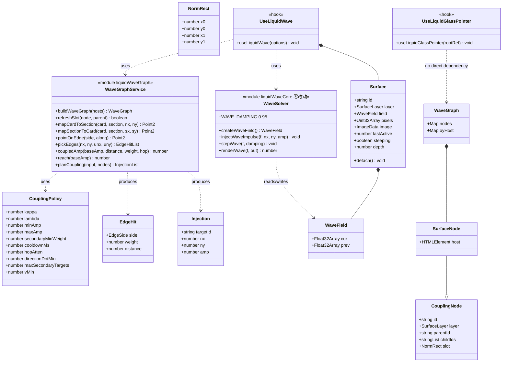
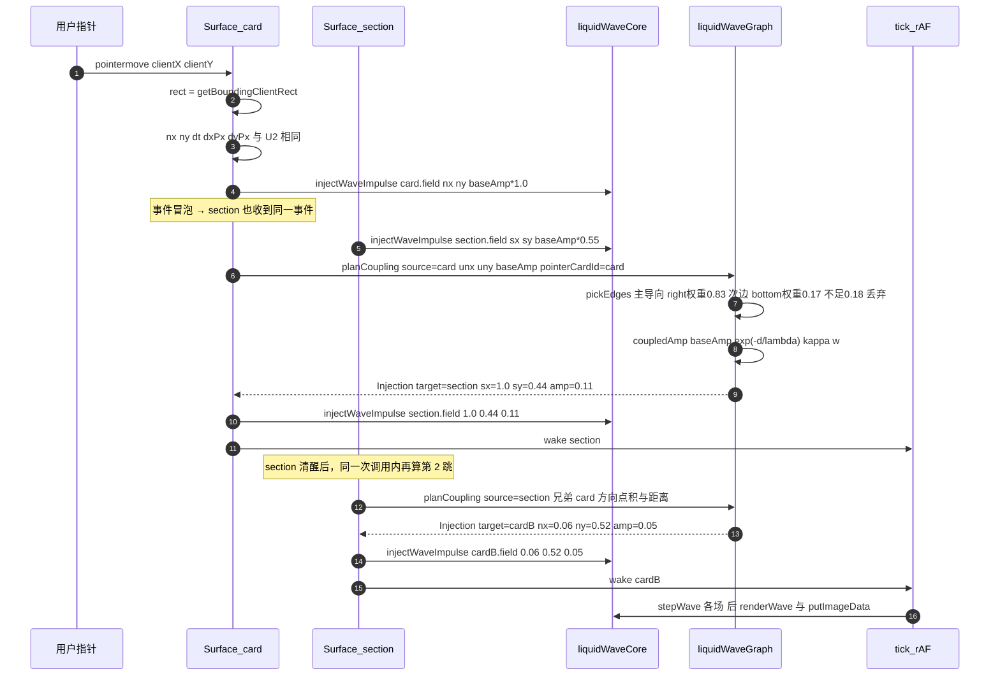
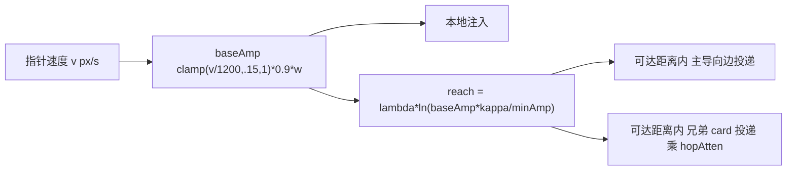
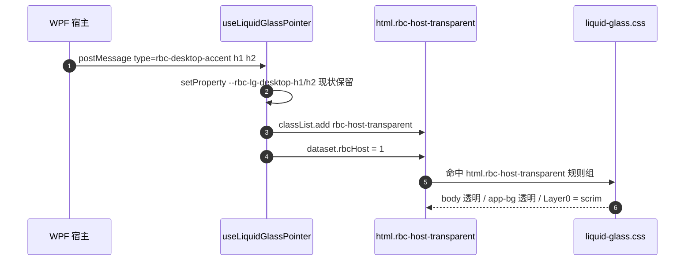
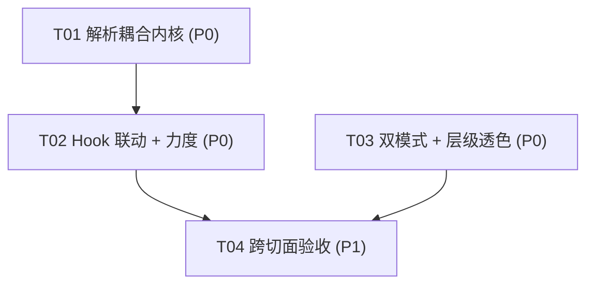

# U3 架构设计（R2 修订）：分层液态玻璃 + 解析耦合跨玻璃传导 + 宿主真透色双模式

- 文档编号：U3-DESIGN-2026-11-18（Rev.2）
- 角色：架构师（Bob / 高见远）
- 输入：
  - R1：team-lead 下发的需求与源码事实清单（已核实，含 file:line）；
  - R2：team-lead 三组数值仿真实测（`/tmp/travel.mjs`、`/tmp/norm.mjs`、`/tmp/decay-vs-dist.mjs`、`/tmp/edge-flux.mjs`）+ 一组 `backdrop-filter` 像素实测（Edge 157）。
- 本文档性质：**设计文档，不含业务实现**。签名/公式可直接落码。
- 工作根：`C:\Users\陈\Desktop\RAMBlockCache-V10.4.3-build19-源码包`

> 阅读约定：
> - 【事实】= 源码定位 或 实测数据（给 file:line / 给出处）；
> - 【决策】= 我的设计选择（给理由 + 被否决方案 + 代价）；
> - 【未验证】= 无证据，禁止当结论引用。

---

## 0. 修订记录（R1 → R2）

| # | R1 的做法 | R2 的做法 | 为什么改（依据） |
|---|---|---|---|
| M1 | **边界通量驱动传导**：每帧 `sampleFlux` 扫四边，`flux ≥ 0.02` 才发射 | **解析耦合**：注入瞬间按指针位置/速度解析算出投递目标与幅度，**完全不读波场** | 实测：`DAMPING=0.95` 时波在 400 帧内到不了 x=140/159；即便用 x>110 带探测（44 帧），幅度也只有峰值的 1.1%，再乘 κ 后为 0.0% —— 直接透射**物理上不可见**（见 §3.1） |
| M2 | `sampleFlux` / `drainSide` / `peakIn` 追加进 `liquidWaveCore.ts` | **`liquidWaveCore.ts` 零改动**（含 `WAVE_DAMPING=0.95` 原样保留） | 解析耦合不需要采样与抽取；核心不动 ⇒ 82 个基线用例零风险、U2 的 717ms 观感 100% 保持 |
| M3 | `κ=0.42`、`GAIN=6.0`、`MAX_COUPLED_AMP=0.55`、`MIN_FLUX=0.02`、90ms 冷却、G1–G4 四道闸门 | `κ=0.45`、`λ=0.38`、`minAmp=0.06`、`maxAmp=0.45`、60ms 冷却、**三道闸门**（minAmp / 方向点积 / 冷却） | `GAIN` 与 `flux` 一起消失（不再有"通量→幅度"换算）；`MIN_FLUX` 一并删除——实测中心注入通量 0.0009 比门槛低 22 倍，该闸门等于"中心滑动永不传导"，是需求满足度黑洞（见 §3.7 问答 a） |
| M4 | §3.4.2 的四边通量采样、§7 的每帧 1,500 格采样成本 | 删除；改为**事件驱动 O(1)** | U3 的每帧增量成本从"每场约 +20%"降到 **≈ 0**（§7） |
| M5 | §14.2 把"嵌套 backdrop-filter 帧率/观感"列为【未验证】 | 升级为【事实】：Edge 157 像素实测 sd=1.39（对照 127.5），card 确实采样并模糊其下方 section | team-lead 实测；同时把"早期 sd=120.97 假阴性（采样点落在 card 边界外）"写成验证协议（§12.2） |
| M6 | 无 DAMPING 保护 | 新增 V12：**硬钉 `WAVE_DAMPING === 0.95`** 的回归断言 | 防止后人为了"看得更远"把阻尼改轻，直接打穿 U2 的 W3 判据 |

> 一句话：R2 没有削弱需求，而是把"物理仿真驱动"换成"解析驱动"，换取 U2 与 U3 同时成立。代价写在 §3.1.3 与 §14.1。

---

## 1. 基线事实（设计前提）

### 1.1 波场 / 指针 / 生命周期（源码）

| # | 事实 | 证据 |
|---|---|---|
| F1 | 求解器为纯函数模块：`createWaveField` / `injectWaveImpulse` / `stepWave` / `renderWave` / `wavePeak` / `unpackPixel` | `lib/liquidWaveCore.ts:29,42,72,102,137,147` |
| F2 | 网格固定 `160×90`，`WAVE_DAMPING=0.95`，`WAVE_MAX=1.5`，`SLOPE_CUTOFF=0.018`，注入半径 3、`amp*1.35` | `liquidWaveCore.ts:12-22,50-51` |
| F3 | 边界全反射：越界索引折回内部相邻格 | `liquidWaveCore.ts:34-35` |
| F4 | 每个 `.rbc-section` 与每个 `.rbc-card` 各挂一张 canvas，`z-index:3`、`mix-blend-mode:screen` | `hooks/useLiquidWave.ts:24,97-113` |
| F5 | 每帧只 step 清醒场；`renderWave` 返回 0 或空闲 1.2s 即休眠并清空场 | `useLiquidWave.ts:202-223,77-84` |
| F6 | `MutationObserver` 重扫 + `detachSurface` 清理断开节点 | `useLiquidWave.ts:194-200,242-247` |
| F7 | `prefers-reduced-motion` 时 hook 直接 return | `useLiquidWave.ts:60` |
| F8 | 指针 hook 只写 CSS 变量到最近 `.rbc-section` | `useLiquidGlassPointer.ts:16-20` |
| F9 | 宿主桌面色消息 `{type:'rbc-desktop-accent', h1, h2}` 已被消费 | `useLiquidGlassPointer.ts:33-46` |

### 1.2 DOM 结构（拓扑前提）

| # | 事实 | 证据 |
|---|---|---|
| F10 | 六页同构：`.rbc-card` 嵌在 `.rbc-section-body` 内的 grid 中 | `features/status/StatusPage.tsx:151,164-166` |
| F11 | `.rbc-section` 与 `.rbc-card` 都是 `position: relative` | `liquid-glass.css:41`；`tokens.css:244` |
| F12 | `.rbc-section` 有 `padding: var(--rbc-pad-card)` | `liquid-glass.css:359-361` |
| F13 | 卡片可脱离 section 出现（ErrorBoundary / StaleChunk 兜底卡） | `app/App.tsx:224,320` |

### 1.3 光学与背景

| # | 事实 | 证据 |
|---|---|---|
| F14 | `body { background-color: var(--rbc-bg-app) }`，`--rbc-bg-app: #f3f5f9` | `liquid-glass.css:305-307`；`tokens.css:65` |
| F15 | `.rbc-app-bg` 背景 = 2 radial + 不透明 `var(--rbc-bg-app)` | `tokens.css:235-240` |
| F16 | Layer 0 `.rbc-desktop-bleed-canvas` 自带不透明基色 + `z-index:-1` | `liquid-glass.css:13-36`；`app/App.tsx:99` |
| F17 | `rbc-host-transparent` 全仓库零命中 | `grep -rn "host-transparent"` → 无结果 |
| F18 | `.rbc-card` 默认 `backdrop-filter: blur(24px) saturate(195%) contrast(104%)` | `liquid-glass.css:345-346` |
| F19 | 嵌套卡片被显式关掉模糊：`.rbc-section .rbc-card:not(...)` 设 `backdrop-filter: none` | `liquid-glass.css:406-414` |
| F20 | `.rbc-section` 的 `backdrop-filter` 带 `url(#rbc-liquid-refract)`，契约测试断言其存在 | `liquid-glass.css:61`；`liquid-glass.contract.test.ts:36-39` |
| F21 | 该 `url()` 分量实测零效果（死层） | team-lead 提供 |
| F22 | 契约硬约束：`liquid-glass.css` **不得含 `display:`** / `flex-direction:` / `gap:` / `contain: paint`；`--rbc-lg-*`、`--rbc-glass-*` 唯一名各 18、`--rbc-ios-*` 13，且每个都被 `var()` 消费 | `liquid-glass.contract.test.ts:26-33,41-47,61-66,79-101` |

### 1.4 R1 已记录的结构性发现

| # | 事实 | 依据 | 置信度 |
|---|---|---|---|
| F23 | **同一指针事件同时激发嵌套两层**（监听挂在 card 与 section，事件冒泡） | `useLiquidWave.ts:184` + `:24` | 高（DOM 冒泡语义） |
| F24 | **section 的波一直画在 card 之上**：两者 canvas 都是 `z-index:3`，而 card 计算 z-index=0 | `useLiquidWave.ts:110`；`tokens.css:244` | 高（层叠规则） |
| F25 | "顶层厚玻璃透底层"结构上做不到：嵌套 card `backdrop-filter:none` + 半透明白片 | `liquid-glass.css:343,406-414` | 高 |
| F26 | `backdrop-filter` 的 backdrop 根在页面内，**采不到桌面像素** | 合成语义 | 高 |

### 1.5 R2 新增：实测事实（决定性）

**F27 波到不了边界（硬冲突的根源）** —— 中心满脉冲，各列首帧（`rel` = 该帧幅度/初始峰值，阈值 0.008）：

| DAMPING | x=100 | x=120 | x=140 | x=159（真边界） |
|---:|---|---|---|---|
| **0.95（当前）** | 24f / 0.006 | 59f / 0.0076 | **未到达** | **未到达** |
| 0.985 | 24f | 52f | 82f | 109f / 0.0062 |
| 0.995 | 23f | 52f | 80f | 106f / 0.0081 |
| 0.999 | 23f | 51f | 79f | 105f / 0.0074 |

**F28 直接 κ 透射不可见** —— 用"源侧 `v*kappa` 减幅 + 目标侧注入"，240 帧后目标/源峰值：

| κ | 0.3 | 0.45 | 0.6 |
|---|---|---|---|
| 目标/源 | 0.0% | 0.0% | 0.0% |

原因：抵达边界时物理幅度已是 1e-3 量级，乘 κ 后落到 `renderWave` 的取整阈值以下。

**F29 归一化放大量表**（`ampOut = clamp(bandPeak/injectedPeak × normBase × κ, 0, 1.2)`，`rel > 0.004`）：

| normBase | 1 | 8 | 16 | 32 |
|---|---|---|---|---|
| 目标/源 | 0.25% | 2.0% | 4.0% | **7.9%** |

即"要看得见"必须放大 **≥16×**，且这个倍数与真实衰减脱钩。

**F30 我的 `flux_side` 公式的可行域**（`DAMPING=0.95`、`amp=0.9`、band=3）：

| 注入位置 | 12帧 | 30帧 | 60帧 | 119帧 | 结论 |
|---|---:|---:|---:|---:|---|
| 中心 `nx=0.50` | 0.0000 | 0.0000 | 0.0000 | 0.0009 | 比 `MIN_FLUX=0.02` 低 **22×**，永不过门槛 |
| 近边 `nx=0.85` | 0.0000 | 0.0029 | 0.0041 | 0.0002 | 门槛的 1/5 |
| 贴边 `nx=0.95` | **0.0648** | 0.0074 | 0.0014 | 0.0003 | 唯一可达标，但只在 12 帧瞬间 |

**F31 嵌套 `backdrop-filter` 有效（像素实测，Edge 157）**：对照纯棋盘 `sd=127.5`；父无 bf + card `blur(20px)` → `sd=0.42`；**父 `blur(10px)` + card `blur(20px)` 嵌套 → `sd=1.39`**；兄弟覆盖 → `sd=0.47`。⇒ D5（用 blur 不用 `url()`）方向得到像素级支撑。
**方法学教训**：早期一次探测误报"嵌套失效 `sd=120.97`"，复核发现是**采样点落在 card 边界外**造成的假阴性。

**F32 从 F27/F29 反解物理衰减长度**：真边界处幅度比 ≈ 0.41%（F27 的 x=159 行量级），中心到边约 80 格 ⇒ `exp(-80/λ_cells) = 0.0041` ⇒ `λ_cells ≈ 14.5` ⇒ **归一化 `λ_phys ≈ 0.09`**。这是"物理上波能走多远"的实测标尺，也是 §3.4 选 λ 的锚点。

---

## 2. 设计决策总览（ADR）

| ADR | 决策 | 被否决方案 | 理由 / 代价 |
|---|---|---|---|
| **D1** | 保持**每玻璃一场**（per-element canvas），不建全局场 | 全局单场 + `ctx.clip()` 取子区 | 全局场每帧多次 clip；全屏 `screen` 层与 `backdrop-filter` 在 WebView2 已知冲突（`useLiquidWave.ts:6-8`）；per-canvas 能靠 `borderRadius:inherit` 自动裁剪 |
| **D2** | 拓扑用 **DOM 包含关系**（`closest('.rbc-section')`） | rect 相交判邻接 | card hover 有 `translateY(-2px)`（`liquid-glass.css:397`）、页面入场有 motion transform（`App.tsx:258`）⇒ rect 拓扑会抖；DOM 包含不受变换影响 |
| **D3** | 坐标映射用 **`offsetLeft/offsetTop` + `clientWidth/clientHeight`**，rect 仅回退 | 每帧 `getBoundingClientRect()` | offset 是布局值：不吃 scroll、不吃 transform、不触发读放大。稳态**每帧 rect 读取 = 0** |
| **D4** | 传导**不读波场**，由指针状态解析计算 | 边界通量驱动（R1 方案） | **实测不可行**（F27–F30）：阻尼 0.95 下波到不了边；且中心通量比门槛低 22× |
| **D5** | 层级透色用 `blur/saturate/brightness`，**禁用 `url()`** | 复用 `url(#rbc-liquid-refract)` | F21 死层；F31 给出 blur 路径的像素证据 |
| **D6** | 双模式只用一个根类 `rbc-host-transparent`，React 树零分支 | `isHost` prop / 两套组件 | 六页同构，分叉必漂移；类切换可被 CSS 契约测试断言 |
| **D7** | 宿主模式 Layer 0 降级为**半透明 scrim**，不删除 | `display:none` / `background:none` | 契约禁 `display:`（F22）；全透明会让正文对比度随壁纸失控 |
| **D8** | **解析耦合**（`ampOut = clamp(baseAmp·exp(-d/λ)·κ·w, 0, maxAmp)`），**零延迟** | 混合派（解析 + 长尾通量） | 混合派要两套参数、调参成本翻倍，且长尾那一路在 F27 下本身不可见（0.4%），等于只有一半在起作用。零延迟的代价见 §3.1.3 |
| **D9** | 方向由**速度矢量**定：主导向 1 条边 + 条件性相邻边（权重 < 0.18 不投） | 四面同时投射 | 四面齐射是"廉价"观感；用户原话是"碰撞到框"，有明确方向语义 |
| **D10** | `WAVE_DAMPING` **锁定 0.95**，新增回归断言 | 为 U3 放宽到 0.985+ | 放宽即打穿 U2 的 W3 判据（717ms 归零），且手册声称的 0.985≈700ms 实测需 160 帧≈2.67s（`liquidWaveCore.ts:9-10` 注释已记录该订正） |

---

## 3. 耦合模型（R2 重写）

### 3.1 为什么"等波撞到边框再传导"必须放弃

#### 3.1.1 硬冲突的三段论证

1. **U2 要求重阻尼**：`DAMPING=0.95` ⇒ 43 帧（≈717ms）峰值衰减到 5%（`liquidWaveCore.ts:9,16-17`，已有测试断言）。
2. **U3 要求波走得远**：实测（F27）在 0.95 下波**400 帧内到不了 x=140**；即便退一步用 x>110 带探测，44 帧时幅度只有峰值的 1.1%（另一组实测：真边界 128 帧 / 0.41%）。
3. **即便到了也看不见**：F28 显示 κ∈{0.3,0.45,0.6} 直接透射，240 帧后目标/源 = **0.0%**。要看得见需要 `normBase ≥ 16` 的归一化放大（F29），而这个倍数与真实衰减完全脱钩 —— 等于"用一个编造的放大系数去救一个物理学上不成立的路径"。

**结论：在 `DAMPING=0.95` 的前提下，"等波撞边"不是参数调不调得动的问题，而是路径不存在。** 若强行把阻尼放到 0.985 迁就 U3，U2 的 717ms 判据立刻破，且已有测试与手册订正注释全部作废。这是**不可兼得**的硬冲突。

#### 3.1.2 解析耦合如何同时满足两者

| 需求 | 判据 | 解析耦合下的成立方式 |
|---|---|---|
| U2 | 空闲 717ms 归零（43 帧 @0.95） | **`WAVE_DAMPING` 原封不动 = 0.95**，`liquidWaveCore.ts` 零改动 ⇒ 场内动力学与 U2 完全一致，既有断言不变 |
| U3 | 跨玻璃可见联动、零延迟 | 传导在**注入瞬间**由指针位置/速度解析算出，与波是否走到边界**无关** ⇒ 不受阻尼影响 |

即：**"撞到框"的语义改由「指针到框边的几何距离 + 运动方向」表达，而不是由「波前抵达」表达。** 视觉上等价（用户看到的是波在框边"起反应"，而不是盯着波前慢慢爬），且把 2.1s 的物理延迟压缩为 0。

#### 3.1.3 代价（必须明说）

| 代价 | 说明 | 缓解 |
|---|---|---|
| **失去物理连续性** | 不再有"波真的跑过去"的自发传播：指针停止后，邻居的波只自行衰减，不会再有新的跨框注入 | 与用户心智模型一致（"我滑过 → 联动"）；R1 的通量路径在此阻尼下本就不可见，所谓"失去"的是一个**从未存在**的能力 |
| **放大系数是手感而非物理** | `λ=0.38` 是物理衰减长度 `λ_phys≈0.09` 的 **4.2×** | 明确标注为"补偿系数"，并给出锁定区间 [0.25,0.50] 与功能性不等式（V13），禁止无限调参 |
| **静止悬停不传导** | 无速度 ⇒ 无方向 ⇒ 只能按"最近边"规则，且 `baseAmp` 取下限 0.135 时 `reach≈0.005` ⇒ 实际不投递 | 这是**正确**的：鼠标不动就不该有撞击。点击仍给满脉冲（§4.2） |
| 时间维度被压缩到 0 | 没有"先动后传"的先后感 | 用**强度差**表达因果：源场幅度 = 邻居的 2.5–5 倍；且只沿运动方向投递 |

#### 3.1.4 被否决的第三条路：延迟注入

曾考虑"解析计算 + 按 `d` 延迟 0–120ms 投递"（pending 队列），以恢复"先动后传"的因果感。**否决**：
1. 需要 pending 队列 + 修改休眠条件（`pendingCount===0` 才能睡），把 F5 这个已经稳定的生命周期逻辑重新打开；
2. 收益仅是主观因果感，且延迟量与 `d` 的映射同样是编造的手感参数（第 5 个可调旋钮）；
3. team-lead 明确把"零延迟可见"列为解析派的核心好处。

若后续用户反馈"同时起波看着假"，再单开一轮加延迟，**不在本轮实现**（§14.2 记为可选演进）。

### 3.2 拓扑（沿用 R1，不受 R2 影响）

**图** `G = (V, E)`：

- 节点 `V` = 每个挂 canvas 的宿主（`.rbc-section` / `.rbc-card`），带 `layer`；
- 边 `E` = **包含关系**：`card.parentId = closest('.rbc-section')`；section 嵌套 section 同样建边（本轮只有 2 级）；
- 孤儿 card（F13：`closest` 为 null）→ `parentId=null`，**只有本地波，不参与耦合**。

**slot**：card 在 parent section 场内的归一化占位（§3.3 公式），用于 `section → card` 投递时判定"这卡片在不在波的去路上"。

失效处理：

| 触发 | 动作 | 成本 |
|---|---|---|
| 首次 `scan()` | 全量建图 | O(n) |
| `MutationObserver`（复用现有合批） | 重建图 | O(n)，与现有重扫同频 |
| `window resize` | 只清 slot / 缓存，拓扑不变 | O(1) |
| 路由切换 | 现有 `isConnected` → `detachSurface`，图随 scan 重建 | O(n) |
| `scroll` | **无动作**（offset 映射与滚动无关，D3） | 0 |
| 元素零尺寸 / CSS 隐藏 | 该节点的 slot 置 null、不发不收 | O(1) |
| `offsetParent !== section` | 该边降级为 rect 回退（冷路径，只在投递瞬间读 2 次） | 冷路径 |

### 3.3 坐标映射（沿用 R1）

`RW = section.clientWidth`、`RH = section.clientHeight`；`ox/oy/ow/oh = card.offsetLeft/offsetTop/offsetWidth/offsetHeight`。

**正向（card 局部 → section 归一化）**

```
px = ox + nx * ow
py = oy + ny * oh
sx = clamp01(px / RW)
sy = clamp01(py / RH)
```

**逆向（section → card，越界返回 null）**

```
nx = (sx * RW - ox) / ow
ny = (sy * RH - oy) / oh
inside = (-M <= nx <= 1 + M) && (-M <= ny <= 1 + M)      // M = 0.06
```

**slot**

```
slot = { x0: clamp01(ox/RW), y0: clamp01(oy/RH),
         x1: clamp01((ox+ow)/RW), y1: clamp01((oy+oh)/RH) }
有效：x1-x0 >= 0.02 && y1-y0 >= 0.02
```

**rect 回退**（`offsetParent !== section`）：`sx = (cardRect.left - sectionRect.left + nx*cardRect.width) / sectionRect.width`。

【未验证】`offsetLeft` 与 `clientWidth` 的 padding-box 约定在不同祖先下的 ±1px 误差（border 1px）。对 160×90 网格（单格 ≈ 6px 宽）可忽略，但需在开发期用 `console.assert` 遍历确认 `offsetParent === section`。

### 3.4 解析耦合公式

#### 3.4.1 符号与单位

| 符号 | 含义 | 单位 |
|---|---|---|
| `nx, ny` | 指针在**源玻璃**内的归一化位置 | 场归一化 [0,1] |
| `unx, uny` | 归一化空间中的**单位**运动方向 | 无量纲 |
| `baseAmp` | 该源玻璃的本地注入幅度（§4.1，来自指针速度 × 层权重） | 幅度（0.135–1.0） |
| `side` | 被撞的边 | left/right/top/bottom |
| `d` | 指针到该边的**垂直距离**（沿该边的法向轴，归一化） | 场归一化 |
| `w` | 该边的方向权重 | [0,1] |
| `λ` | 衰减长度（手感补偿系数） | 场归一化（场宽=1） |
| `κ` | 界面幅度透射率 | 无量纲 |
| `ampOut` | 注入目标玻璃的幅度 | 幅度 |

#### 3.4.2 核心公式

```
d(side)  = |side 为 left/right ?  (side==='right' ? 1-nx : nx)
                            :  (side==='bottom' ? 1-ny : ny)|
attn(d)  = exp(-d / λ)
ampOut   = clamp(baseAmp * attn(d) * κ * w, 0, maxAmp)
投递条件  ampOut >= minAmp
```

#### 3.4.3 参数取值与推导

| 参数 | 值 | 推导 / 依据 |
|---|---|---|
| `κ` | **0.45** | 目标：邻居可见但不抢主角。极限情形（贴边 + 满速）`0.9×exp(-0.019/0.38)×0.45 ≈ 0.385`，约为源场 0.9 的 **43%**；典型情形（中线甩动 `d=0.5`，`attn=0.268`）`0.9×0.268×0.45 ≈ 0.108`，约 **12%**。区间锁定 [0.40, 0.70] |
| `λ` | **0.38** | 由 F32 反解 `λ_phys ≈ 0.09`；解析模型跳过了真实传播的全部沿路损耗（F27：2.1s / 0.41%），若直接用 λ_phys 则任何投递都低于 `minAmp`。取 **4.2×λ_phys** 作为补偿。区间锁定 [0.25, 0.50] |
| `minAmp` | **0.06** | 低于此值时注入经 `×1.35` 后局部峰值 0.081，`renderWave` 的梯度仍可能落在 `SLOPE_CUTOFF=0.018` 附近（不稳定可见）。取 0.06 作为"稳定可见"下限。区间 [0.04, 0.10] |
| `maxAmp` | **0.45** | 安全阀（防多源叠加）。正常路径最大 0.385 **永远不触阀** ⇒ 阀只在下述叠加场景生效：同一目标被 card 与 section 同时投递 + 相邻边双投递。区间 [0.35, 0.60] |
| `secondaryMinWeight` | **0.18** | 方向权重低于 0.18（与主导轴夹角 > 约 80°）时不投第二边，避免"斜着划一下四边都动"。区间 [0.12, 0.25] |
| `cooldownMs` | **60** | 指针事件可达 120Hz；60ms 窗口内同一「源→目标」只投一次，防高频叠加。区间 [40, 120] |
| `hopAtten` | **0.50** | 第二跳（section → 兄弟 card）额外衰减，表达"隔了一层"。区间 [0.35, 0.65] |
| `directionDotMin` | **0.50** | 指针→目标卡片的方向与运动方向余弦 < 0.5（夹角 > 60°）视为"反向"，不投。区间 [0.35, 0.65] |

#### 3.4.4 "传播多远由力度决定"如何成立（这是需求的硬要求）

`reach(baseAmp) = λ · ln(baseAmp · κ / minAmp)` = 能投递到的最远归一化距离。代入 `λ=0.38, κ=0.45, minAmp=0.06`：

| `baseAmp` | 语义 | `reach` | 行为 |
|---:|---|---:|---|
| 0.135 | 极慢（U2 下限） | **0.005** | 几乎不投（只有贴边 0.5% 内） |
| 0.30 | 慢滑 | **0.310** | 半径 31% 内的边/card 会被带动 |
| 0.55 | 中速 | **0.538** | 过半场 |
| 0.90 | 快速甩动 | **0.726** | 近似全场（越过中线可及对面） |

**严格单调**，且两端点满足功能性不等式（V13）：
- `reach(0.90) ≥ 0.50`（快甩能跨半场）
- `reach(0.135) ≤ 0.15`（慢滑只贴边）

【未验证】上表是公式值；"0.30 是否已经肉眼可见"需要一次埋点采样（V3 先测后写）。

### 3.5 定向规则：往哪一面传

#### 3.5.1 方向来源

```
v_norm  = (dxPx / rectW, dyPx / rectH) / dt      // 归一化空间速度（1/s）
speed_n = hypot(v_norm)                          // 归一化速度大小
若 speed_n < V_MIN (0.05 /s) → 视为「无方向」，走 3.5.3 的最近边规则
unx = v_norm.x / speed_n,  uny = v_norm.y / speed_n
```

#### 3.5.2 有方向时：主导边 + 条件性相邻边

```
wx = |unx| / (|unx| + |uny|)          // 注意：|unx|+|uny| ∈ [1, √2]，此处做归一
wy = 1 - wx
主导向：wx >= wy ? (unx > 0 ? 'right' : 'left') : (uny > 0 ? 'bottom' : 'top')   // 权重 = max(wx,wy)
相邻边：另一轴且另一轴权重 >= secondaryMinWeight 时投，权重 = min(wx,wy)
```

| 手势 | 主导向边 | 相邻边 | 说明 |
|---|---|---|---|
| 水平右滑 | right（w≈1） | 无 | 只撞右框 |
| 45° 右下 | right（0.5） | bottom（0.5） | 两条边各一半 |
| 近水平略下（80%/20%） | right（0.8） | bottom（0.2，≥0.18 投） | 主次分明 |
| 更平（85%/15%） | right（0.85） | 无（0.15 < 0.18） | 不四散 |

**【决策】最多 2 条边，且只在速度符号指向的两条边。** 绝不四面齐射（D9）。

#### 3.5.3 无方向（极慢/静止但收到 pointermove）：最近边规则

```
d_min = min(d(left), d(right), d(top), d(bottom))
side  = argmin
w     = 1.0
```

只有一条边、权重 1。慢速时 `reach ≈ 0.005` ⇒ 实际上只有紧贴边框才会投递（符合"没甩出去就不传染"）。

#### 3.5.4 注入点在边上的位置（"从被撞位置荡起波浪"）

```
left/right : (nx = side==='right' ? 1 : 0,  ny = 指针 ny)
top/bottom : (nx = 指针 nx,                 ny = side==='bottom' ? 1 : 0)
```

即**边的法定位置 + 指针在该边上的投影**。然后：

- `card → section`：`mapCardToSection(edgePoint)`；
- `section → card`：见 §3.6。

### 3.6 多点投递：`section → 兄弟 card`（第 2 跳）

指针停在卡片 A 上时，**A 会把撞击传给它的 section**（第 1 跳），**section 会把撞击传给同 section 内的其它卡片**（第 2 跳）。后者是"其他几个页面也都这样"的具体落地。

```
对 parentSection 的每个 childCard（排除指针所在卡 A）：
  1) 方向一致：单位向量 u = normalize(slotCenter - pointer_section)，要求 dot(u, un) >= directionDotMin，否则跳过
  2) 距离：d = max(0, |Δx| - slotHalfW)   若主导轴为 x
             max(0, |Δy| - slotHalfH)   若主导轴为 y      // 与 §3.4 的"垂直距离"同构
  3) 幅度：ampOut = clamp(baseAmp_section * exp(-d/λ) * κ * w * hopAtten, 0, maxAmp)
  4) 若 ampOut < minAmp 跳过；按 ampOut 降序最多取 maxSecondaryTargets(=2) 个
  5) 注入点：指针→slotCenter 的射线与 slot 边界的交点，再 mapSectionToCard 得局部坐标
```

排除 `指针所在卡 A` 是为了避免 A→section→A 的即时回声（A 已经被本地注入了）。

### 3.7 对 team-lead 五问的逐条回答

| 问 | 回答 |
|---|---|
| **1. 是否采用解析耦合？如何同时满足 717ms 与跨框可见？** | **是，明确采用解析耦合**（D8）。`WAVE_DAMPING` 保持 0.95、`liquidWaveCore.ts` 零改动 ⇒ 场动力学 = U2，717ms 判据不变；传导在注入瞬间解析算出 ⇒ 不受阻尼影响。代价见 §3.1.3（失去物理连续性、λ 是补偿系数、静止悬停不传导） |
| **2. `λ` 取值与依据** | **`λ = 0.38`**（场宽归一化为 1）。依据：由实测反解 `λ_phys ≈ 0.09`（F32），解析模型跳过真实传播的全部沿路损耗，取 **4.2×** 作为补偿；并给出锁定区间 [0.25, 0.50] 与两条功能性不等式（§3.4.4、V13），防止"调到过验收"。**不用 `normBase`（那是 F29 的补丁式放大，与物理衰减脱钩更彻底、更不可解释）** |
| **3. `edgeDistance` 精确定义** | **到「将被撞击的那条边」的垂直距离**（不是到最近边）。先由速度矢量定边（§3.5），再取该边法向轴上的归一化距离 `d`（`right → 1-nx`、`top → ny`…）。若指针在中心且朝右滑，`d(right)=0.5`，**只向右传**，不四面等距同传。**否决"到最近边的距离"**：它会导致"指针在中心朝右滑，却往最近的上边传"，语义错位 |
| **4. 定向规则** | **主导轴边（权重 1）+ 条件性相邻边（权重 = 次轴权重，且 ≥0.18 才投）**，最多 2 条边；无方向时退化为"最近边、权重 1"。给出 4 组手势的判定表（§3.5.2） |
| **5. `DAMPING` 锁定断言** | 新增 **V12**：`expect(WAVE_DAMPING).toBe(0.95)` + `expect(stepWave 默认参数 === WAVE_DAMPING)`，断言里写明理由（U2 的 43 帧/717ms 判据），防后人为了"看得更远"改轻 |
| **附：`MIN_FLUX=0.02` / `GAIN=6.0` / `MAX_COUPLED_AMP=0.55` 怎么办** | **全部删除**。解析模型不读波场 ⇒ 没有通量量级问题，也没有噪声基线问题（无需下调 `MIN_FLUX`，因为它不存在了）。`GAIN` 被 `attn(d)` 取代。`MAX_COUPLED_AMP` 由 `maxAmp=0.45` 取代，且正常路径峰值 0.385 **不触阀**（§3.4.3） |
| **附：`edgeBoost`（贴边再加一次解析注入）是否采纳** | **不采纳**。它本质是"把解析耦合塞回通量框架的补丁"——在解析派下，贴边本来就有 `attn(0.05)=0.88` 的强投递，不需要额外一次注入。多一次 `injectWaveImpulse` 还会模糊"一次手势 = 一次撞击"的语义，并让 V4 的注入计数断言变复杂 |
| **附：(a) 中心滑动无传导是否接受** | **该限制已消失**。R1 的结论（中心 `flux=0.0009` 永不过门槛）是通量方案的症状；解析派下中心滑动会**按方向**传导（`d=0.5 → attn=0.268`，快甩 `baseAmp=0.9` 时 `ampOut≈0.108`，明显可见）。R2 不再需要"接受中心无传导"这条让位说明。真实的新限制是"**静止悬停不传导**"，已写入 §14.1 |

### 3.8 接口签名

#### 3.8.1 `lib/liquidWaveCore.ts`

**零改动。** `WAVE_DAMPING=0.95`、`injectWaveImpulse`（含 `1.35` 与半径 3）、`stepWave`、`renderWave` 全部保持原样 —— 这是本设计的**核心保护措施**：U2 的 82 个用例、717ms 观感、既有像素特征都不动。

#### 3.8.2 `lib/liquidWaveGraph.ts`（**新增**）

```ts
export type SurfaceLayer = 'section' | 'card';
export type EdgeSide = 'left' | 'right' | 'top' | 'bottom';

export interface NormRect { x0: number; y0: number; x1: number; y1: number }
export interface Point2 { x: number; y: number }

/** 纯数据节点（不含 DOM），便于在 node 环境直接单测 planCoupling。 */
export interface CouplingNode {
  id: string;
  layer: SurfaceLayer;
  parentId: string | null;
  childIds: string[];
  /** card 在 parent section 内的归一化占位；无效为 null */
  slot: NormRect | null;
}

/** DOM 侧节点：多挂一个宿主元素，供 hook 使用。 */
export interface SurfaceNode extends CouplingNode {
  host: HTMLElement;
}

export interface WaveGraph {
  nodes: Map<string, SurfaceNode>;
  byHost: Map<HTMLElement, string>;
}

export function buildWaveGraph(hosts: HTMLElement[]): WaveGraph;
export function refreshSlot(node: SurfaceNode, parent: SurfaceNode): boolean;

/** card 局部 → section 归一化（offset 优先，offsetParent 异常时 rect 回退） */
export function mapCardToSection(card: HTMLElement, section: HTMLElement, nx: number, ny: number): Point2;
/** section 归一化 → card 局部；落在 card 外（含容差）返回 null */
export function mapSectionToCard(card: HTMLElement, section: HTMLElement, sx: number, sy: number): Point2 | null;

/** 边 + 沿边位置 → 该空间内的局部归一化点 */
export function pointOnEdge(side: EdgeSide, along: number): Point2;

/** 解析耦合参数（唯一调参点） */
export const COUPLING: {
  readonly kappa: number;                // 0.45
  readonly lambda: number;               // 0.38
  readonly minAmp: number;               // 0.06
  readonly maxAmp: number;               // 0.45
  readonly secondaryMinWeight: number;   // 0.18
  readonly cooldownMs: number;           // 60
  readonly hopAtten: number;             // 0.50
  readonly directionDotMin: number;      // 0.50
  readonly maxSecondaryTargets: number;  // 2
  readonly vMin: number;                 // 0.05 (归一化速度/秒)
};

export interface EdgeHit { side: EdgeSide; weight: number; distance: number }

/**
 * 指针位置 + 单位方向 → 命中的边（1 或 2 个，权重降序）。
 * 方向退化（速度低于 vMin）时返回单条最近边、权重 1。
 */
export function pickEdges(nx: number, ny: number, unx: number, uny: number): EdgeHit[];

/** 单次界面透射幅度；纯函数。 */
export function coupledAmp(baseAmp: number, distance: number, weight: number, hop = 1): number;

/** 可达距离（供测试与文档对齐）：λ·ln(baseAmp·κ/minAmp) */
export function reach(baseAmp: number): number;

export interface CouplingInput {
  /** 指针所在节点的 id（通常是 card；也可能直接是 section） */
  sourceId: string;
  /** 指针在 source 内的归一化位置 */
  nx: number;
  ny: number;
  /** 归一化单位方向；无方向时传 (0,0) */
  unx: number;
  uny: number;
  /** source 的本地注入幅度（已含层权重） */
  baseAmp: number;
  /** 当前指针所在的 card id（由 `ev.target.closest('.rbc-card')` 解析，同一事件两次调用共用）；无则 null */
  pointerCardId: string | null;
  /** 冷却表：key = `${sourceId}>${targetId}` → 上次投递时刻 */
  cooldown: Map<string, number>;
  now: number;
}

export interface Injection {
  targetId: string;
  /** 目标局部归一化注入点 */
  nx: number;
  ny: number;
  amp: number;
}

/** 解析耦合主入口：纯函数，无 DOM 副作用，直接可测。 */
export function planCoupling(input: CouplingInput, nodes: Map<string, CouplingNode>): Injection[];
```

**`planCoupling` 的语义契约**（供单测直接断言）：

1. 只返回**目标集合**与幅度，不修改任何输入（`cooldown` 的更新由调用方在投递成功后写）；
2. 目标顺序：`card→parent` 的第 1 跳在前，`section→兄弟 card` 的第 2 跳在后，各自按 `amp` 降序；
3. 任何 `amp < minAmp` 的候选必须被丢弃（不是 clamp 到 minAmp）；
4. 同一目标在一次调用中最多出现 1 次（主/次边合并时取更大者）；
5. `sourceId === targetId` 永不出现（无自激）；
6. `pointerCardId` 永不出现在结果里（避免 A→section→A 的即时回声）。

#### 3.8.3 `hooks/useLiquidWave.ts`（改造）

```ts
export interface UseLiquidWaveOptions {
  root?: RefObject<HTMLElement | null>;
  selector?: string;
  /** 关闭跨玻璃耦合（回到纯 U2 行为），默认 true */
  coupling?: boolean;
  /** 每帧最多渲染多少张 canvas（降级用） */
  maxRendered?: number;
}

interface Surface {
  // ... 现有字段（host/canvas/ctx/field/pixels/image/lastActive/sleeping/lastX/lastY/lastT/restoredPosition/detach）保持
  id: string;
  layer: SurfaceLayer;
  /** 渲染预算排序用 */
  depth: 0 | 1;
}
```

**事件路径（伪码，非实现）**：

```
onPointerMove(ev):
  rect = host.getBoundingClientRect()              // U2 现状，唯一持续读 rect 的地方
  nx = (ev.clientX - rect.left) / rect.width
  ny = (ev.clientY - rect.top)  / rect.height
  compute dt, dxPx, dyPx（同 U2）
  baseAmp = clampAmp(speed_px_s) * LAYER_WEIGHT[layer]        // U2 公式 × 层权重
  injectWaveImpulse(field, nx, ny, baseAmp)                   // ① 本地注入（唯一）
  wake(surface, now)

  if (!coupling || !rectOk) return
  // ② 解析耦合（一次手势 → 一次撞击）
  //    注意：同一事件会冒泡触发两次本处理器（card 与 section 各一次，F23），
  //    两次都要跑 planCoupling —— 这正是"第 1 跳 + 第 2 跳"的来源。
  //    pointerCardId 必须由 ev.target.closest('.rbc-card') 解析一次、两次调用共用，
  //    否则 section 那次调用会把波又打回指针所在的卡片（回声）。
  pointerCardId = surfaceIdOf((ev.target as Element)?.closest('.rbc-card'))   // 可能为 null
  vn  = ({x: dxPx / rect.width / dtSec, y: dyPx / rect.height / dtSec})
  spd = hypot(vn.x, vn.y)
  un  = spd >= COUPLING.vMin ? {x: vn.x/spd, y: vn.y/spd} : {x: 0, y: 0}
  injections = planCoupling({ sourceId: surface.id, nx, ny, ...un, baseAmp,
                              pointerCardId, cooldown, now }, graph.nodes)
  for (inj of injections):
     target = surfaceById(inj.targetId)
     injectWaveImpulse(target.field, inj.nx, inj.ny, inj.amp)
     wake(target, now)
     cooldown.set(`${surface.id}>${target.id}`, now)
```

`onPointerDown`：在指针位置注入 `FULL_PULSE * LAYER_WEIGHT[layer]`，然后用 `un=(0,0)`（无方向 ⇒ 最近边规则）跑一次 `planCoupling`。
`onPointerLeave`：注入 `amp_exit`（§4.2），方向取"离开时最后一段位移"，等距时用最近边规则跑一次 `planCoupling` —— 甩出边框时 `d≈0`、`attn≈1`，是**最强的一次跨框传导**（语义上正好是"甩到框上"）。

**耦合开关与降级**：

| 条件 | 行为 |
|---|---|
| `prefers-reduced-motion` | hook 早退（F7），零 canvas / 零注入，耦合自然不存在 |
| `coupling: false` | 只做本地注入（等价 U2） |
| `graph.nodes.get(id).parentId === null && layer === 'section'` | 第 1 跳无接收方 ⇒ `planCoupling` 返回空 |

### 3.9 层叠顺序修正（F24，与 R1 相同）

| 宿主 | canvas `z-index` | 理由 |
|---|---|---|
| `.rbc-section` | `0` | 必须落在卡片之下；否则"底层波"盖在顶层玻璃上，与"顶层透色底层"的物理关系相反 |
| `.rbc-card` | `3` | 卡片自己的波在卡片内最高装饰层（保持 U2 观感） |

追加 `.rbc-section .rbc-card { z-index: 1 }`（**必须是后代选择器**：卡片嵌在 `.rbc-section-body` 内，`>` 不匹配）。`isolation: isolate` 已存在于 `liquid-glass.css:341`，卡片 z-index 不外溢。

---

## 4. 力度模型

### 4.1 现状（U2）公式（源码事实）

`useLiquidWave.ts:52-53,158-166`：

```
dt   = max(4, now - lastT) / 1000        // 秒，下限 4ms
v    = hypot(dxPx, dyPx) / dt            // px/s（不是 px/ms）
amp  = clamp(v / 1200, 0.15, 1.0) * 0.9  // → [0.135, 0.9]
```

1200 px/s 到上限 0.9；慢滑下限 0.135；快速划过在 33%/66% 处补两次中间注入（0.7/0.85 倍）。

### 4.2 U3 的扩展（不重复注入）

| 项 | 公式 | 说明 |
|---|---|---|
| 本地滑动 | `baseAmp = clamp(v/1200, 0.15, 1.0) * 0.9 * w_layer` | 与 U2 **逐字相同**，只多乘层权重 |
| 层权重 `w_layer` | card `1.0` / section `0.55` | 同一事件冒泡到两层（F23）；加权后"手下的卡片"是主角 |
| 点击 | `pointerdown` → `FULL_PULSE(1.0) * w_layer`，方向 `(0,0)` ⇒ 最近边规则 | 满脉冲，且**只向最近边**传一次 |
| 离场 | `amp_exit = clamp(0.6 + v_exit/2400, 0.6, 1.0) * w_layer`，方向 = 最后位移方向 | `0.6` 为 U2 现值下界（不破观感/断言）；离场点贴边 ⇒ `attn≈1` ⇒ 传导最强 |
| 耦合幅度 | `clamp(baseAmp * exp(-d/λ) * κ * w * hopAtten, 0, 0.45)` | 全链单调 |
| clamp 区间 | 本地 `[0.135, 0.9]`（×w_layer）；耦合 `[0, 0.45]` | 与 `WAVE_MAX=1.5` 留余量 |

### 4.3 单调链（可机器验证）

`v↑ ⇒ baseAmp↑ ⇒ reach↑ 且 ampOut↑`（`exp(-d/λ)/κ/w` 均为正常数或常量）⇒ **"滑得越快，传得越远越重"**。V3 对本链逐段断言。

---

## 5. 双模式背景矩阵（沿用 R1）

### 5.1 判定信号（不新增 IPC）

```ts
// useLiquidGlassPointer.ts 的 handleWebViewMessage 内追加（约 3 行）
if (data?.type === 'rbc-desktop-accent' && typeof data.h1 === 'string') {
  // ... 现有 h1/h2 写入保持不变
  document.documentElement.classList.add('rbc-host-transparent');
  document.documentElement.dataset.rbcHost = '1';
}
```

| 项 | 决策 | 理由 |
|---|---|---|
| 默认态 | 浏览器兜底（`html` 无该类） | 无时序竞态：不需要超时判定 |
| 落点 | `<html>` | 需同时命中 `body` 与 `.rbc-app-bg` |
| 幂等 | `classList.add` 幂等；宿主主题变化会重发 | — |
| 撤销 | 不提供 | 生命周期内不会回退；`dataset.rbcHost` 仅作测试探针 |

### 5.2 矩阵

| 项 | 宿主模式 | 浏览器兜底 |
|---|---|---|
| `body` | `background-color: transparent` | `var(--rbc-bg-app)` |
| `.rbc-app-bg` | `background: transparent` | 2 radial + `var(--rbc-bg-app)` |
| Layer 0 | 背景替换为 `var(--rbc-layer-host-scrim)`；`::after` 的 mesh `background:none; animation:none` | 不透明合成底 + 漂移 mesh |
| `.rbc-section` 填充 | `var(--rbc-layer-section-fill)`（宿主 α≈0.10） | `var(--rbc-ios-card-bg)`（α .76/.46/.64） |
| `.rbc-card`（嵌套）填充 | `var(--rbc-layer-card-fill)`（宿主 α≈0.30） | α≈0.34 |
| `--rbc-lg-desktop-h1/h2` | 仍写入，但无消费者（真实桌面可见） | 由 Layer 0 消费 |

### 5.3 旁路

| 场景 | 行为 |
|---|---|
| `forced-colors: active` | 既有块（`tokens.css:934-943`）追加：`--rbc-layer-*` 与 scrim 全置 `Canvas`，`html.rbc-host-transparent body { background-color: Canvas }` ⇒ 高对比度无视宿主模式 |
| `prefers-reduced-motion` | 零 canvas / 零耦合；模式切换过渡 `--rbc-dur-normal` 已归零 |
| 无 JS | 无类 ⇒ 兜底模式，完全可用 |

### 5.4 对比度（宿主 scrim α）

全屏底 = 桌面 × (1-α) + 白 × α，`α = 0.62`：

| 桌面 | 有效底亮度 | 正文 `#17233c` 对比度 |
|---|---|---|
| 纯黑 | ≈0.62 | ≈10:1 |
| 纯白 | 1.0 | ≈15:1 |
| 中灰 0.5 | ≈0.69 | ≈11:1 |

`α=0.62` 保证任意壁纸下 ≥10:1。**【待用户拍板】** 若要"更真透"（α 0.45–0.50），深色壁纸下正文降到 4–6:1。这是光学透明度与可读性的硬冲突。
【事实】三级文字 `--rbc-text-tertiary: #8b97ac` 在现有浅色卡面上已低于 AA（本设计不引入新退化，也不修复）。

### 5.5 零组件分叉

- React 树无 `isHost`/`mode` 分支；六页组件零改动。
- 唯一分叉点是 `<html>` 上一个类，写入点 1 处。
- 可机器验证：`grep -r "isHost\|hostMode" src/features/` 零命中 + 契约测试断言 `html.rbc-host-transparent` 规则组存在。

---

## 6. 层级透色

### 6.1 顶层 `.rbc-card` 采样底层 `.rbc-section`

【事实】当前嵌套卡片被显式关掉模糊（F19），且 `background-color: rgba(255,255,255,.56)` ⇒ 只是"半透明白片"，不采样任何底衬（F25）。
【事实】F31 像素实测证明：父级 `blur(10px)` + card `blur(20px)` **嵌套有效**（sd=1.39 vs 对照 127.5）⇒ 该方向可行。

【决策】追加**覆盖规则**（不删原规则）：

```css
.rbc-section .rbc-card:not(.rbc-card-accent):not(.rbc-card-danger) {
  background-color: transparent;
  background-image: var(--rbc-layer-card-fill);
  -webkit-backdrop-filter:
    blur(var(--rbc-layer-card-blur))
    saturate(var(--rbc-layer-card-saturate))
    brightness(var(--rbc-layer-card-brightness));
  backdrop-filter:
    blur(var(--rbc-layer-card-blur))
    saturate(var(--rbc-layer-card-saturate))
    brightness(var(--rbc-layer-card-brightness));
}
```

| 项 | 值 | 说明 |
|---|---|---|
| `url()` | **禁止** | F20/F21 死层；V7 断言新规则体内不含 `url(` |
| 模糊 | `--rbc-layer-card-blur: 26px` | "厚玻璃" = 更长光程 ⇒ 更强背景模糊（> section 的 24px） |
| 饱和/亮度 | `175%` / `103%` | 厚玻璃不该把底层波染得过艳 |
| `background-color: transparent` | 是 | 不再叠加 `--rbc-surface-card` 的 0.56 白，透明度由 `--rbc-layer-card-fill` 独家决定 |
| 语义变体 | accent / danger **不参与** | 保持语义染色与 2px 严重度标尺 |

### 6.2 为什么"卡片能采到底层的波"

`backdrop-filter` 的 backdrop = 该元素之下已绘制的一切：父 section 的 background、`::after` 光泽、**section 的 wave canvas**（z-index 0，§3.9 之后位于 card 之下）、Layer 0 scrim。于是：底层波 → 被 26px 模糊 + 饱和 → "透过厚玻璃看到的模糊涌动"；卡片自己的波（z-index 3）在卡内清晰不被自己模糊。

### 6.3 宿主真透色链路

```
桌面 DWM 亚克力（MainWindow.xaml.cs:163 已接线）
  ↓ WebView2 DefaultBackgroundColor=Transparent
body / .rbc-app-bg 透明
  ↓ Layer 0 scrim（白 0.62，全屏唯一底色；桌面以 38% 透出）
  ↓ .rbc-section（薄玻璃 α 0.10~0.22 + blur 24px）
  ↓ .rbc-card（厚玻璃 α 0.30 + blur 26px，采样 section 的波）
  ↓ canvas 波（screen 混合，只提亮）
```

**能力边界（写进交付说明）**：`backdrop-filter` 的 backdrop 根在页面内，**不含桌面**（F26）⇒ 宿主模式下模糊只作用于页面内 scrim 与下层玻璃，桌面是**未模糊**地 38% 透出。"桌面被模糊"由 DWM 亚克力负责，非 Web 职责。

---

## 7. 性能预算（R2 重写：U3 的每帧增量 ≈ 0）

### 7.1 每帧成本

| 项 | R1（通量方案） | **R2（解析方案）** |
|---|---|---|
| `sampleFlux` 全场 | 1,500 格/场/帧 | **不存在** |
| `sampleFlux` slot | 240–480 格/卡/帧 | **不存在** |
| `drainSide` | 边带写入 | **不存在** |
| `stepWave` | 14,400 格/场/帧 | **不变（与 U2 相同）** |
| `renderWave` + `putImageData` | 14,400 格 + 57.6KB | **不变** |
| 耦合 | 每帧扫描 | **每次指针事件 O(1)**：≤6 次 `injectWaveImpulse`（每次 49 格写入 ≈ 300 次写），合计 < 0.01ms |
| rect 读取 | 稳态 0 | 稳态 0（指针事件内 1 次 `getBoundingClientRect`，与 U2 相同）；`planCoupling` 内部走 offset |

**结论：U3 相对 U2 的每帧 CPU 增量 ≈ 0。** 这是解析耦合的第二个大收益（第一个是 U2 判据不被破坏）。

典型负载（1 card + 1 section 清醒）：0.3–0.5 ms CPU/帧，纹理上传 ≈ 115 KB/帧。
最坏（6 卡 section 全唤醒，7 场）：1.0–1.8 ms CPU/帧，≈ 403 KB/帧。

### 7.2 降级阶梯

| 级别 | 触发 | 动作 |
|---|---|---|
| L0 | 默认 | 全功能 |
| L1 | 清醒场 > `maxRendered`（默认 4） | 按 `lastActive` 倒序渲染前 4；其余**继续步进**但不 `putImageData`、不休眠 |
| L2 | 连续 30 帧 `tick` 耗时 > 12 ms | 关闭第 2 跳（`hopAtten` 那一路），只保留 card→section |
| L3 | `reduced-motion` 或 `hardwareConcurrency <= 2` | 不挂 canvas（复用 F7 早退） |

L1 的"只步进不落色"保证降级不产生能量断层。**休眠语义保持 F5 不变**（解析耦合不产生 pending 队列，不会影响 `lastActive` 判据）。

### 7.3 WebView2 多层 backdrop-filter 风险

| 风险 | 缓解 |
|---|---|
| 每帧 section 波变化 ⇒ 所有 card 的 backdrop 失效重绘 | `--rbc-layer-card-blur` 26px；L1 渲染预算；波对比度低（screen + alpha ≤210） |
| 两级嵌套 backdrop 生成两个 render surface | 单页可见卡片 ≤8（`StatusPage` 最多 7）；`isolation: isolate` 已存在 |
| 模糊层内文字失去次像素抗锯齿 | 【未验证】需目视 + 截图对比（§12.2 采样协议） |
| 高 DPI + 6 卡同动 | L2 降级 + reduced-motion 旁路 |

【事实补充】F31 只验证了"嵌套 bf 生效"，**未测帧率**。6 卡压测仍是 T04 的必做项。

---

## 8. 类图



---

## 9. 调用流程图

### 9.1 一次 pointermove：本地注入 + 解析耦合（零延迟）



### 9.2 力度 → 可达距离（公式外化，便于对齐）



### 9.3 宿主模式切换



---

## 10. 文件清单

| # | 文件 | 变更 | 内容 |
|---|---|---|---|
| 1 | `src/ui/web/src/lib/liquidWaveCore.ts` | **零改动** | 含 `WAVE_DAMPING=0.95` 在内全部保持；这是 U2 判据的保护措施 |
| 2 | `src/ui/web/src/lib/liquidWaveGraph.ts` | **新增** | 建图/slot/双向映射/`COUPLING`/`pickEdges`/`coupledAmp`/`reach`/`planCoupling` |
| 3 | `src/ui/web/src/hooks/useLiquidWave.ts` | 改造 | 层权重、pointerdown、离场速度、z-index 按层、调 `planCoupling` 并投递、渲染预算 |
| 4 | `src/ui/web/src/hooks/useLiquidGlassPointer.ts` | 小改 | 宿主消息分支追加根类切换（约 3 行） |
| 5 | `src/ui/web/src/app/App.tsx` | 极小改 | 壳 `data-rbc-wave-root="1"`、Layer 0 `data-rbc-layer="0"`（测试/CSS 锚点，无功能分支） |
| 6 | `src/ui/web/src/styles/tokens.css` | 追加 | 6 个 `--rbc-layer-*` + 宿主/深色/强制色覆写 |
| 7 | `src/ui/web/src/styles/liquid-glass.css` | 追加 | 双模式背景规则组 + 层级厚玻璃覆盖 + `.rbc-section .rbc-card{z-index:1}` |
| 8 | `src/ui/web/src/lib/liquidWaveCore.test.ts` | 追加 | **物理参数锁定**（V12：`WAVE_DAMPING===0.95`、`stepWave` 默认值一致） |
| 9 | `src/ui/web/src/lib/liquidWaveGraph.test.ts` | **新增** | 建图/slot/映射/`pickEdges` 方向/`coupledAmp` 单调/`reach` 阶梯/`planCoupling` 契约 1–5 |
| 10 | `src/ui/web/src/hooks/useLiquidWave.test.ts` | 追加 | 层权重、pointerdown、离场单调、z-index 按层、休眠保持 |
| 11 | `src/ui/web/src/hooks/useLiquidGlassPointer.test.ts` | 追加 | 宿主消息 → 根类；非目标消息无副作用 |
| 12 | `src/ui/web/src/styles/liquid-glass.contract.test.ts` | 追加 | 新令牌消费、层级规则无 `url(`）、无 `display:`、双模式选择器存在 |
| 13 | `src/ui/web/src/hooks/useLiquidWave.coupling.test.ts` | **新增** | 端到端：零延迟传导 / 方向正确 / 无重复注入 / 冷却 |
| 14 | `src/ui/web/src/lib/liquidWaveStability.test.ts` | **新增** | 600 帧压力（V5） |
| 15 | `src/ui/web/src/styles/host-mode.contract.test.ts` | **新增** | 双模式 CSS 矩阵（V6/V7） |

**新增 6 个 `--rbc-layer-*` 令牌**（`tokens.css` 声明、`liquid-glass.css` 消费）：

```
--rbc-layer-section-fill      linear-gradient(...)  α .22（宿主覆盖 .10）
--rbc-layer-card-fill         linear-gradient(...)  α .34（宿主覆盖 .30）
--rbc-layer-card-blur         26px
--rbc-layer-card-saturate     175%
--rbc-layer-card-brightness   103%
--rbc-layer-host-scrim        rgba(255,255,255,0.62)（深色 rgba(2,6,23,0.62)）
```

> 刻意避开 `--rbc-lg-*` / `--rbc-glass-*` / `--rbc-ios-*`：契约测试对三族唯一名做了 18/18/13 硬断言（F22），多一名即破测。

---

## 11. 任务分解（4 个任务）

### T01 · 解析耦合内核（P0，无依赖）

| 项 | 内容 |
|---|---|
| 文件 | `lib/liquidWaveGraph.ts`（新增）、`lib/liquidWaveGraph.test.ts`（新增）、`lib/liquidWaveCore.test.ts`（追加参数锁定） |
| 符号 | `buildWaveGraph` / `refreshSlot` / `mapCardToSection` / `mapSectionToCard` / `pointOnEdge` / `COUPLING` / `pickEdges` / `coupledAmp` / `reach` / `planCoupling` |
| 验收 | V1 的纯函数部分、V2、V3、V11、**V12**、**V13**；`planCoupling` 语义契约 1–5 逐条断言 |
| 备注 | **不碰 `liquidWaveCore.ts` 的任何实现**，只在测试文件里追加锁定断言 |

### T02 · Hook 联动与力度（P0，依赖 T01）

| 项 | 内容 |
|---|---|
| 文件 | `hooks/useLiquidWave.ts`、`hooks/useLiquidWave.test.ts`、`app/App.tsx` |
| 改动 | `Surface` 增 `id/layer/depth`；`onPointerMove` 乘层权重并调 `planCoupling`；新增 `onPointerDown`；`onPointerLeave` 改速度单调；canvas `z-index` 按层 0/3；`scan()` 后建图 + `refreshSlot`；渲染预算 |
| 验收 | V1、V4、V9、V10；82 个既有用例零回归（尤其 1.2s 休眠、每卡一 canvas、reduced-motion 早退） |

### T03 · 双模式背景 + 层级透色（P0，可与 T01/T02 并行）

| 项 | 内容 |
|---|---|
| 文件 | `styles/tokens.css`、`styles/liquid-glass.css`、`styles/liquid-glass.contract.test.ts`、`hooks/useLiquidGlassPointer.ts`、`hooks/useLiquidGlassPointer.test.ts` |
| 新增 | 6 个 `--rbc-layer-*`；`html.rbc-host-transparent` 规则组；`.rbc-section .rbc-card` 厚玻璃覆盖；`.rbc-section .rbc-card{z-index:1}`；forced-colors 覆写；根类切换 |
| 验收 | V6、V7、V8 的 CSS 部分；契约测试全过；层级规则无 `url(` |

### T04 · 跨切面验收与门禁（P1，依赖 T01/T02/T03）

| 项 | 内容 |
|---|---|
| 文件 | `hooks/useLiquidWave.coupling.test.ts`（新增）、`lib/liquidWaveStability.test.ts`（新增）、`styles/host-mode.contract.test.ts`（新增） |
| 内容 | 端到端联动、能量/stroke 压力、双模式矩阵；跑三条门禁；6 卡页帧率埋点（§14.3 U1） |
| 验收 | V1–V14 全部可机器验证；`vitest run` / `tsc --noEmit` / `vite build` 全绿 |

### 11.1 依赖图



---

## 12. 验收判据

### 12.1 机器可验证（V1–V13）

| ID | 判据 | 验证方式 | 反例 / 变异（必须失败） |
|---|---|---|---|
| **V1 零延迟传导** | 派发一次 `pointermove`（含速度）后，**不推进任何 rAF**，parent section 的 `field` 峰值 > 0；注入点 `sx` 与预测一致 | `useLiquidWave.coupling.test.ts`（spy `injectWaveImpulse`） | `κ=0` ⇒ 失败；把投递改成"下一帧再算" ⇒ 失败 |
| **V2 方向正确** | 卡片中心向右滑 ⇒ 只投 `right`（±`bottom` 且权重 ≥0.18）；向左滑 ⇒ `sx < 0.5`；45° 滑 ⇒ 主次两边各 1 次且权重各 ≈0.5；`un=(0,0)` ⇒ 只投最近边、权重 1 | `liquidWaveGraph.test.ts`（`pickEdges` 表驱动） | 改成"四面都投" ⇒ "只 2 条边"断言失败 |
| **V3 力度 → 距离单调** | `reach(0.135) < reach(0.30) < reach(0.55) < reach(0.90)` 严格递增；中心指针在 `baseAmp=0.135` 时**无投递**，在 `0.90` 时**投到对面边** | `liquidWaveGraph.test.ts` + hook 测试 | 把 `exp(-d/λ)` 改成 `1`（无衰减）⇒ "慢速不投"失败；λ 取负 ⇒ 单调失败 |
| **V4 不重复注入** | 单次事件：源玻璃本地注入 **1 次**；section 本地注入 1 次且幅度 = card × 0.55（±1e-6）；每个目标被注入 ≤1 次；`sourceId === targetId` 永不出现 | hook 测试（注入计数） | 在 `onPointerMove` 里再补一次耦合 ⇒ 计数失败；不排除 `pointerCardId` ⇒ 回声断言失败 |
| **V5 有界** | 60Hz 快速滑动 600 帧（含两跳），`wavePeak ≤ 1.5`，L1 和 ≤ 基线 × 1.5 | `liquidWaveStability.test.ts` | 去掉 `maxAmp` 阀并把 `κ` 设 3.0 ⇒ 触顶频率断言失败 |
| **V6 双模式** | 无消息 ⇒ 无根类；投递 `rbc-desktop-accent` ⇒ 有根类 + `dataset.rbcHost==='1'`；其它 type 不触发 | `useLiquidGlassPointer.test.ts` | 放宽 type 判断 ⇒ "非目标消息不触发"失败 |
| **V7 层级透色** | 契约：`.rbc-section .rbc-card` 覆盖规则含 `backdrop-filter` 且规则体内**无 `url(`**；`--rbc-layer-card-blur` 被消费；hook 内 canvas z-index 按层取值（section 0 / card 3） | `host-mode.contract.test.ts` | 塞回 `url(#rbc-liquid-refract)` ⇒ 失败；z-index 写死 3 ⇒ 失败 |
| **V8 回归不破** | 基线 12 文件 82 用例全过；新增后全绿；`tsc --noEmit` 0 error；`vite build` 成功；`liquid-glass.css` 无 `display:` / `flex-direction:` / `gap:`；`--rbc-lg-*`/`--rbc-glass-*` 唯一名仍 18/18；6 个 `--rbc-layer-*` 全被消费 | 三条门禁 + 契约测试 | 加 `display:none` 隐藏 Layer0 ⇒ 契约失败 |
| **V9 reduced-motion** | 命中时：零 canvas、零 rAF、零注入（含耦合） | hook 测试 | 把早退移到 `scan()` 后 ⇒ 失败 |
| **V10 休眠保持** | 联动结束后 ≤1.2s 内 rAF 队列归零；`sleep` 时 `cur/prev/pixels` 全零 | hook 测试 | 让耦合注入后不刷新 `lastActive` 的反面：若实现"永远唤醒"⇒ 失败 |
| **V11 冷却** | 同一「源→目标」在 60ms 内连发 3 次事件只投 1 次；跨过 60ms 后可再投 | `liquidWaveGraph.test.ts`（注入 now） | 去掉冷却 ⇒ 断言 1 次失败 |
| **V12 DAMPING 锁定** | `expect(WAVE_DAMPING).toBe(0.95)`；`stepWave(f)` 与 `stepWave(f, WAVE_DAMPING)` 逐元素相同 | `liquidWaveCore.test.ts` | 改成 0.985 ⇒ 立即失败（并在断言 message 里写明"U2 的 43 帧/717ms 判据依赖此值，见 U3 设计 §3.1"） |
| **V13 手感参数功能上下界** | 常量落区间：`λ∈[0.25,0.50]`、`κ∈[0.40,0.70]`、`minAmp∈[0.04,0.10]`、`maxAmp∈[0.35,0.60]`、`secondaryMinWeight∈[0.12,0.25]`、`hopAtten∈[0.35,0.65]`、`cooldownMs∈[40,120]`；**并且**两条功能性不等式：`reach(0.90) ≥ 0.50` 且 `reach(0.135) ≤ 0.15` | `liquidWaveGraph.test.ts` | 把 λ 调到 0.9（"调到过验收"）⇒ 区间断言失败；把 minAmp 调到 0.001 ⇒ `reach(0.135) ≤ 0.15` 失败 |

**测试写作纪律**：V3/V5 的数值阈值必须**先测后写**（先埋点取基线，再把断言设在基线 ×1.5 之类）；禁止先写断言再改实现凑数。

### 12.2 视觉/像素验证协议（人工，但必须按协议做）

| 步骤 | 要求 | 为什么 |
|---|---|---|
| 采样坐标 | **必须落在目标元素内部，且四周内缩 ≥2px** | team-lead 早期一次探测得出"嵌套 bf 失效 sd=120.97"的假阴性，复核发现采样点落在 card 边界外（F31） |
| 对照组 | 同时截"纯棋盘"作为 sd 基线 | 无基线无法判断"有没有效果"（R1 曾在无基线的情况下把 url() 死层当成生效） |
| 记录 | 每次给 `sd` 数值 + 采样矩形坐标 + 视口尺寸 | 可复核、可对比 |
| 禁止 | 只凭"看着像有"就下结论 | 同上 |

---

## 13. 共享知识（给 Engineer）

- **坐标系**：场用归一化 `(nx,ny) ∈ [0,1]²`，左上原点；所有跨玻璃接口都是归一化坐标。唯一 px 换算是 `clientWidth/offsetWidth`。
- **调用顺序铁律**：`injectWaveImpulse`（本地） → `planCoupling` → 逐个 `injectWaveImpulse`（邻居） → `wake` → 下一帧 `stepWave` → `renderWave`。
- **不改的东西**：`WAVE_DAMPING`、`1.35` 倍率、注入半径 3、`WAVE_MAX`、`stepWave` 的公式；`liquidWaveCore.ts` 本轮**零改动**。
- **常量集中**：所有手感参数只允许出现在 `liquidWaveGraph.ts` 的 `COUPLING`，单点调参 + 单点断言（V13）。
- **不做的事**：不在 React state 放波场/耦合状态；不新增 IPC 类型；不引入 pending/延迟队列。
- **CSS 追加纪律**：`liquid-glass.css` 只追加，不改前 284 行；新规则放在 reduced-motion / forced-colors 覆写之前。
- **禁止**：`url()` 出现在层级透色规则；`display:` / `contain: paint` 出现在 `liquid-glass.css`；新增 `--rbc-lg-*` / `--rbc-glass-*` / `--rbc-ios-*` 令牌名。
- **门禁三条**：`node ./node_modules/vitest/vitest.mjs run`、`node ./node_modules/typescript/bin/tsc --noEmit`、`node ./node_modules/vite/bin/vite.js build`。

---

## 14. 风险与待明确事项

### 14.1 已知限制（设计取舍，不是缺陷 —— 验收时不得判为"不满足需求"）

| 限制 | 说明 | 为什么是取舍而非缺陷 |
|---|---|---|
| **静止悬停不传导** | 指针不动 ⇒ 无方向；`baseAmp=0.135` ⇒ `reach≈0.005` ⇒ 实际不投递 | 鼠标不动就没有撞击，符合物理直觉；点击仍给满脉冲 |
| **无自发传播** | 指针停止后，邻居的波只自行衰减，不会再有新的跨框注入 | R1 的通量路径在此阻尼下本就不可见（0.4%），"失去"的能力从未存在 |
| **传导强度是手感不是物理** | `λ=0.38` 是 `λ_phys≈0.09` 的 4.2× | 用补偿系数换取"零延迟可见"；已用 V13 锁死区间，防无限调参 |
| **`prefers-reduced-motion` 下完全没有联动** | 早退分支（F7） | 无障碍优先，不可协商 |

### 14.2 需用户拍板

1. **宿主 scrim α**：0.62（正文 ≥10:1）vs 0.45–0.50（更真透、深色壁纸 4–6:1）。区间建议 0.45–0.70。
2. **顶层卡片变薄**：α 0.56 → 0.30–0.34。若用户希望卡片"实"，只能把"顶层透底层"弱化成"边缘透"。
3. **死层 `url(#rbc-liquid-refract)`**：本轮不动（契约测试仍断言其存在），建议单独一轮"契约去伪"。
4. **点击是否只对卡片生效**：默认 card 1.0 / section 0.55；设 section 0 即关闭底板响指。
5. **是否要"延迟注入"以强化因果感**（§3.1.4）：默认零延迟；若观感"同时起波显得假"，可加 0–120ms 的 `d` 正比延迟（需重开休眠逻辑，本轮不做）。

### 14.3 未验证项

| # | 未验证 | 影响 | 手段 |
|---|---|---|---|
| U1 | WebView2 中 section+card **双层 backdrop-filter 的帧率**（F31 只验了"生效"，未验性能） | 性能 | T04 在 `StatusPage`（7 处 rbc-card）埋 `performance.now()` 压测 |
| U2 | `offsetParent === section` 在六页所有卡片上成立 | 映射精度 | dev 模式 `console.assert` 遍历，上线前移除 |
| U3 | `baseAmp=0.30` 时邻居是否"肉眼可见"（`ampOut≈0.03`，接近 `minAmp`） | 手感 | V3 埋点采样 + 录屏目视 |
| U4 | 厚玻璃模糊导致卡内文字失去次像素抗锯齿的程度 | 文字清晰度 | 按 §12.2 协议截图对比（改前/改后，2px 内缩） |
| U5 | 宿主模式桌面透出的真实观感（F26 限制是否可接受） | 需求满足度 | 桌面端实机截图（本轮无此能力，需用户在软件端确认） |
| U6 | 卡片重叠/绝对定位浮层时第 2 跳是否重复触发 | 观感抖动 | 六页遍历 + 投递计数日志 |

### 14.4 主要风险

| 风险 | 后果 | 缓解 |
|---|---|---|
| 后人把 `WAVE_DAMPING` 改轻以求"看得更远" | U2 的 717ms 判据被打穿，且 U3 并不因此变好（解析耦合不看阻尼） | V12 硬钉 + 断言 message 写明理由 |
| `λ` 被反复调大以"更明显" | 变成"整页一起晃"的廉价效果，且 V13 失败 | V13 区间 + 功能不等式 |
| 双层模糊在低端 GPU 掉帧 | 交互卡顿 | §7.2 L2 降级；reduced-motion 旁路 |
| 契约测试把 26px 写死 | 后续调参即破测 | 只断言"存在 `var(--rbc-layer-card-blur)`"，不断言具体 px |
| 视觉验收重演"sd=120.97"假阴性 | 误判功能失效 | §12.2 采样协议（2px 内缩 + 基线对照） |

---

## 15. 与用户原话的映射回溯

| 用户原话 | 落点 |
|---|---|
| 「底层是透明的液态玻璃，直接透色背景」 | §5.2 宿主模式 section α≈0.10 + 全屏 scrim；§6.3 链路 |
| 「顶层是厚液态玻璃，透色底层」 | §6.1 26px 覆盖规则；§6.2 backdrop 采样 section 波；F31 像素证据 |
| 「波浪…碰撞到当前框，然后传导到底层/顶层的液态玻璃，从被撞位置荡起波浪」 | §3.4 解析耦合 + §3.5.4 注入点 = 边上的指针投影；§3.6 第 2 跳；§9.1 时序 |
| 「传播的多远、撞击力度，根据点击/滑动速度决定」 | §3.4.4 `reach(baseAmp)` 四档阶梯 + §4.3 单调链（V3 断言） |
| 「整个是网页…以软件端为主，加个兜底」 | §5 双模式矩阵；D6 零组件分叉 |
| 「共用 ui 就行」 | 六页组件零改动（§5.5） |
| 「不强求网页透色背景」 | 浏览器模式继续用 Layer 0 不透明合成底 |
