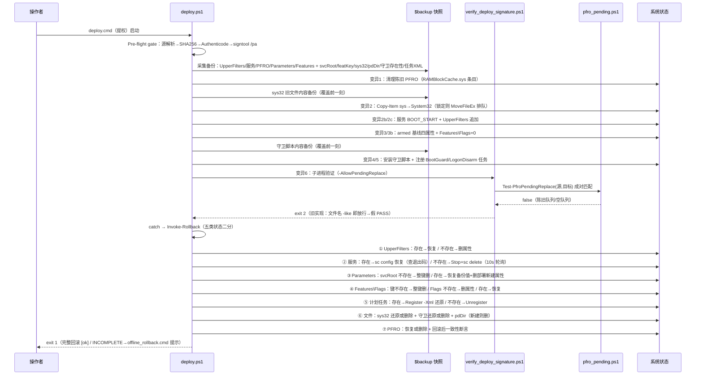
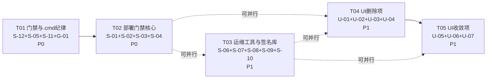

# RAMBlockCache 增量设计 · 脚本层 fail-open 收口 + UI 死代码/死令牌清理（W1-2 前置）

- **日期**：2026-10-19 · **架构**：高见远（Bob）· **上游需求**：`deliverables/iteration-prd-2026-10-19.md`（S-01…S-12 / U-01…U-07 / G-01）
- **基线**：门禁五件套全绿（锚点 b6fb097b…）；WPF Release 0 错误 0 警告；本机无 WDK → 驱动源码零改动
- **性质**：增量设计 + 文件级任务分解。**不写代码**；本文所有行号均为 2026-10-19 实测值（PRD 行号可能有 ±几行漂移，已逐项核验，见 6.2）
- **主理人裁定执行**：未决 1（src/dist/ 不删，S-08 就地修）；未决 2（sign_wpf_single.cmd 按规范 §7.3 作废退役，S-09 按作废方案重设计）；未决 3（每卷配额随 W2-3，U-02 只删死数据）；未决 4（Toast 删除，W1-2 重建）；未决 5（动效时长单一事实源 = C# `Motion`，本文 D1 裁定）

---

## Part A · System Design

### 1. 实现方案总览

三层改动，全部为**既有栈内修改/删除 + 1 个新增纯函数库**，零新增第三方依赖，零驱动源码改动，不触发锚点/重签名链：

| 层 | PRD 项 | 改动性质 | 一句话概括 |
|---|---|---|---|
| 脚本层 | S-01…S-12 | 行为修复 ×6（S-01/03/04/05/06/07）+ 一致性 ×2（S-02/S-10）+ 健壮性 ×1（S-08）+ 纪律 ×1（S-12）+ 可维护性 ×2（S-09/S-11） | 把"失败不可见/回滚不对称/基准造假/死路径"四类 fail-open 收口，全部机器可验证 |
| UI 层 | U-01…U-07 | 删除 ×4（U-01/02/03/04）+ 收敛 ×2（U-05/06）+ 可观测 ×1（U-07） | 消灭假接线与双轨定义；回退色/动效时长各收敛到唯一事实源 |
| 门禁层 | G-01 | 门禁增强 ×1 | check_ps_syntax 增第 3 类检查（.cmd/.bat 纯 ASCII + 无 BOM），把 S-12 成果制度钉死 |

**总文件面**：41 个文件（39 修改 / 6 删除 / 1 新增 —— 去重后；其中 MainWindow.xaml、UiState.cs、check_signature.ps1 各被两个 PRD 项触及，见文件清单表）。

### 2. 关键技术决策

#### D1（U-05 裁定）动效时长单一事实源 = C# `Motion`，XAML 以 `{x:Static}` 引用

- **决策**：定义只保留 `Controls/Motion.cs` 一处（`Dur90/120/180/240/480` + `EaseStandard/EaseOut/EaseIn`）；`Theme/Dark.xaml` 删除全部 `RbcDur*`/`RbcEase*` 令牌，BtnBase 内两处 `Duration="0:0:0.090"` 字面量改 `Duration="{x:Static ctl:Motion.Dur90}"`；`MainWindow.xaml` 的 Toast 模板（含 4 处 `0:0:0.` 字面量）随 U-01 整体删除后，全 XAML 树零时长字面量。
- **备选**：XAML 令牌为源 + 代码运行期解析（`TryFindResource` + `Duration.Parse`）——被否：运行期解析失败无编译期保护、资源字典缺失即静默回退、代码侧每次取用都要写解析样板。
- **理由**：① `{x:Static}` 是 XAML 解析期绑定，拼错/缺失=构建期炸，符合"fail-closed 要尽早"；② WPF `x:Static` 支持 `public static readonly` **字段**（先例：`{x:Static Visibility.Collapsed}` 即枚举静态字段），`Motion.Dur*` **无需改动成员种类**，最小侵入；③ 代码侧已有消费方（StateBar/NumberRoller/CardHover）零改动。
- **影响文件**：`Theme/Dark.xaml`（删令牌 + 补 `xmlns:ctl` + BtnBase 两处）、`MainWindow.xaml`（U-01 删除时一并消灭 4 处字面量；侧边栏激活令牌）、`Controls/Motion.cs`（仅 U-04 注释修正，不动定义）。
- **验收判据**（PRD 硬约束）：`grep '0:0:0\.' *.xaml` 零命中；Motion 与 XAML 两侧无同值重复定义；`RbcSidebarWidth` 成为侧边栏宽度唯一来源。
- **注意**：`NumberRoller.cs:69` 的 `320ms` 是五档之外的第六档（Motion 注释自称"仅五档"），不在本轮范围，备案留待 02b 规范修订（见 6.1 假设 A8）。

#### D2（S-01）回滚五类状态：扩 `Invoke-Rollback` + 备份段扩充，不新建函数

- **决策**：在既有 `Invoke-Rollback`（deploy.ps1:214-262）内按"存在→恢复 / 不存在→删除"补齐五类分支；备份段（:176-212）扩充快照属性；System32 旧文件与守卫脚本的**内容备份放在变异段覆盖前一刻**执行（备份段只记存在性布尔值——因为变异可能中途失败，内容备份必须紧贴覆盖点）。
- **备选**：新建 `Restore-PreDeployState` 函数——被否：回滚只有唯一调用点（catch 内），拆函数只会多一层作用域传递（`$backup`/`$clsKey`/`$svcRoot` 等闭包变量），且现有结构评审过两轮，扩写比拆写风险低。
- **备份段新增快照属性**（9 项）：`SvcRootExisted`（Parameters 整键）/ `FeatKeyExisted`（Features 整键）/ `Sys32Existed` + `Sys32Backup` + `Sys32Replaced` / `PdDirExisted` / `GuardExisted` + `GuardBackup`（两脚本）/ `TaskExisted` + `TaskDef`（两任务导出 XML）。
- **redeploy 场景**（`SvcExisted=$true` 或文件/任务已存在）：覆盖前 Copy-Item 到 `$env:TEMP\RAMBlockCache.sys.predeploy`（及两守卫脚本备份），回滚时还原；计划任务用 `Export-ScheduledTask` 存 XML，回滚 `Register-ScheduledTask -Xml ... -Force` 重注册还原。
- **fresh-install 场景**：服务 `Stop-Service`（10s 有界轮询）→ `sc.exe delete`（退出码 ∈ {0,1060} 视为 OK）；Parameters 整键 `Remove-Item -Recurse`；Features 整键删；两任务 `Unregister-ScheduledTask`；System32 文件与两守卫脚本删除；`pdDir` 若为部署新建则整删。
- **PFRO**：现状（恢复/删除）已覆盖取消 MoveFileEx 排队替换；仅补**回归断言**——回滚后重读 PFRO，与备份值做 `-join '|'` 比对，不一致入 `$errors`（既验"排队已取消"，也防误删第三方条目）。
- **每步检查**：所有新增外部调用包 try/catch 或查 `$LASTEXITCODE`，失败统一汇入既有 `$errors` → "ROLLBACK INCOMPLETE + offline_rollback 提示"路径，退出码仍为 1。
- **影响文件**：`src/scripts/deploy.ps1`（唯一）。
- **诚实标注**：真机回滚演练需提权+重启，归 W0；本轮只证静态正确性（分支核对 + check_ps_syntax 解析）。

#### D3（S-04）PFRO 纯函数落点：新建 `src/scripts/pfro_pending.ps1`（纯函数库，两侧 dot-source）

- **决策**：纯函数放**第三个文件**，不放进 `verify_deploy_signature.ps1` 本体，也不放进 `rb_common.ps1`。
- **备选与否决理由**：① 放 verify 本体——QA 要 dot-source 它做内存正/负例断言（PRD 4.2），会连带执行顶层验证流（exit 语义污染测试进程）；② 放 rb_common.ps1——它是"部署公共配置"层（含 `$ErrorActionPreference='Stop'` 与 param 块），把部署门禁的匹配逻辑耦合进构建工具库，且 verify 门禁 dot-source 它会引入无关副作用。`deploy.ps1` 与 verify 之间是**子进程调用**（deploy.ps1:362）而非 dot-source，deploy 的 PFRO 需求是"整值备份/恢复 + 断言"，不需要配对匹配，故 deploy 不 dot-source 本库——"两侧复用"落在 **verify 运行时侧 + QA 测试侧**，且库本身对 deploy 侧开放（未来若 deploy 需要断言排队内容，直接 `.` 即可，零执行副作用）。
- **函数签名**（纯函数、无系统访问、无顶层代码）：
  - `Remove-PfroPathPrefix([string]$Path)` → 去 `\??\` / `\\?\` 前缀 + Trim + ToLowerInvariant（大小写不敏感归一化）。
  - `Split-PfroPairs([string[]]$Entries)` → 按 REG_MULTI_SZ 扁平结构 `[源1,目标1,源2,目标2,…]` 步长 2 切对；奇数尾元素丢弃；`return ,$pairs` 保空数组语义。
  - `Test-PfroPendingReplace([string[]]$PfroEntries, [string]$ExpectedSource, [string]$ExpectedTarget)` → `bool`；源（归一化）== `$srcSys` **且** 目标 == `$dest` 才 `$true`；空数组/陈旧队列 → `$false`。
- **影响文件**：新增 `src/scripts/pfro_pending.ps1`；改 `src/scripts/verify_deploy_signature.ps1`（顶部 `. (Join-Path $scriptsDir 'pfro_pending.ps1')`，`-AllowPendingReplace` 块改为调用该函数，`@($pfro)` 兼容 `$null`）。
- **QA 三例**（内存数据，不碰注册表）：① 仅陈旧条目（源=旧 dist 路径）→ false → exit 2；② 含匹配 (srcSys,dest) 对 → true → exit 0；③ 空数组 → false → exit 2。

#### D4（S-02）sidecar 哈希正则三处统一 + 互相引用注释

- **决策**：三处（deploy.ps1:97 / verify_deploy_signature.ps1:55 / check_signature.ps1:94）统一为词边界正则 `(?<![0-9a-fA-F])[0-9a-fA-F]{64}(?![0-9a-fA-F])`；每处加同一模式注释，点名另两处文件，声明"改此正则必须同步另两处"。
- **理由**：现状两处非锚定（行内任意位置取第一条 64hex）+ 一处行首锚定（`^`）——`"SHA256: <hash>"` 格式 sidecar 会被 check_signature 静默跳过（回落锚点），同一 sidecar 两个门禁两种解释；词边界正则对三种格式（`<hash>` / `<hash>  path` / `SHA256: <hash>`）同解，且天然拒绝 65+ hex 的误匹配。
- **注释模式**（三处逐字同构，仅"另两处"文件名列举相同）：
  ```powershell
  # [FIX S-02] sidecar 首行哈希正则三处统一（deploy.ps1 / verify_deploy_signature.ps1 /
  # check_signature.ps1）：词边界匹配，禁行内任意位置取首条——"SHA256: <hash>" 格式
  # 必须三处同解；改此正则必须同步另两处。
  ```
- **不影响**：check_signature.ps1:81 的锚点提取正则（`DefaultExpectedSha256\s*=\s*''?…`）是另一用途，不动。
- **影响文件**：上述三文件。

#### D5（S-10）工具发现逻辑落点：`rb_common.ps1` 新增 `Find-*`/`Resolve-Tool`，`setup/sign_driver.ps1` dot-source 复用

- **决策**：发现函数写进 `rb_common.ps1`（部署公共库）；`setup/sign_driver.ps1` 以 `Join-Path $PSScriptRoot '..\scripts\rb_common.ps1'` dot-source 复用，**不复制**。
- **备选**：复制一份发现逻辑到 sign_driver.ps1——被否：S-10 要修的正是"两个签名入口策略不一致"这一漂移缺陷，复制等于把缺陷原样保留。
- **解析优先级**（PRD 原文）：显式 param > 环境变量（`RB_SIGNTOOL`/`RB_MSBUILD`/`RB_NUGETPKG`）> 自动发现（signtool = deploy.ps1:104-119 同款 Kits 递归；MSBuild = `Get-Command`；NugetPkg = `$env:USERPROFILE\.nuget\packages`）> `$null`。
- **懒解析 + 点到用 fail-loud**（关键设计）：dot-source 时只把 `$Script:SignTool/$Script:MSBuild/$Script:NugetPkg` 解析为字符串或 `$null`，**不 throw**；`Sign-Driver` 内 `$null` 即 throw 并说清"缺什么、怎么设"。理由：三个无参消费方（install/game_mode/run_diskspd .ps1）中 game_mode/run_diskspd 只用 `Assert-Admin`/`$ProjectRoot`，eager-throw 会把无关运维工具全炸掉。（注意：PRD R6 称"三消费方仅使用 Assert-Admin/ProjectRoot"**与实测不符**——install.ps1:8/9/35 消费 NugetPkg/MSBuild/SignTool，见 6.2 不符点 N1；懒解析设计已覆盖该风险。）
- **Sign-Driver 变更**：增 `-TimestampUrl`（默认 digicert）+ `-NoTimestamp`；签名输出 `2>&1` 捕获，失败时若输出匹配 `timestamp` 则 throw"时间戳不可达（离线？）→ 联网重试或 -NoTimestamp"，否则 throw"签名失败（查证书拇指纹/测试根）"；捕获期间函数内 `$ErrorActionPreference='Continue'`（函数作用域遮蔽，不影响调用方），避免 Stop 语义把 signtool stderr 警告变成终止性错误。
- **sign_driver.ps1 对齐**：保持 `-Target/-Thumbprint/-ResultFile` 参数面；文件头显式 `$ErrorActionPreference='Continue'`（保住"失败也写结果文件"的既有契约）；dot-source 后取 `$Script:SignTool`，`$null` 时写 `SIGNTOOL NOT FOUND` 行而非裸奔；补同样时间戳参数面（默认时间戳 on，与原 rb_common 行为一致）。
- **影响文件**：`src/scripts/rb_common.ps1`、`src/setup/sign_driver.ps1`。**不扩散到 deploy.ps1/verify**：门禁脚本保持自包含（最后防线的签名发现不依赖可被业务改动的公共库），PRD"同款"指同算法非同代码，可接受的有意重复。

#### D6（S-09）sign_wpf_single.cmd 作废横幅与退出码（按主理人裁定，PRD 原"自动发现+重定向"方案作废）

- **决策**：整文件替换为作废桩：ASCII 英文 `rem` 警告横幅（说明作废理由 + 权威入口）+ `echo` 说明 + `exit /b 1`；**不保留** UAC 自提权块（不再签名，提权无意义）、**不保留** `pause`（保退出码确定性，CI 不挂起）。
- **横幅要点**：① DEPRECATED，依据 code-standards §7.3；② 旧目标 `RamBoostFS.Wpf.exe` 非发布物，"只修路径发现等于让陈旧目标失败得更漂亮"；③ 权威入口 = 同目录 `sign_all.cmd`（SIGTOOL 优先 → Kits 版本倒序 → 找不到 exit 1；签 sys/Controller.exe/ctl 三发布物，缺失跳过——已核实 sign_all.cmd:13-23,40-47）。
- **退出码**：恒 `exit /b 1`（"此脚本被有意弃用"= 非零）；无 `10.0.26100.0` 硬编码残留；保持纯 ASCII 无 BOM（G-01 会断言）。
- **影响文件**：`src/sign_wpf_single.cmd`（唯一）。

#### D7（S-03）verify 退出码 4 语义与"源不可达"归类

- **决策**：新增退出码 **4 = I/O 失败**（源 sys 不存在/不可读、Get-FileHash 抛异常）；`Resolve-SysSource` 的 catch 从 exit 1 改为 exit 4（PRD 验收明确"不存在路径 → 4，旧行为 1"）；两处 `Get-FileHash` 包 try/catch → exit 4；头注释退出码表更新为 `0=verified / 1=usage / 2=hash-deployed mismatch / 3=signature-signtool / 4=I-O failure`。
- **不变**：sidecar 无哈希/无期望值仍为 1（usage）；`$dest` 不存在仍为 2（部署副本缺失=无法验证部署，属 mismatch 类，PRD 未要求改）。deploy.ps1 调用方"非零即失败"，不受影响。
- **影响文件**：`src/scripts/verify_deploy_signature.ps1`。

#### D8（G-01）check_ps_syntax 第 3 类检查与 .ps1 检查逐字同构

- **决策**：新增 .cmd/.bat 检查段：`Get-ChildItem -Recurse -Include *.cmd,*.bat -File` + **与 .ps1 段逐字相同**的 `$exclude` 数组与 Where 管道；逐文件读字节：BOM（EF BB BF）→ `[FAIL][BOM ]` + continue；非 ASCII 字节（>0x7F）→ `[FAIL][CHR ] {rel} ({n} non-ASCII bytes)`；通过 → `[ OK ] {rel}`；统计行在既有格式后追加 `cmd_files= cmd_chr= cmd_bom=`（`files=` 仍只计 .ps1，保持既有解析兼容）。
- **顺序纪律**（PRD 3.3 红线）：T01 内必须先完成 S-12 五文件英文化，再启用本断言并跑负向测试（临时塞一行中文 → FAIL → 还原 → fail=0）。
- **影响文件**：`src/scripts/check_ps_syntax.ps1`（含 .SYNOPSIS/.DESCRIPTION 注释块改"三类检查"）。

#### D9（U-06）回退色收敛点 = `Services/UiState.cs` 内新增 `internal static class FallbackPalette`

- **决策**：单点定义 6 个冻结 `SolidColorBrush`（Danger/Warning/Success/Neutral/SurfaceHover/BorderStrong），取值 = Dark.xaml 令牌值，字段注释逐条锚定令牌键；`CardHover`/`StateBar`/`UiState.ColorForRisk` 全部引用该点，删除全部散落字面量。
- **理由**：PRD 建议"UiState 内收敛"且 UiState.cs:105 自述"禁止界面散落 Color 常量"——定义点与注释同文件， doctrine 与结构一致；`StateBar.xaml.cs` 已有 `using …Services`（Controls→Services 依赖既存），无新增耦合方向。`internal` 限定程序集内，不扩大公开面。
- **映射**：IndianRed→Danger `#FFF27A72`；Goldenrod→Warning `#FFF2B84B`；MediumSeaGreen→Success `#FF63D6A0`；Brushes.Gray/Colors.Gray→Neutral `#FFA6A6B0`（=RbcNeutralFg）；0x1E1E24→SurfaceHover、0x3A3A45→BorderStrong（两值原已等值，仅收敛位置）。
- **注意**：收敛点用 `Color.FromRgb(0xF2,0x7A,0x72)` 分量写法，天然不含 `0xF27A72` 连续字面量，通过 PRD grep 验收。
- **影响文件**：`Services/UiState.cs`、`Controls/CardHover.cs`、`Controls/StateBar.xaml.cs`。

#### D10（U-07）LogService 空 catch 防递归方案

- **决策**：LogService.cs:43 处改 `catch (Exception ex)`：`System.Diagnostics.Debug.WriteLine` + `Interlocked.Increment(ref _writeFailures)` 静态计数（`internal static int WriteFailures` 只读暴露，供测试/QA 读取）；**严禁回调 LogService 自身**（写盘失败的报错走写盘=递归风暴）。
- **另三处**：MainViewModel:373（Telemetry）/ StatsService:183（Stop 等待）/ DriverService:290（卸载前 FLUSH）→ `LogService.Warn/Error`；DriverService 保持"继续卸载"行为不变，只加可见性。
- **已知限制**（如实记录）：`Debug.WriteLine` 在 Release 配置被条件编译掉，计数是唯一持久信号——PRD 明文选此方案，QA 知悉即可；不改用 Trace/Console 以保持 PRD 约定。
- **影响文件**：`ViewModels/MainViewModel.cs`、`Services/StatsService.cs`、`Services/LogService.cs`、`Services/DriverService.cs`。

---

### 3. 文件清单表

> 改动类型：修改 / 删除 / 新增。全部文件**不涉签名链**（否）——sys/哈希/锚点零改动，不触发 sync_anchors 与重签名。

| # | 路径 | 类型 | 改动要点 | PRD 项 | 任务 |
|---|---|---|---|---|---|
| 1 | `src/scripts/deploy.ps1` | 修改 | 备份段 +9 快照属性；Invoke-Rollback 五类状态二分（服务 stop+delete、Parameters/Features 键与属性级删除、任务 XML 还原/注销、文件还原/删除、PFRO 回归断言）；既有 sc.exe config 恢复补退出码检查；sidecar 正则统一 | S-01, S-02 | T02 |
| 2 | `src/scripts/verify_deploy_signature.ps1` | 修改 | sidecar 正则统一；Get-FileHash ×2 try/catch → exit 4；Resolve-SysSource catch 改 exit 4；头注释退出码表；dot-source pfro_pending 并改 -AllowPendingReplace 为 (源,目标) 成对匹配 | S-02, S-03, S-04 | T02 |
| 3 | `src/scripts/check_signature.ps1` | 修改 | sidecar 正则统一（:94）；Get-FileHash try/catch → 干净 `result: FAIL` + exit 1（:68） | S-02, S-05 | T01(S-05), T02(S-02) |
| 4 | `src/scripts/pfro_pending.ps1` | **新增** | 纯函数库：`Remove-PfroPathPrefix` / `Split-PfroPairs` / `Test-PfroPendingReplace`；无顶层副作用；UTF-8 BOM | S-04 | T02 |
| 5 | `src/scripts/run_diskspd.ps1` | 修改 | `Run-Diskspd` 参数化（`[string[]]$ExtraArgs`，固定参数+附加参数+路径拼数组 splat）；read-only 变体显式 `-w0`；BASELINE 保持 `-w70` | S-06 | T03 |
| 6 | `src/scripts/game_mode.ps1` | 修改 | 输入循环仅收 1/2/Q（空/其他重提示）；OFF 需输入确认串；`/enum` 与两处 `/set` 后查 `$LASTEXITCODE`，失败非零收尾（2=enum 失败，3=set 失败） | S-07 | T03 |
| 7 | `src/dist/install_manual.ps1` | 修改 | :43/:45/:56 三处 sc.exe 后查 `$LASTEXITCODE`，失败记日志并非零收尾（不打印 MANUAL_INSTALL_DONE）；:51 补 `-Type MultiString` | S-08 | T03 |
| 8 | `src/sign_wpf_single.cmd` | 修改 | 整文件替换为作废桩：DEPRECATED 横幅（规范 §7.3）+ echo 说明 + `exit /b 1` + 指向 sign_all.cmd；纯 ASCII 无 BOM | S-09 | T03 |
| 9 | `src/scripts/rb_common.ps1` | 修改 | 删 `C:\Program1`/`Doubao` 死路径默认值；新增 `Find-SignTool/Find-MSBuild/Find-NuGetPkg/Resolve-Tool`；`$Script:*` 懒解析（找不到=$null）；Sign-Driver 加 `-TimestampUrl`/`-NoTimestamp` + 失败消息区分时间戳不可达；头注释重写 | S-10 | T03 |
| 10 | `src/setup/sign_driver.ps1` | 修改 | dot-source rb_common 复用发现逻辑（`..\scripts\rb_common.ps1`）；EAP 显式 Continue；补时间戳参数面；`$null` 工具写 `SIGNTOOL NOT FOUND`；保持 -Target/-Thumbprint/-ResultFile | S-10 | T03 |
| 11 | `src/scripts/check_repo.py` | 修改 | :52 豁免改显式白名单 `p.name not in {"cache.h"}`，删 `"rb_wiring" not in s` 内容判断子句 | S-11 | T01 |
| 12 | `src/scripts/install.cmd` | 修改 | L9-12、L14-15 中文 REM 英文化（信息不丢失） | S-12 | T01 |
| 13 | `src/sign_all.cmd` | 修改 | L10-12、L27、L36-39 中文 REM 英文化 | S-12 | T01 |
| 14 | `src/ctl/_build_rbfeatctl.cmd` | 修改 | L2-3 中文 REM 英文化 | S-12 | T01 |
| 15 | `src/driver/_build_drv.cmd` | 修改 | L2-3 中文 REM 英文化（.cmd 构建包装，非驱动源码） | S-12 | T01 |
| 16 | `src/core/build_all.bat` | 修改 | L15-16 中文 REM 英文化 | S-12 | T01 |
| 17 | `src/scripts/uninstall.cmd` | 修改 | `@echo off` 后补 `chcp 65001 >nul` | S-12 | T01 |
| 18 | `src/scripts/game_mode.cmd` | 修改 | 补 `chcp 65001 >nul` | S-12 | T01 |
| 19 | `src/scripts/run_diskspd.cmd` | 修改 | 补 `chcp 65001 >nul` | S-12 | T01 |
| 20 | `src/ctl/ramboostctl.cmd` | 修改 | 删 L11 `RB_ELEVATED` 死变量与 `:run` 标签；注释"net session 即提权门禁" | S-12 | T01 |
| 21 | `src/ctl/rbfeatctl.cmd` | 修改 | 删 L9 `RB_ELEVATED` 死变量与 `:run` 标签；同上注释 | S-12 | T01 |
| 22 | `src/scripts/check_ps_syntax.ps1` | 修改 | 新增第 3 类检查：.cmd/.bat 纯 ASCII + 无 BOM；排除清单与输出格式同构；统计行追加 cmd 段 | G-01 | T01 |
| 23 | `…/Services/ToastService.cs` | **删除** | 全文件（ToastService/ToastItem/ToastKind；零 Show 调用点） | U-01 | T04 |
| 24 | `…/MainWindow.xaml` | 修改 | 删 Toast DataTemplate（43-129，含 4 处 `0:0:0.` 字面量）、叠加层（562-566）、`xmlns:services`（L5）、更新 L132 注释；L145 侧边栏 `Width="216"` → `{StaticResource RbcSidebarWidth}` | U-01, U-05 | T04(U-01), T05(U-05) |
| 25 | `…/Services/SettingsService.cs` | 修改 | 删 `QuotaByVolume`/`ModeByVolume`（15-17；存量键被 System.Text.Json 默认忽略，无迁移） | U-02 | T04 |
| 26 | `…/Services/Abstractions/IDriveDisplayPolicy.cs` | **删除** | 接口 + DefaultDriveDisplayPolicy | U-03 | T04 |
| 27 | `…/Services/Abstractions/IPrefetchGate.cs` | **删除** | 接口 + DefaultPrefetchGate | U-03 | T04 |
| 28 | `…/Services/Abstractions/ISystemVolumeOptIn.cs` | **删除** | 接口 + NoopSystemVolumeOptIn | U-03 | T04 |
| 29 | `…/Services/Abstractions/IL2RecoveryReporter.cs` | **删除** | 接口 + NoopL2RecoveryReporter | U-03 | T04 |
| 30 | `…/Services/Abstractions/IOperationProgress.cs` | **删除** | 接口 + InMemoryOperationProgress + OperationProgress 记录（均零外部消费，已核验） | U-03 | T04 |
| 31 | `…/Services/FeatureRegistry.cs` | 修改 | 删 5 行注册（22-25,27）；类注释改为"后续波次接口随消费方一起加入" | U-03 | T04 |
| 32 | `…/Services/UiState.cs` | 修改 | 删 `ColorForKey`（:106）；新增 `internal static class FallbackPalette`（6 冻结画刷，注释锚定令牌键）；`ColorForRisk` 回退改引 FallbackPalette | U-04, U-06 | T04(U-04), T05(U-06) |
| 33 | `…/Controls/Motion.cs` | 修改 | :16-20 注释修正（"启动期一次性求值" → 设置页 setter 实时改判，MainViewModel.cs:778-779） | U-04 | T04 |
| 34 | `…/App.xaml.cs` | 修改 | :18-20 注释同步修正（同上） | U-04 | T04 |
| 35 | `…/Theme/Dark.xaml` | 修改 | 补 `xmlns:ctl`；删 RbcDur*/RbcEase*（45-57）、RbcChart*×8+RbcSkeleton*×2（59-72）、StateBadge（89-93）；BtnBase 两处 `Duration="0:0:0.090"` → `{x:Static ctl:Motion.Dur90}`（138,146）；删令牌区改单一事实源说明注释 | U-05 | T05 |
| 36 | `…/Controls/CardHover.cs` | 修改 | 64-65/73-74 四处回退色改引 `FallbackPalette.SurfaceHover.Color`/`BorderStrong.Color` | U-06 | T05 |
| 37 | `…/Controls/StateBar.xaml.cs` | 修改 | :26 `Brushes.Gray` → `FallbackPalette.Neutral`；:43 `Colors.Gray` → `FallbackPalette.Neutral.Color` | U-06 | T05 |
| 38 | `…/ViewModels/MainViewModel.cs` | 修改 | :373 空 catch → `LogService.Warn`（埋点失败可见，行为不变） | U-07 | T05 |
| 39 | `…/Services/StatsService.cs` | 修改 | :183 空 catch → `LogService.Warn` | U-07 | T05 |
| 40 | `…/Services/LogService.cs` | 修改 | :43 空 catch → `Debug.WriteLine` + 静态失败计数（禁自身回调）；新增 `internal static int WriteFailures` | U-07 | T05 |
| 41 | `…/Services/DriverService.cs` | 修改 | :290 空 catch → `LogService.Warn`（保持继续卸载） | U-07 | T05 |

---

### 4. 数据结构和接口（classDiagram）

```mermaid
classDiagram
    class DeployBackup {
        +bool UpperFiltersExisted
        +string[] UpperFilters
        +bool SvcExisted
        +int SvcStart
        +int SvcType
        +int SvcError
        +string SvcGroup
        +bool SvcRootExisted
        +hashtable ParamProps
        +bool FeatExisted
        +int FeatFlags
        +bool FeatKeyExisted
        +bool PfroExisted
        +string[] Pfro
        +bool Sys32Existed
        +string Sys32Backup
        +bool Sys32Replaced
        +bool PdDirExisted
        +hashtable GuardExisted
        +hashtable GuardBackup
        +hashtable TaskExisted
        +hashtable TaskDef
        +bool Mutated
    }
    class deploy_ps1 {
        +Invoke-Rollback() void
        +Resolve-SysSource(Explicit) string
        +Resolve-ExpectedSha(Sys, Explicit) string
        +Resolve-SignTool() string
    }
    class verify_deploy_signature_ps1 {
        +Resolve-ExpectedSha(Sys, Explicit) string
        +exit 0 verified / 1 usage / 2 mismatch / 3 signature / 4 IO
    }
    class pfro_pending_ps1 {
        <<pure library>>
        +Remove-PfroPathPrefix(Path) string
        +Split-PfroPairs(Entries) pair[]
        +Test-PfroPendingReplace(PfroEntries, ExpectedSource, ExpectedTarget) bool
    }
    class rb_common_ps1 {
        +Find-SignTool() string
        +Find-MSBuild() string
        +Find-NuGetPkg() string
        +Resolve-Tool(Explicit, EnvName, Finder) string
        +Sign-Driver(TimestampUrl, NoTimestamp) void
        +Assert-Admin() void
    }
    class setup_sign_driver_ps1 {
        +string Target
        +string Thumbprint
        +string ResultFile
        +string TimestampUrl
        +bool NoTimestamp
    }
    class check_ps_syntax_ps1 {
        +Check-Ps1 BOM+SYN
        +Check-Cmd ASCII+noBOM
    }
    class check_signature_ps1 {
        +sidecar regex unified
        +Get-FileHash guarded
    }
    class Motion {
        <<static>>
        +bool IsReducedMotion
        +Duration Dur90
        +Duration Dur120
        +Duration Dur180
        +Duration Dur240
        +Duration Dur480
        +KeySpline EaseStandard
        +KeySpline EaseOut
        +KeySpline EaseIn
    }
    class FallbackPalette {
        <<internal static>>
        +SolidColorBrush Danger
        +SolidColorBrush Warning
        +SolidColorBrush Success
        +SolidColorBrush Neutral
        +SolidColorBrush SurfaceHover
        +SolidColorBrush BorderStrong
    }
    class UiStateView {
        +ColorForRisk(risk) SolidColorBrush
        -FindBrush(key, fallback) SolidColorBrush
    }
    class ToastService {
        <<deleted U-01>>
    }
    deploy_ps1 --> DeployBackup : 采集快照 / 回滚消费
    deploy_ps1 ..> verify_deploy_signature_ps1 : 子进程调用
    verify_deploy_signature_ps1 ..> pfro_pending_ps1 : dot-source 纯函数
    setup_sign_driver_ps1 ..> rb_common_ps1 : dot-source 复用发现+时间戳
    check_signature.ps1 .. check_ps_syntax_ps1 : 同属门禁五件套
    UiStateView ..> FallbackPalette : 回退色单点
    CardHover ..> FallbackPalette
    StateBar ..> FallbackPalette
    Dark_xaml ..> Motion : x:Static ctl:Motion.Dur90
```

### 5. 程序调用流程（sequenceDiagram）

以 S-01 主路径（部署失败 → 五类回滚）为骨架，覆盖 S-02/S-03/S-04 的验证段：



### 6. Anything UNCLEAR（假设与实测差异）

#### 6.1 假设（设计时裁定，QA/工程按此执行）

- **A1**：`{x:Static}` 引用 `Motion.Dur*`（`public static readonly` 字段）依赖 WPF StaticExtension 对静态字段的支持——先例 `{x:Static Visibility.Collapsed}`（枚举静态字段）为 WPF 惯用法；若构建期意外，最小回退是把字段改 get-only 属性（`public static Duration Dur90 { get; }`），不改值。
- **A2**：S-01 中 fresh-install 删服务前 `Stop-Service` 用 10s 有界轮询（install.ps1 用 15s，回滚路径取短）；轮询超时仍继续 `sc.exe delete`（打删除标记），不视为错误——与 install.ps1:53 的 {0,1060} 容忍一致。
- **A3**：S-01 回滚**不删除** `$env:TEMP` 下的内容备份（保留恢复材料；TEMP 本身易失），仅在成功还原后自然失效。
- **A4**：S-04 纯函数对奇数长度 PFRO 数组丢弃尾元素（REG_MULTI_SZ 理应成对；畸形数据不参与匹配）。
- **A5**：S-10 的 `Find-MSBuild` 只做 `Get-Command MSBuild.exe`（PATH 探测），不额外探测用户级 .NET SDK（`~\\.dotnet`）——PRD 原文边界，避免范围扩大。
- **A6**：S-09 作废桩不加 `pause`——退出码确定性优先于交互停留（CI/脚本调用不挂起）；双击用户的可见性由 echo 三行承担。
- **A7**：U-06 中 StateBar 的 `Brushes.Gray`/`Colors.Gray` 映射到 Neutral（=RbcNeutralFg #FFA6A6B0）——PRD"取令牌值"下最接近的中性语义令牌；原 Gray #FF808080 无对应令牌。
- **A8**：`NumberRoller.cs:69` 的 320ms 是 Motion 五档之外的第六档时长，**不在本轮范围**（PRD 未列）；建议记入 02b 规范修订 backlog，本轮不动以守住"不扩大范围"。
- **A9**：G-01 的 .cmd 枚举用 `-Include *.cmd,*.bat`（PS 5.1 下配合 -Recurse 生效）；若实测异常，回退为 `-Filter` 两遍合并，排除管道保持逐字同构。

#### 6.2 与 PRD 不符/需知之处（实测核验发现）

- **N1（重要）PRD R6 缓解措施前提有误**：R6 称"rb_common.ps1 三消费方仅使用 Assert-Admin/ProjectRoot"——实测 `install.ps1:8/9/35` 分别消费 `$Script:NugetPkg`/`$Script:MSBuild`/`$Script:SignTool`，且 :14 调 `Sign-Driver`。影响：S-10 后 install.ps1 的 legacy 构建链在缺工具机器上从"陈旧路径 file-not-found"变为"$null 调用错误"——两者均 fail-loud，且 install.ps1 是 legacy 调试入口（权威=deploy.ps1/ramboostsetup），可接受；D5 的懒解析设计保证 game_mode/run_diskspd 两运维工具不受波及。
- **N2**：PRD S-01 范围外的 `deploy.ps1:232-233` 已携带 `[FIX 建议-2 2026-10-18]` 组名引号修复（回滚 `group= "System Bus Extender"` 整参传递）——现状已覆盖，本轮无动作。
- **N3**：bug-hunt #28 提及的 Sparkline `#60CDFF ≠ RbcAccent` 已修复（现为 `Color.FromRgb(0x4C,0xC2,0xFF)` + `= RbcAccent` 注释）；PRD U-06 未含 Sparkline，无动作。
- **N4**：行号漂移（以本文/实测为准）：DriverService 空 catch 实测 :290（bug-hunt 记 :284）；verify `-AllowPendingReplace` 块实测 134-146（PRD 134-146 ✅）；deploy 备份段实测 176-212（PRD ~180-213）；变异段实测 267-364。其余 S-/U-/G- 行号与 PRD 一致。
- **N5**：`src/dist/` 游离件中两份 stray .cmd（check_env.cmd / game_mode.cmd）实测**纯 ASCII 无 BOM**——G-01 不会误伤；PRD 2.2 的 chcp 补充仍随删除授权走，本轮不动。
- **N6**：`dist/RAMBlockCache.sys.sha256` sidecar 当前不存在——S-02 三处一致性由 QA 合成 sidecar 三格式验证（PRD 4.2 已设计）；真实发布面 `dist\RAMBlockCache.sys` + `dist\wpf\RAMBlockCache.Controller.exe` 在**包根** `dist\`（src\dist\ 是游离副本区，两者勿混淆）。
- **N7**：`RB_ELEVATED` 全树（含 Build16 存档 .cmd）实测仅存于 `ctl/ramboostctl.cmd:11` 与 `ctl/rbfeatctl.cmd:9`；PRD 验收 grep 需排除 `*.md` 与 `RAMBlockCache-Build16`（文档/存档不在活跃代码面）。
- **N8**：本工作副本**不是 git 仓库**（git 2.55 已装，`git status` = fatal: not a git repository）——PRD 4.2 中"git diff 确认仅 X 变更"类验收需 QA 先 `git init` 建基线提交，或按本文文件清单表人工核对文件面。
- **N9**：`setup/sign_driver.ps1` 全树零调用方（独立 helper，疑为外部/手动调用）——S-10 改它低风险，但 ResultFile 输出契约必须保持（外部调用方不可见）。

---

## Part B · Task Decomposition

### 7. Required Packages

**无新增第三方包/依赖。** 本轮全部改动位于既有栈内：PowerShell 5.1（含新增纯函数库）、Python 3.13（门禁脚本小改）、.NET 8 WPF（用户级 SDK `C:\Users\陈\.dotnet\dotnet.exe`）。`package.json`/`requirements.txt` 类清单不适用。

### 8. Task List（有序，按实现顺序）

#### T01 · 门禁与 .cmd 脚本纪律基础设施（P0，首任务）

- **对应 PRD 项**：S-12（纪律三连）、S-05、S-11、G-01
- **Source Files（13）**：
  - S-12 英文化 5：`src/scripts/install.cmd`、`src/sign_all.cmd`、`src/ctl/_build_rbfeatctl.cmd`、`src/driver/_build_drv.cmd`、`src/core/build_all.bat`
  - S-12 chcp 3：`src/scripts/uninstall.cmd`、`src/scripts/game_mode.cmd`、`src/scripts/run_diskspd.cmd`
  - S-12 死变量 2：`src/ctl/ramboostctl.cmd`、`src/ctl/rbfeatctl.cmd`
  - G-01：`src/scripts/check_ps_syntax.ps1`
  - S-05：`src/scripts/check_signature.ps1`
  - S-11：`src/scripts/check_repo.py`
- **Dependencies**：无
- **内部顺序纪律（硬）**：先完成 S-12 五文件英文化 → 再实现 G-01 断言 → 跑负向测试。顺序倒置=门禁自失败（当前基线 5 文件含中文）。
- **改动要点**：
  1. 5 文件中文 REM 逐条英文化（信息不丢失，禁改逻辑；译文要点见共享知识 SW-5）；
  2. 3 包装在 `@echo off` 后插 `chcp 65001 >nul`（与 deploy.cmd/install.cmd 既有模式一致）；
  3. 2 文件删 `if "%RB_ELEVATED%"=="1" goto run` + `:run` 标签，替换为注释 `rem Elevation gate is the net session check below; RB_ELEVATED was a dead variable (UAC relay never sets it).`；
  4. check_ps_syntax 增第 3 类检查（结构/排除清单/输出格式与 .ps1 段逐字同构，见 D8）；
  5. check_signature.ps1:68 Get-FileHash 包 try/catch → `Fail` + `result: FAIL` + exit 1（对齐 :49-53 既有 catch 形状）；
  6. check_repo.py:52 豁免改 `p.name not in {"cache.h"}`。
- **完成判据**：① 全活跃 .cmd/.bat 无非 ASCII、无 BOM（check_ps_syntax 自身即断言）；② 3 包装含 `chcp 65001`；③ `RB_ELEVATED` 代码面零命中（排除 .md/Build16）；④ check_ps_syntax `fail=0` 且负向测试生效（塞中文→FAIL→还原→fail=0）；⑤ check_repo 负向测试（临时 `_tmp_gate_probe.c` 含 rb_wiring 注释 + CORE_REALLOC → FAIL → 删→PASS）；⑥ check_signature `-SysPath C:\Windows` → `result: FAIL`、exit 1、无裸异常栈；⑦ 五件套全绿。
- **验证命令**：五件套（见 SW-2）+ 上述三条负向测试。

#### T02 · 部署门禁核心：回滚对称 + sidecar 一致 + pending 纯函数（P0）

- **对应 PRD 项**：S-01、S-02、S-03、S-04
- **Source Files（4）**：`src/scripts/deploy.ps1`、`src/scripts/verify_deploy_signature.ps1`、`src/scripts/check_signature.ps1`、`src/scripts/pfro_pending.ps1`（新增）
- **Dependencies**：**T01**（check_signature.ps1 被 T01 的 S-05 与 T02 的 S-02 先后修改——S-05 在 68 行区、S-02 在 94 行区，区域不重叠但串行保平安；pfro_pending.ps1 属新增 .ps1，T01 的 G-01 会扫描它，须保证 UTF-8 BOM）
- **改动要点**：
  1. S-01：备份段 +9 属性；变异段在 Copy-Item 前加 sys32/守卫内容备份并置 `Sys32Replaced`；Invoke-Rollback 按 D2 补齐五类二分 + PFRO 回归断言 + 既有 sc.exe config 恢复补退出码检查；
  2. S-02：三处 sidecar 正则统一 + 同构互引注释（D4）；
  3. S-03：verify 的 Get-FileHash ×2 与 Resolve-SysSource catch 收口到 exit 4 + 头注释退出码表（D7）；
  4. S-04：新增 pfro_pending.ps1（D3 签名），verify dot-source 并将 -AllowPendingReplace 改为成对匹配。
- **完成判据**：① S-01 静态核对 checklist——五类状态均有"存在→恢复/不存在→删除"分支、无新增无检查调用、diff 仅 deploy.ps1（+pfro 新增）；② S-02 三格式 × 三处 = 9/9 一致 harness；③ S-03 不存在路径 → exit 4 + 消息指 I/O；④ S-04 三例内存断言（陈旧→2 / 匹配→0 / 空→2）不碰注册表；⑤ check_ps_syntax 保解析；⑥ 五件套全绿。
- **验证命令**：五件套 + PRD 4.2 对应负例 harness。

#### T03 · 运维工具与签名公共库（P1）

- **对应 PRD 项**：S-06、S-07、S-08、S-09、S-10
- **Source Files（6）**：`src/scripts/run_diskspd.ps1`、`src/scripts/game_mode.ps1`、`src/dist/install_manual.ps1`、`src/sign_wpf_single.cmd`、`src/scripts/rb_common.ps1`、`src/setup/sign_driver.ps1`
- **Dependencies**：无（与 T02/T04/T05 文件零重叠，可并行）
- **改动要点**：
  1. S-06：`Run-Diskspd($label,$path,[string[]]$ExtraArgs)` 参数化（`$dargs = @(固定) + $ExtraArgs + @($path)` 后 `& $diskspd @dargs`）；read-only 传 `-w0`；BASELINE/70-30 传 `-w70` 保行为；删 `($work -replace '-w70','')`；
  2. S-07：输入循环（1/2/Q）+ OFF 确认串 + 三处 bcdedit `$LASTEXITCODE` 检查（D 见 S-07 设计）；
  3. S-08：install_manual.ps1 三处 sc.exe 退出码检查（失败记日志 + 非零收尾，不打印 MANUAL_INSTALL_DONE）+ `-Type MultiString`；
  4. S-09：sign_wpf_single.cmd 整文件替换为作废桩（D6）；
  5. S-10：rb_common.ps1 发现函数 + 懒解析 + Sign-Driver 时间戳参数化；sign_driver.ps1 dot-source 对齐（D5）。
- **完成判据**：① S-06 grep 反证（无 `-replace '-w70'`、read-only 含 `-w0`）+ 人审参数化；② S-07 人审循环/确认 + grep 三处 bcdedit 后有 `$LASTEXITCODE`；③ S-08 grep 三项俱全；④ S-09 grep 四项（无 10.0.26100.0、含 DEPRECATED/exit /b 1、指向 sign_all.cmd、ASCII 无 BOM）；⑤ S-10 grep 无反例（无 `C:\Program1`、无 `Doubao`）+ 人审三消费方不依赖被改默认值 + 发现失败 fail-loud；⑥ check_ps_syntax 过（sign_wpf_single.cmd 纯 ASCII 由 G-01 断言）；⑦ 五件套全绿。
- **验证命令**：五件套 + PRD 4.2 S-06…S-10 各行。

#### T04 · UI 删除项：Toast / 死数据 / 假接线 / 死方法（P1）

- **对应 PRD 项**：U-01、U-02、U-03、U-04
- **Source Files（12）**：`Services/ToastService.cs`（删）、`MainWindow.xaml`、`Services/SettingsService.cs`、`Services/Abstractions/{IDriveDisplayPolicy,IPrefetchGate,ISystemVolumeOptIn,IL2RecoveryReporter,IOperationProgress}.cs`（5 删）、`Services/FeatureRegistry.cs`、`Services/UiState.cs`、`Controls/Motion.cs`、`App.xaml.cs`
- **Dependencies**：无
- **改动要点**：
  1. U-01：删 ToastService.cs 全文件 + MainWindow.xaml 的 DataTemplate(43-129)/叠加层(562-566)/`xmlns:services`(L5)/L132 注释中的"Toast 叠加层"表述；
  2. U-02：删 AppSettings 的 QuotaByVolume/ModeByVolume（存量键无需迁移）；
  3. U-03：删 5 接口文件 + FeatureRegistry 5 行注册，类注释改"随消费方一起加入"；
  4. U-04：删 UiState.ColorForKey（保留 ColorForRisk 与 FindBrush）；Motion.cs / App.xaml.cs 注释改"实时求值"事实。
- **完成判据**：① `ToastService|ToastItem|ToastKind|ToastTemplate` 全树（cs+xaml）零命中；② `QuotaByVolume|ModeByVolume` 零命中；③ 5 接口名零命中；④ `ColorForKey` 零命中 + 人审两处注释与 MainViewModel.cs:778-779 实时求值一致；⑤ WPF Release 构建 0 错误 0 警告；⑥ 五件套全绿（G-01 不涉及 .cs）。
- **验证命令**：五件套 + WPF 构建 + grep 零残留。

#### T05 · UI 收敛项：动效单轨 / 散色收敛 / 空 catch 可观测（P1）

- **对应 PRD 项**：U-05、U-06、U-07
- **Source Files（9）**：`Theme/Dark.xaml`、`MainWindow.xaml`、`Services/UiState.cs`、`Controls/CardHover.cs`、`Controls/StateBar.xaml.cs`、`ViewModels/MainViewModel.cs`、`Services/StatsService.cs`、`Services/LogService.cs`、`Services/DriverService.cs`
- **Dependencies**：**T04**（双重原因：① MainWindow.xaml 与 UiState.cs 同文件串行；② U-05 验收"XAML 无 `0:0:0.` 字面量"以 U-01 删除 Toast 模板为前提——模板内 4 处字面量随删除消灭，Dark.xaml BtnBase 两处由本任务改 x:Static）
- **改动要点**：
  1. U-05：Dark.xaml 补 `xmlns:ctl`、删死令牌（RbcDur*/RbcEase*/RbcChart*×8/RbcSkeleton*×2/StateBadge）、BtnBase 两处 Duration 改 `{x:Static ctl:Motion.Dur90}`、删令牌区改单一事实源注释；MainWindow L145 激活 RbcSidebarWidth；
  2. U-06：UiState.cs 新增 FallbackPalette（D9）；ColorForRisk/CardHover×4/StateBar×2 回退色改引；
  3. U-07：四处空 catch 补日志（D10；LogService 处 Debug + 计数防递归）。
- **完成判据**：① grep：Dark.xaml 无 `RbcDur|RbcEase|RbcChart|RbcSkeleton|StateBadge`；MainWindow L145 引 `RbcSidebarWidth`；XAML 无 `0:0:0.`；② grep：代码侧无 `0x1E1E24|0x3A3A45|IndianRed|Goldenrod|MediumSeaGreen|Brushes.Gray|Colors.Gray`（FallbackPalette 收敛点除外）+ 人审回退值=令牌值；③ grep：四文件无空 catch + 人审 LogService 无自身回调；④ WPF Release 0/0；⑤ 4.3 启动冒烟（五页切换 / ReduceMotion 三选实时 / 关闭，无资源缺失与绑定异常）。
- **验证命令**：五件套 + WPF 构建 + 4.3 冒烟清单。

### 9. 共享知识 / 跨文件约定（SW）

- **SW-1 编码纪律**：所有 .ps1 必须 **UTF-8 with BOM**（写入工具保证；新增 pfro_pending.ps1 同样）；.cmd/.bat 必须**纯 ASCII 无 BOM**；中文只进 .md；.cs/.xaml 按既有 UTF-8（csproj 默认）。
- **SW-2 门禁五件套**（每任务完成后全跑，期望：PASS/PASS/exit 0/fail=0/PASS）：
  ```
  python src/scripts/check_repo.py
  python src/scripts/check_proto_sync.py --strict
  python deliverables/gstack/model/refcount_model.py
  powershell -NoProfile -ExecutionPolicy Bypass -File src\scripts\check_ps_syntax.ps1
  powershell -NoProfile -ExecutionPolicy Bypass -File src\scripts\check_signature.ps1
  C:\Users\陈\.dotnet\dotnet.exe build src\ui\controller\RAMBlockCache.Controller\RAMBlockCache.Controller.csproj -c Release   # 期望 0 警告 0 错误
  ```
- **SW-3 审计标记**：本轮所有代码改动处行内标记统一 `[FIX S-xx]` / `[FIX U-xx]` / `[FIX G-01]`（沿用规范 §0.4 `FIX[编号]` 惯例，编号全局唯一，可加日期 `[FIX S-01 2026-10-19]`）；PRD 项号即追溯键。
- **SW-4 sidecar 正则三处同步**：`(?<![0-9a-fA-F])[0-9a-fA-F]{64}(?![0-9a-fA-F])` 在 deploy.ps1 / verify_deploy_signature.ps1 / check_signature.ps1 三处逐字一致 + 互引注释；**未来改一处必须同步另两处**（check_signature.ps1:81 的锚点提取正则不属此列）。
- **SW-5 S-12 英文化译文要点**（信息不丢失）：install.cmd 9-12=入口修正说明（旧链指向废弃占位脚本、现指权威 install.ps1 同哈希门禁模型）；14-15=去掉 -NoExit 的理由；sign_all.cmd 10-12=SIGTOOL 优先+Kits 版本倒序发现、旧硬编码 26100 问题；27=版本号读 version.h 单一事实源；36-39=签名目标修正为真实发布物、旧目标非发布物说明；_build_rbfeatctl 2-3=本机非标 MSVC 包装 + 正常机器直接 cl 命令；_build_drv 2-3=环境覆盖支持与旧硬编码问题；build_all.bat 15-16=test_evict_wire 淘汰接线测试与 RB_EVICT_HOOK_EXTERNAL/RB_WIRED_L2_ON_EVICT 说明。
- **SW-6 退出码语义**（verify_deploy_signature.ps1 新版）：0=verified；1=usage（sidecar 无哈希/无期望值）；2=hash 或 deployed mismatch（含 dest 缺失、pending 不匹配）；3=签名/signtool；4=I/O（源不存在/不可读、Get-FileHash 抛）。game_mode.ps1：0=取消/完成；2=/enum 失败；3=/set 失败。sign_wpf_single.cmd：恒 1（作废）。
- **SW-7 动效单一事实源**：时长/缓动定义只在 `Controls/Motion.cs`；XAML 动画 Duration 一律 `{x:Static ctl:Motion.DurN}`（Dark.xaml/MainWindow.xaml 均已/将补 `xmlns:ctl="clr-namespace:RAMBlockCache.Controller.Controls"`）；KeySpline 由代码侧 Motion.Ease* 使用；不得在任何一侧新增同值定义（grep `0:0:0\.` 验收）。
- **SW-8 回退色单点**：`FallbackPalette`（UiState.cs 内 internal）是代码侧唯一回退色定义；字段注释锚定 Dark.xaml 令牌键；改令牌值必须同步此处（注释即契约）。
- **SW-9 可观测模式**：Telemetry/StatsService/DriverService 空 catch → `LogService.Warn/Error`（带上下文消息，行为不变）；LogService 自身写盘失败 → `Debug.WriteLine` + `Interlocked` 计数（**禁回调 LogService**，防递归）；Release 下 Debug 输出被条件编译，计数为持久信号（PRD 约定，QA 知悉）。
- **SW-10 grep 验收模板**（PowerShell，代码面限定、排除 .md 与 Build16）：
  ```powershell
  # 例：RB_ELEVATED 零命中
  Get-ChildItem src -Recurse -Include *.cmd,*.bat,*.ps1,*.cs,*.py |
    Where-Object { $_.FullName -notlike '*RAMBlockCache-Build16*' } |
    Select-String -Pattern 'RB_ELEVATED'          # 期望零命中
  # 例：XAML 零时长字面量
  Get-ChildItem src\ui\controller -Recurse -Include *.xaml |
    Select-String -Pattern '0:0:0\.'              # 期望零命中
  ```
- **SW-11 文件面核对**：本副本非 git 仓库（见 N8）——每任务完成后按本文文件清单表核对改动面，或由 QA `git init` 后 `git diff --name-only`；S-01 验收"diff 仅 deploy.ps1（+pfro_pending.ps1 新增）"。
- **SW-12 签名链红线**：本轮任何文件不得改动 `dist\RAMBlockCache.sys`、三处 `DefaultExpectedSha256` 锚点（deploy.ps1:42 / verify:25 / README.txt:19）与 README 签名节；不运行 sync_anchors.ps1；check_signature 必须持续 PASS（锚点 b6fb097b…）。

### 10. 任务依赖图



**并行/串行结论**：
- **串行链 1（必须）**：T01 → T02（check_signature.ps1 同文件两轮修改 + G-01 依赖 S-12 先行的内部纪律）。
- **串行链 2（必须）**：T04 → T05（MainWindow.xaml/UiState.cs 同文件；U-05 的字面量清零验收以 U-01 删除为前提）。
- **可并行**：T02 ∥ T03 ∥ T04 三者文件零重叠；T03 与 T05 亦可并行（仅 rb_common 被 game_mode/run_diskspd .ps1 dot-source，同属 T03 内部自洽）。
- **建议执行序**：T01 → T02 →（T03 ∥ T04）→ T05 → 全量五件套 + WPF + 4.3 冒烟收口。

### 11. 风险与回退

| 层 | 最可能出错点 | 等级 | 缓解 / 回退方式 |
|---|---|---|---|
| 脚本层 | S-01 回滚分支写错（如误删第三方 UpperFilters/PFRO 条目、`Remove-Item` 整键误伤） | 中 | 静态分支核对 checklist（五类 × 二分）；PFRO/UpperFilters 全部走"备份值恢复"而非构造新值；真机演练归 W0 不谎称验证；回退=还原 deploy.ps1 单文件（git/文件副本） |
| 脚本层 | S-10 后 rb_common 消费链断裂（install.ps1 的 MSBuild/NugetPkg/SignTool，见 N1） | 中 | 懒解析+点到用 fail-loud；install.ps1 为 legacy 入口（权威=deploy.ps1）；若需回退=还原 rb_common.ps1 + sign_driver.ps1 两文件 |
| 脚本层 | S-04 纯函数路径归一化漏掉某种 PFRO 前缀形态 → 匹配假阴性（验证过严，fail-closed 方向安全） | 低 | 归一化同时去 `\??\`/`\\?\` + 大小码不敏感；QA 三例覆盖陈旧/匹配/空；假阴性只会让部署验证更严，不会放行坏二进制 |
| 门禁层 | G-01 与 S-12 顺序倒置 → 门禁自失败；负向测试后忘还原 | 中 | T01 内部顺序纪律（先英文化后断言）；负向测试后必须重跑五件套确认 fail=0 |
| UI 层 | 删除令牌存在隐藏消费者（TryFindResource/未 grep 路径）→ 运行期 fallback 或抛 | 中 | 全树 grep（cs+xaml）双重确认（已做：死令牌零消费）；4.3 启动冒烟是唯一运行期防线；回退=还原 Dark.xaml 单文件 |
| UI 层 | `{x:Static ctl:Motion.Dur90}` 解析失败 | 低 | 解析期绑定=构建期即报（不会逃到运行期）；兜底=字段改 get-only 属性（A1），值不变 |
| UI 层 | U-06 回退值与令牌漂移（未来改令牌忘同步） | 低 | FallbackPalette 字段注释锚定令牌键；人审"回退值=令牌值"进验收判据 |
| 全局 | 非 git 仓库导致"diff 文件面"验收不可执行（N8） | 低 | QA 先 `git init` + 基线提交；或按 SW-11 人工核对清单表 |

---

## 附：本轮红线遵守声明

- 零驱动源码改动（`src/driver/` 下 .c/.h 不动；`driver/_build_drv.cmd` 为 .cmd 构建包装，仅英文化 REM）；
- 不触 sys/哈希/锚点/重签名链（SW-12）；`dist\RAMBlockCache.sys` 保持 b6fb097b…；
- .ps1 UTF-8 BOM；.cmd 纯 ASCII 无 BOM；中文只进 .md；
- "已验证"仅指门禁五件套 + WPF 构建 + 4.2 负例测试的静态证据；S-01 回滚与 diskspd 真机跑的运行时状态如实标注待 W0。
