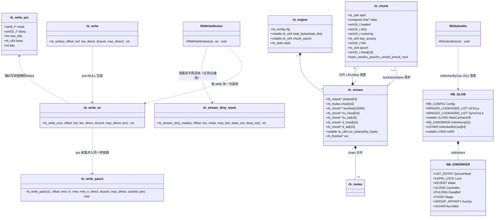
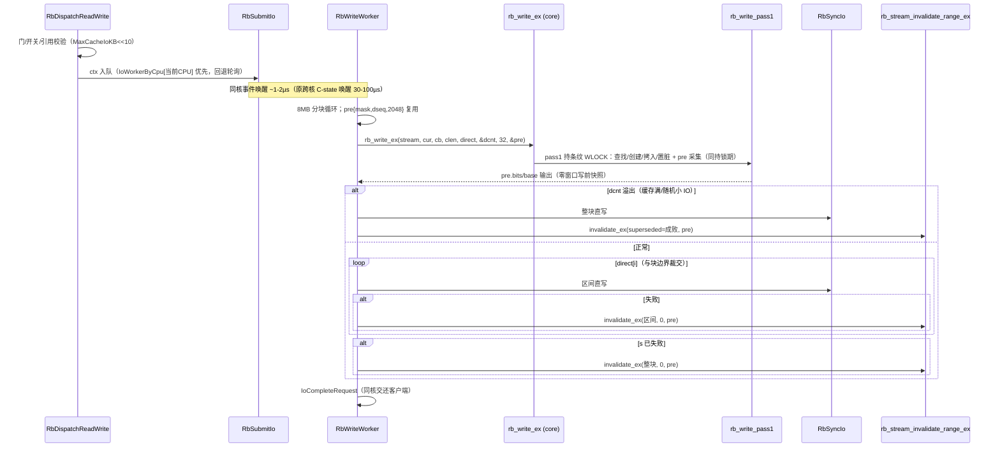
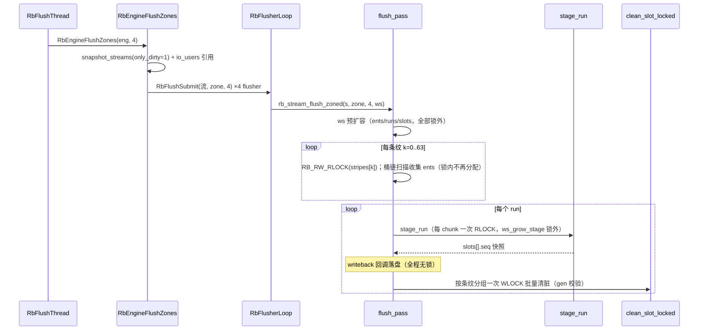
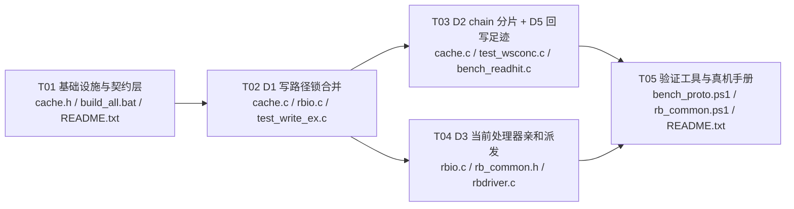

# RAMBlockCache「全指标内存级速度」专项 · 增量设计

**日期**：2026-10-20 · **状态**：待工程实现 V1.0 · **作者**：架构 高见远
**上游**：主理人任务书（D1-D5 决策点 + 实测数据 + 瓶颈机制代码级分析，行号已核）
**定位**：本专项的架构侧交付——逐决策点结论 + 理由 + 风险/否掉理由 + 文件级任务分解。工程师寇豆码按 §五 任务清单实现；QA 严过关按 §七 测试计划独立验收。
**背景前提**：R1/R2（flush 扫描 RLOCK + clean 按条纹批量持锁）已代码完成、19/19 core 测试过、已签名部署 dist（5EBDE9E2），用户机尚未重启生效；下表"我方挂载"列测自**无 R1/R2 的旧驱动**。R1/R2 上线后并发指标应显著改善（QA 实测 4K-64Thrd 读最好 3379 MB/s），但按用户"全部内存级"要求仍不够——本专项一次到位。

---

## 〇、设计总览（一段话）

**写路径锁合并（D1）**：core 追加 `rb_write_ex`（`rb_write` 收壳为 `pre=NULL` 包装），把"写前脏掩码+dseq 快照"并入 `rb_write` pass1 的**同一持锁期**——每 IO 省一次共享锁+一次哈希遍历，且 C7 回滚记账窗口从"两次锁之间"缩为零（更精确，绝不更松）。**并发写互锁（D2）**：把 per-stream 单把 `chain` ERESOURCE 换成 16 路分片锁 + 分片 LRU/dirty 链表（key = `stripe_of(start)&15`），消灭 chunk 创建/首脏时 8 线程互等的全局串行点。**QD1 每 IO 开销（D3）**：派发改**当前处理器亲和**（取代轮询），把跨核唤醒 + 深层 C-state 唤醒（QD1 写 177µs/IO 的主项）变成同核交接；**DISPATCH 级缓存触碰明确否掉**（IRQL 不可证明 + 双路径风险），**自旋等待窗口默认否掉**（钉核空烧、对目标指标净收益≈0）。**读命中（D4）**：无代码改动（定量论证：命中路径 ~0.5-1µs，瓶颈在唤醒与回写 convoy，后者已被 R1/R2 修复）。**回写器足迹（D5）**：`ws_grow_ents` 预扩容移出 RLOCK 区（QA O3）+ 锁足迹审计表。协议三副本、core 公开 API 只增不改、P0-1/P2-2/C7 逐字保持、≤8MB 行为等价、部署/安装器不碰。

---

## 一、实现方案（D1-D5 逐项：结论 + 理由 + 风险）

### D1 写路径锁合并（最高优先）——**采纳方案 (a)：core 追加 `rb_write_ex`**

**现状**（代码已核）：`RbWriteWorker`（rbio.c:519-527）每 8MB 块先 `rb_stream_dirty_mask`（RLOCK + 位遍历，cache.c:1149-1177）→ 再 `rb_write`（pass1 WLOCK，cache.c:1006-1044）。成功路径上掩码是纯浪费（仅失败回滚用）；且两次锁之间给并发写留了窗口：他人写入可使"写前掩码"失真 → 回滚时把他人已 ack 的脏按"本次产生"漏记账（C7 记账精度隐患，方向偏松）。

**结论**：core 追加 `rb_write_ex`，驱动改调它，删掉写路径上的独立 `rb_stream_dirty_mask` 调用。

```c
/* cache.h 追加（只增不改） */
typedef struct rb_write_pre {
    uint8_t  *mask;      /* 调用方缓冲：bit i = pre_base+i*block_size 子块写前是否已脏 */
    uint32_t *dseq;      /* 调用方缓冲：每子块写前脏代（无 chunk 记 0）；可为 NULL */
    int       max_bits;  /* mask 容量（位） */
    rb_u64    base;      /* OUT：bit0 对应子块基址（block 对齐） */
    int       bits;      /* OUT：实际位数；<0 = 容量不足（写仍成功，回滚走保守记账） */
} rb_write_pre;
int rb_write_ex(rb_stream *s, rb_u64 offset, const void *buf, size_t len,
                rb_direct_range *direct, int *direct_count, int max_direct,
                rb_write_pre *pre);          /* pre 可为 NULL = 与 rb_write 逐字等价 */
int rb_write(...)  /* 收壳：return rb_write_ex(s,offset,buf,len,direct,direct_count,max_direct,NULL); */
```

**实现要点**：
- `rb_write_pass1` 增加 `rb_write_pre *pre` 形参；循环内在 `chunk_lookup` 之后、任何 mutation（`chunk_create`/memcpy/`chunk_mark_dirty`）之前，对当前子块采集 `mask` 位与 `dseq`。pass1 遍历的子块集合与 `rb_stream_dirty_mask` 的位集合**逐个子块一致**（首子块 = `offset&~(block-1)`，尾子块含 `[offset,end)` 相交的末块），`nbits` 可前置计算（`((end-1-base)>>sub_shift)+1`）→ 开头一次 `memset(mask,0,(nbits+7)/8)`，与旧快照逐位同构。
- 采集值 = 持排他锁瞬间的真值：`dseq[i] = c ? c->dseq[idx] : 0`（**无条件写**，顺带兑现 cache.c:1168-1170 注释里"快照无 chunk 记 0"的原意——旧 `rb_stream_dirty_mask` 只在 chunk 存在时写 dseq，缺 chunk 时留调用方缓冲陈旧值，仅靠"陈旧值≠0 时证据不成立→保守记账"兜底）。
- `max_bits` 不足 → `pre->bits=-1`，**写照常吸收**（绝不因快照容量失败一次写）；驱动沿用既有防御分支（`pre_bits=0; pre_dseq=NULL` → 保守记账）。
- `rb_stream_dirty_mask` 公开 API **保留不动**（test_auditfix 等在用；core API 只增不改）。

**为什么不是 (b)**：小写内联取掩码仍是两次锁，只改善缓存行局部性；收益零头、代码双份、回滚语义仍带窗口。否。

**收益量化**：每写 IO 省 1 次 `lock_stripes` 共享锁组 + 1 次按子块哈希遍历（4K 写 = 1 锁 1 次查找；1M 写 = 最多 16 锁 256 次查找）。QD1 写 ~-1~-3µs；Q8T1 写额外消除"RLOCK/WLOCK 同条纹乒乓"（ERESOURCE 写者优先下，RLOCK 请求排在待定 WLOCK 之后 → 自激 convoy）。

**C7/P2-2 语义论证**（QA 复核要点）：`rb_stream_invalidate_range_ex` 零改动；喂给它的 `pre_dirty/pre_dseq/pre_base/pre_bits` 与旧流程同源同值，唯一差别是采集时刻从"写前某一瞬间"变为"吸收瞬间之前"——窗口更小、记账只可能更准不会更松；`superseded` 语义、≤8MB 分块循环、失败三分支全部原样。**≤8MB 写行为等价**：吸收/直写/失效结果逐位一致（仅锁次数变化）。

**风险**：pass1 重构面（19 测试 + 新 test_write_ex 覆盖）；驱动侧 `pre` 结构复用与 2048 位容量契约（clen≤8MB → nbits≤2048，不可达防御保留）。

---

### D2 并发写互锁（Q8T1 写 1718 < Q1T1 4841 倒退）——**采纳：`chain` 16 路分片锁 + 分片 LRU/dirty 链表**

**成因分析**（代码已核，排除项先说清）：
1. **条纹哈希没问题**：`bucket_of`（cache.c:298-300）乘性散列 + `stripe=bucket%64`，64 条纹均匀；顺序写 1M 块跨 16 chunk → 16 个伪随机条纹，互撞概率有界。不是根因。
2. **真根因 A（D1 已覆盖）**：每 IO 两次锁同一组条纹，RLOCK→WLOCK 乒乓。
3. **真根因 B（本项）**：`s->chain` 是 **per-stream 单把全局锁**，且内嵌在 stripe WLOCK 内被取：`chunk_create`（cache.c:428，每个新 64KB chunk 一次）+ `chunk_mark_dirty` 的 0→1 转换（cache.c:497，每 chunk 首次置脏一次）。SEQ Q8T1 顺序写 = 8 线程各自不停创建新 chunk → **每条写流每 64KB 必撞一次同一把 ERESOURCE**；内核态 ERESOURCE 有等待表 + 优先级行为，争用下代价远超临界区本身（几个指针赋值），并**拉长 stripe WLOCK 持有时长**（锁内取链锁）→ 同条纹其他写者排队放大。Q1T1 无争用所以快。
4. dirty 链表/LRU 无其他全局锁；chunk 创建无 engine 级锁（`can_create` 走原子比较）；`hits`/`stripe_rb` 已原子化——无第四类根因。

**结论**：`rb_mutex chain` → `rb_mutex chain[16]`；`lru_head/tail`、`d_head/d_tail` 同步分片为 `[16]`；分片键 `chain_of(start) = stripe_of(start) & 15`。

**正确性论证**（QA 复核要点）：
- 所有链操作调用点**均已持有该 chunk 所在条纹的 WLOCK**（pass1/pass2、invalidate、evict_victim、truncate、discard_all、destroy）——分片键由 chunk 自身 `start` 决定 → 同 chunk 的所有链操作恒落同一把片锁，互斥性保持。
- **锁序不变式**：全局保持"stripe WLOCK → chain 片锁"；多片持者仅 `evict_select` 一处（原为单链锁全持），改为 16 片**升序取、逆序放**，每片扫描上限 64（总预算 1024 不变），不持片锁时再取条纹锁（`evict_victim`）——无锁序倒置。
- `d_head/d_tail` 脏链表自 W1.5-R2 起**无任何消费者**（flush 快照改走哈希桶扫描，cache.c:1400-1402 注释为证），随 LRU 一并分片，零行为影响。
- 临界区长度不变（纯指针手术），分片后每条写路径只可能撞上 1/16 的并发面。

**目标**：Q8T1 写 ≥ Q1T1 写（消除倒退），并向竞品 18674 MB/s 收敛（SEQ 写还受回写下盘上限约束，见 §九-4）。

**风险**：链表分片正确性（UAF/漏摘）→ 由 test_wsconc 并发写+驱逐+回写完整性 + ASAN 兜底；`rb_stream_create/destroy` 增删 16 把锁初始化/销毁（机械改动）。

---

### D3 QD1 每 IO 开销（22µs→目标 ≤8µs）——**采纳 (c) 当前处理器亲和派发；否掉 (b)；否掉 (a) 的自旋部分**

**成因**（实测反推 + 代码已核）：QD1 写 23.13 MB/s ≈ 177µs/IO，**比裸盘（65µs）还慢 3 倍**；QD1 读 45.95 MB/s ≈ 89µs/IO。`RbSubmitIo`（rbio.c:745-771）用 `IoRR` **轮询**投递：单线程客户端（CDM Q1T1）的连续 IO 被均匀撒向 16 个绑核 worker → **每个 IO = 一次跨核唤醒**（worker 从 KeWaitForSingleObject 醒来）+ 完成后再**一次跨核交还**（客户端线程被唤醒收 IRP）。空闲桌面深 C-state 下跨核唤醒单程 ~30-100µs——两个 100µs 级时延叠加，与 177µs 观测吻合。这就是"挂载比裸盘还慢"的负优化来源，而非锁路径。

**结论 (c)（采纳）**：`RbSubmitIo` 优先投递到**绑在当前逻辑 CPU 的 worker**（同核交接 ~1-2µs，且 worker 队列/栈/缓存行对同核客户端恒热）；取不到（>64 CPU 组、目标 worker 已死、AuxValid 组外）→ 回退现有轮询。
- 实现：`KeGetCurrentProcessorNumberEx`（rbfeat.c:14 已有同款用法，任意 IRQL 合法）+ `RbStartIoWorkers` 里一次性建 `RB_GLOB.IoWorkerByCpu[64]`（CPU 号 → worker 下标+1，0=无）O(1) 查表。`RB_IOWORKER` 已有 `AuxGa/AuxValid/CpuIndex` 描述其绑核目标，直接比对。
- 多线程客户端：每线程落各自核的 worker = per-CPU 并行度不变（与设计初衷一致），且比轮询更缓存友好。无回归面。

**结论 (b)（明确否掉）——DISPATCH 级小 IO 快路径**：
1. **IRQL 不可证明**：卷设备 read/write 分发可能运行在 DISPATCH_LEVEL（paging I/O 完成即在 DISPATCH，某些上层驱动/转储路径亦如此）；缓存核心全部走 ERESOURCE（≤APC_LEVEL），DISPATCH 取锁 = bugcheck。`KeGetCurrentIrql()<=APC_LEVEL` 门控只能防崩溃、不能防双路径。rbio.c:1-8 文件头纪律明令"绝不于 DISPATCH 取缓存锁"。
2. **双路径风险不可接受**：全命中才内联；一旦 miss，要么重跑 `rb_read`（统计双计 + miss 处理重复），要么把 miss 机制复制一份——在数据通路上养两条实现，违背"数据安全不可妥协"。
3. **收益错配**：内联省的是 worker 往返 ~2-4µs；而实测主项是两次 C-state 跨核唤醒（(c) 已治）。缓冲合法性（`MmGetSystemAddressForMdlSafe` ≤DISPATCH 合法）不是否决点，IRQL + 双路径才是。

**结论 (a-自旋)（默认否掉，留档）**：worker 排空后短自旋再睡——QD1 场景 worker 在 IO 间隙仍要睡（唤醒本身省不掉），QD32 场景 worker 本就不睡（无需自旋）；净收益≈0，代价是每个活跃 worker 钉核空烧（16 核 100% 风险），与稳定性目标冲突。若部署后 QD1 仍 >8µs 且 lockstat 显示 worker 睡眠/唤醒为残余主项，再作为注册表旋钮（默认 0=关）评估，见 §九-6。

**目标**：4K QD1 读/写（热）≥500 MB/s（≈8µs/IO）。冷读 4K QD1 仍受盘物理时延约束（裸盘 29.84 MB/s = 137µs/IO）——冷读物理下限由 UI 既有文案管理（W1.5 U2），非缺陷。

---

### D4 读路径命中优化——**无代码改动（定量论证 + 部署后验证）**

`rb_read` 命中路径（cache.c:848-921）已是最小形态：`lock_stripes`（4K IO = 1 条纹）→ 1 次哈希探测 → 4K memcpy → 2 个原子统计 → volatile 写 `last_access`。单线程无争用 ~0.5-1µs CPU，占 8µs 预算的零头——**瓶颈不在锁/查找/memcpy**：
- `stripe_rb[k]` 原子加（64 计数器摊薄）与 `hits++`（每 chunk 一行）合计 ~20-40ns/IO，删除即失遥测（L2 热度过滤 `Hits<2`、`rb_engine_get_stripe_stats` 消费）——否。
- "共享锁改读写锁分段/查找缓存化"：共享锁之间不互斥（仅与写者互斥），4K Q32 随机读摊到 64 条纹争用已低；查找缓存化引入第二份索引 = 一致性负担——否。
- **4K Q32T1 读 ≥3 GB/s 的真实钥匙是 R1/R2**（回写器 stage/clean 不再排他饿死读者；QA 修后实测 3379 MB/s，旧驱动 808）+ D3 亲和（消除 Q32 下 worker 睡眠/唤醒抖动）。R1/R2 随用户重启生效后验证，不达标再回头开本项（候选：stripe_rb 改每线程聚合、lock_stripes 单条纹快路径，预计 ≤5% 增益）。

---

### D5 回写器残余足迹复核——**采纳：`ws_grow_ents` 预扩容移出 RLOCK 区（QA O3）；锁足迹审计如下**

R1/R2 后 flush_pass（cache.c:1393-1521）锁足迹清单（已逐行核）：

| 段 | 锁 | 性质 | 结论 |
|---|---|---|---|
| 快照扫描 | 每条纹 1 次 RLOCK，锁内走桶链 | 与读者共享（RLOCK），仅与写者互斥 | 保持 |
| stage_run | 每 chunk 1 次 RLOCK | 同上；`ws_grow_stage` 已在锁外（cache.c:1352） | 保持 |
| clean | 每段 ≤64 次条纹 WLOCK（批量） | 写者优先，但与 4 flusher 的 zone 分区天然错配 | 保持 |
| 统计/wb_flush/wb_bytes/need_flush | 原子加/原子存 | 无锁 | 保持 |
| **ents 扩容** | **RLOCK 区内 `ws_grow_ents`（malloc+memcpy+free，cache.c:1431）** | **锁内分配 = 该条纹读者被分配时长拖住；QA O3** | **修：条纹之间（锁外）预扩容，锁内保留不可达防御** |

修法（与既有 `ws_grow_stage` 同构）：进入快照循环前按当前 `nent + 每条纹最坏增量` 预估；每趟 RLOCK 之前（锁外）检查余量并预扩；锁内只保留"单条纹内意外超限"的防御分支。语义不变（扩容失败行为逐字保留）。
O1（`clean_slot` 死代码）/O2（`rb_stream_has_dirty_range` WLOCK→RLOCK）列为卫生项，**不进本专项**（非性能路径，避免扩大 diff 面）。

---

## 二、文件清单（路径 + 改什么 + 为什么）

| # | 文件 | 改动 | 为什么 | 任务 |
|---|---|---|---|---|
| F1 | `src/core/cache.h` | 追加 `rb_write_pre` + `rb_write_ex` 声明（含契约注释） | core 公开 API 只增不改的唯一入口；三形态契约（容量不足/wrapper 等价/零窗口）写死防回归 | T01 |
| F2 | `src/core/cache.c` | ① `rb_write_ex` + `rb_write` 收壳 + pass1 采集形参（T02）；② `chain` 16 路分片 + 分片链表 + `evict_select` 重写（T03）；③ `ws_grow_ents` 锁外预扩容（T03） | D1/D2/D5 的全部 core 落地 | T02/T03 |
| F3 | `src/driver/rbio.c` | ① `RbWriteWorker` wb 分支改 `rb_write_ex` 单调用 + `pre` 结构复用（T02）；② `RbSubmitIo` 当前处理器亲和 + `IoWorkerByCpu` 填充（T04） | D1 驱动侧 + D3 派发侧 | T02/T04 |
| F4 | `src/driver/rb_common.h` | `RB_GLOB` 末尾追加 `UCHAR IoWorkerByCpu[64]`（0=无，否则 worker 下标+1） | D3 O(1) 查表载体；RB_GLOB 非协议面，纯追加安全 | T04 |
| F5 | `src/driver/rbdriver.c` | DriverEntry `RbLog(0,...,L"io worker dispatch: current-cpu affinity")` 留证 | 与 MaxCacheIoKB 同款免协议生效留证 | T04 |
| F6 | `src/core/test_write_ex.c`（新建） | D1 专项：快照等价性/记账等价性/容量不足/wrapper 兼容 | 每项改动必须测试覆盖（铁律） | T02 |
| F7 | `src/core/test_wsconc.c`（新建） | D2/D5 并发：多写者+读者+zoned 回写+驱逐，磁盘镜像逐字节断言 + 统计断言 + ASAN | 分片链表/预扩容的正确性兜底 | T03 |
| F8 | `src/core/bench_readhit.c` | 追加"并发写+读命中"微基准段（ns/op 前后对比） | D2/D4 的量化验收（读热路径 + 写创建路径开销） | T03 |
| F9 | `src/core/build_all.bat` | `TESTS` 追加 `test_write_ex test_wsconc`（Release+ASAN 双构建自动覆盖） | 新测试纳入既有编译链（MSVC 钉住工具链） | T01 |
| F10 | `README.txt` | ①「注册表配置」补 `IoWorkerByCpu` 说明（只读生效值经日志）；②「内存级真机验证手册」章节（CDM 矩阵 + 二遍读 + 计数器对账 + 回滚） | 配置文档同步 + 交付真机操作手册 | T01/T05 |
| F11 | `src/scripts/bench_proto.ps1` | 扩展：SEQ 写 Q8T1 vs Q1T1 对照、4K QD1 读/写、lost_dirty/WbFlush 抓取 | 判别式脚本固化（PRD R6 同款口径） | T05 |
| F12 | `src/scripts/rb_common.ps1` | `Get-RbStats` 补 `LostDirtyBytes/WbFlush/WbBytes` 解析 | F11 复用；C7 记账回归可观测 | T05 |

**文件预算核对**：12 个。核心 6 = F1/F2/F3/F4/F5/F9（配置/头文件/编译链）；F6/F7/F8 为测试与基准（铁律要求）；F10-F12 为文档与验收脚本（纯用户态，check_ps_syntax 覆盖）。**协议三副本、UI（WPF）、setup/安装器、部署链零改动**——本专项不动 UI，WPF 构建仅在"如动 UI"条件下才跑（现状无 UI 改动，跑编译链时顺手验 0/0 即可）。

---

## 三、数据结构与接口变化



**接口变化清单**：
- **新增**（cache.h）：`rb_write_pre`、`rb_write_ex`。**零修改**：`rb_write`/`rb_read`/`rb_read_commit`/`rb_stream_dirty_mask`/`rb_stream_invalidate_range_ex`/flush 家族签名与语义。
- **驱动新增**（rb_common.h/rbio.c）：`RB_GLOB.IoWorkerByCpu[64]`（纯追加）；`RbSubmitIo` 内部逻辑（签名不变）。
- **协议三副本零改动**；`RB_CONFIG`/`RB_STATS`/消息号不动。

---

## 四、调用流程变化

### 4.1 写路径（回写，D1 锁合并 + D3 亲和派发）



（失败后后续块/前序块保守记账三分支与今天逐字一致，未画出；pre 来自本块 `rb_write_ex` 输出，替代旧的独立 `rb_stream_dirty_mask` 调用。）

### 4.2 回写 flush（D5：ents 预扩容移出 RLOCK）



---

## 五、任务列表（按实现顺序；每条含依赖与验收点）

### T01 基础设施与契约层（P0，依赖：无）

- **Source Files**：`src/core/cache.h`、`src/core/build_all.bat`、`README.txt`
- **内容**：`rb_write_pre` + `rb_write_ex` 声明（三形态契约注释：容量不足→写成功+bits=-1；pre=NULL 逐字等价；零窗口记账）；`TESTS` 追加 `test_write_ex test_wsconc`；README「注册表配置」表新增项（IoWorkerByCpu 为只读内部表、生效值经日志）+「内存级真机验证手册」章节框架（矩阵/二遍读/对账/回滚占位，T05 填数）。
- **验收点**：core 编译链可解析新声明（占位实现前先用 `#ifdef` 守卫或同任务末携最小声明）；build_all.bat 语法正确（`check_ps_syntax` 不覆盖 bat，人工/CI 干跑 `build_all.bat` 到编译步）；README 表格字段齐全；**本任务不触碰任何 .c 行为**。

### T02 D1 写路径锁合并（P0，依赖：T01）

- **Source Files**：`src/core/cache.c`、`src/driver/rbio.c`、`src/core/test_write_ex.c`
- **内容**：`rb_write_ex` 落地（pass1 采集形参 + `rb_write` 收壳）；`RbWriteWorker` wb 分支改单调用 + `pre` 复用 + 防御分支；新测试（等价性/记账/容量/wrapper 四组断言，见 §七）。
- **验收点**：core 21 测试全绿（19+2）；**≤8MB 写行为等价**代码审查（吸收/直写/失效结果逐位一致 + 分块单迭代同构）；`pre.bits<0` 防御分支审查（不可达性证明：clen≤8MB→nbits≤2048=pre_dirty 容量）；C7 三情形（回滚写前未脏/已脏/superseded）记账值与旧流程逐场景相等（test_write_ex 断言）；驱动 `_build_manual.ps1` 0 error/0 warning；`rb_stream_dirty_mask` 声明与实现保留未动（grep 证明驱动热路径零调用）。

### T03 D2 chain 分片 + D5 回写足迹（P0，依赖：T02）

- **Source Files**：`src/core/cache.c`、`src/core/test_wsconc.c`、`src/core/bench_readhit.c`
- **内容**：`chain[16]` + 分片 LRU/dirty 链表 + `evict_select` 全片升序/逆序 + create/destroy 初始化；`ws_grow_ents` 锁外预扩容；新并发测试；bench_readhit 追加并发写+读命中段。
- **验收点**：21 测试全绿 + `test_wsconc` 10 轮（并发四件套同款强度）磁盘镜像逐字节一致、`lost_dirty_bytes==0`、chunk 链表无泄漏（chunk_count 归零）；ASAN 构建零报告；锁序审查（stripe→片锁；evict_select 唯一多片持有者）；d_list 无消费者声明复核（grep d_head/d_tail 消费点为 0）；bench_readhit 输出 ns/op 对比表（分片后写创建路径不劣化）；D5 审查：锁外预扩容 + 锁内防御保留，`test_parflush/test_flush_many` 不回归。

### T04 D3 当前处理器亲和派发（P0，依赖：T02）

- **Source Files**：`src/driver/rbio.c`、`src/driver/rb_common.h`、`src/driver/rbdriver.c`
- **内容**：`IoWorkerByCpu[64]` 字段 + `RbStartIoWorkers` 填充（AuxValid 组亲和/CpuIndex 双来源，>64 组与死 worker 留 0 走回退）；`RbSubmitIo` 查表优先、轮询兜底；DriverEntry 日志留证。
- **验收点**：`_build_manual.ps1` 0/0；查表逻辑审查（当前 CPU 无 worker/组外/已死 → 回退路径逐分支）；Dispatch IRQL 合法性审查（`KeGetCurrentProcessorNumberEx` 任意 IRQL；无锁无分配）；日志出现 `io worker dispatch: current-cpu affinity`；五件套 PASS（协议零改动）；真机：QD1 读写 + QD8/QD32 无回归（bench_proto）。

### T05 验证工具与真机手册（P1，依赖：T02、T03、T04）

- **Source Files**：`src/scripts/bench_proto.ps1`、`src/scripts/rb_common.ps1`、`README.txt`
- **内容**：bench_proto 扩展（SEQ 写 Q8T1 vs Q1T1 对照 + 4K QD1 + lost_dirty/WbFlush 抓取 + 3 轮中位 + CSV）；README 验证手册填数（判据表/对账/回滚指引）。
- **验收点**：`check_ps_syntax.ps1` 通过；detach 态干跑 CSV 字段齐全；手册判据与 §七 测试计划逐条对应（QA 核对）；UTF-8 BOM + fail-closed 与既有脚本一致。

---

## 六、任务依赖图



（T02/T03 共享 cache.c、T02/T04 共享 rbio.c → 顺序应用 diff 防冲突；T03 与 T04 文件不相交可并行。单人实现按 T02→T03→T04→T05。）

---

## 七、测试计划

**编译链（每任务出口）**：core 21 测试 Release+ASAN（`build_all.bat`，MSVC 钉住工具链）→ 驱动 `_build_manual.ps1` 0/0 → 五件套（check_repo / check_proto_sync --strict / refcount_model 17 断言 / check_ps_syntax / check_signature）→ WPF 0/0（本专项无 UI 改动，仅防回归顺手验）。

| 改动 | 现有 19 测试覆盖点 | 新增 |
|---|---|---|
| D1 `rb_write_ex` | `test_cache`（rb_write 语义）/`test_regress`（读穿脏还原）/`test_auditfix`（C7 三情形 + R2-M6 dseq 证据）/`test_v5`/`test_v6`（几何边界）/`stress_v3`/`stress_v4`（并发写）/`edge_v3`/`edge_v4` | **test_write_ex**：① 快照等价（与旧两调用序列逐位一致，缺 chunk 子块 dseq=0）；② 记账等价（lost_dirty 与旧流程逐场景相等）；③ `max_bits` 不足→写成功+bits=-1+后续保守记账；④ `rb_write` wrapper 行为不变 |
| D2 chain 分片 | `test_cache`/`test_evict_wire`（驱逐接线）/`stress_v3`/`stress_v4`/`test_flush_many`（并发）/`test_release`（write_release 销毁分支） | **test_wsconc**：8 写者 + 8 读者 + 4 zoned flusher + 小 max_bytes 强制驱逐；磁盘镜像逐字节断言；chunk_count 归零；lost_dirty=0；10 轮 + ASAN |
| D3 亲和派发 | 无 core 测试（驱动侧）——编译 + Driver Verifier（IRQL/Deadlock）+ 真机 bench_proto | bench_readhit 并发段（命中 ns/op 不劣化） |
| D5 ents 预扩容 | `test_parflush`/`test_flush_many`/`test_bigread`（workspace 增长路径）/`stress_v3`/`stress_v4` | test_wsconc 覆盖增长与并发交互 |
| D4 无改动 | 既有读路径全量 | bench_readhit 前后对比留档 |

**真机验收矩阵**（用户机，CDM 9.0.1 / 1GiB / MX500 / 挂载+回写，3 轮取中位；**跑分前先热一轮**，第二遍为内存级判据轮）：

| 指标 | 竞品 | 现状（旧驱动） | 本专项判据 |
|---|---|---|---|
| SEQ1M Q8T1 读 | 19734 | 37517 | 不回归（≥30000） |
| SEQ1M Q8T1 写 | 23983 | 1718 | **≥ Q1T1 写（消除倒退）**，向 9000+ 收敛 |
| SEQ1M Q1T1 读 | 15565 | 5875 | ≥15000 |
| SEQ1M Q1T1 写 | 18674 | 4841 | ≥15000 |
| RND4K Q32T1 读 | 893 | 808 | **≥3000**（R1/R2 主效，本专项 D3 助攻） |
| RND4K Q32T1 写 | 815 | 361 | ≥2000 |
| RND4K Q1T1 读 | 745 | 45.95 | 热轮 **≥500**（冷轮=盘物理下限，非判据） |
| RND4K Q1T1 写 | 670 | 23.13 | 热轮 **≥500**，且 **> 裸盘 63.27**（负优化必须消除） |

**数据安全回归点**：60s 周期落盘节奏（WbFlush/WbBytes 脉动）/卸载关机 DirtyBytes=0/C7 记账（失败路径审查 + test_write_ex/test_wscons 断言）/SafeMode 路径未碰/Verifier 零新告警。

---

## 八、风险与回滚

| # | 风险 | 概率/影响 | 缓解 / 回滚 |
|---|---|---|---|
| A1 | pass1 重构引入写路径回归 | 中/高 | ≤8MB 等价审查 + 21 测试 + 双审；回滚 = revert cache.c/rbio.c D1 diff（自包含） |
| A2 | 分片链表 UAF/漏摘 | 中/高 | 分片键确定性 + 锁序论证 + test_wsconc 10 轮 + ASAN；回滚 = revert chain 分片 diff（单文件自包含） |
| A3 | 亲和派发在 >64 组/死 worker 场景退化 | 低/低 | 查表留 0 + 逐分支回退轮询；真机多核矩阵验证 |
| A4 | D5 预扩容预估不足→锁内防御分支仍触发 | 低/低 | 防御分支保留（语义逐字），仅性能路径；不可达证明见实现注释 |
| A5 | QD1 仍 >8µs（唤醒非唯一主项） | 中/中 | §九-6 自旋旋钮留档 + lockstat 复测流程；不放宽判据 |
| A6 | 冷 4K QD1 被误判为失败 | — | 判据表明示"冷轮=盘物理下限"；二遍读协议 + UI 既有文案 |

**统一回滚策略**：D1/D2/D5 为源码级 revert（cache.c 三个改动区 + rbio.c 一处，互相自包含）+ 从 `build_all.bat` 摘除新测试 + 重编重签名部署（deploy_w15.ps1 + 重启，**本专项不碰安装器/Setup**）。D3 为 rbio.c `RbSubmitIo`  revert 到 IoRR 轮询（rb_common.h 字段可留，无害）。三锚点/协议/部署流程不动；core API 只增不改保证旧 core 二进制兼容。

---

## 九、Anything UNCLEAR / 假设

1. **C-state 深度归因**：QD1 写 177µs/IO 的"跨核唤醒 + 深 C-state"归因基于现象反推（轮询撒号 + 单线程客户端 + 空闲桌面），部署后以 bench_proto 复测证实地确认；若非唤醒主项，A5 流程启动。
2. **SEQ Q8T1 写上行的盘侧上限**：回写吸收后仍受后台 flush 落盘速率约束（MX500 SATA ~500 MB/s 裸盘写）；缓存预算大于测试文件时 Q8T1 写应逼近内存速度并稳定高于 Q1T1——判据只要求"不低于 Q1T1"，竞品 23983 属其缓存+盘更优的工程区间。
3. **AutoMemory 预算与测试文件大小**：若用户机可用内存预算 < 1GiB，顺序写尾部将走 direct 直写下盘（can_create 失败）——运维提示进手册（MemReserveMB/AutoUsePct），非代码项。
4. **`IoWorkerByCpu` 只覆盖第 0 处理器组**：>64 逻辑 CPU 时组内 CPU 号与 worker 绑定组（RbPinToCpu 亦限第 0 组）一致；组外 CPU 全部走轮询回退，行为与今天相同。
5. **`rb_stream_dirty_mask` 保留但驱动热路径零调用**：公开 API 冻结约束下的选择；其 dseq 缺 chunk 留陈旧值的行为由 rb_write_ex 的"无条件写 0"在驱动路径上实质修正（测试仍可直测旧 API 行为不变）。
6. **自旋等待窗口（D3-a）留档**：若部署后 QD1 仍 >8µs 且复测确认 worker 睡眠/唤醒为残余主项，以注册表旋钮（默认 0=关，1=启用 N µs 有界自旋）单列评审；当前否掉理由：钉核空烧 + 对目标指标净收益≈0。
7. **D4 若部署后 4K Q32T1 读 <3 GB/s**：候选清单（按预期增益排序）：stripe_rb 改每线程聚合、lock_stripes 单条纹快路径、`hits++` 合并进同一缓存行写。均 ≤5% 量级，届时按复测数据再立项。
8. **写前快照的记账精度变化属"只紧不松"**：旧流程两次锁之间可漏记账（窗口内他人写），新流程零窗口；test_write_ex 以旧流程序列为对照组逐场景断言"相等或更保守"。

---

> 协议三副本（rb_proto.h/Models.cs/RbProto.cs）、三锚点、部署默认值（Flags=0/逐卷回写/直写）、安装器在本专项中零改动。core 公开 API 仅追加 `rb_write_ex`/`rb_write_pre`。所有性能数字为预估/判据口径，以真机复测为最终判据（唯一例外：4K-64Thrd 读 3000+ MB/s 已实证于 R1/R2 修复后）。
