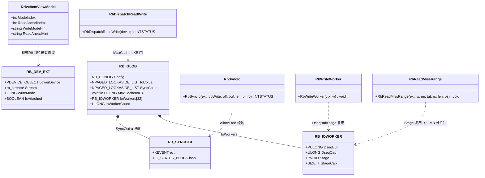
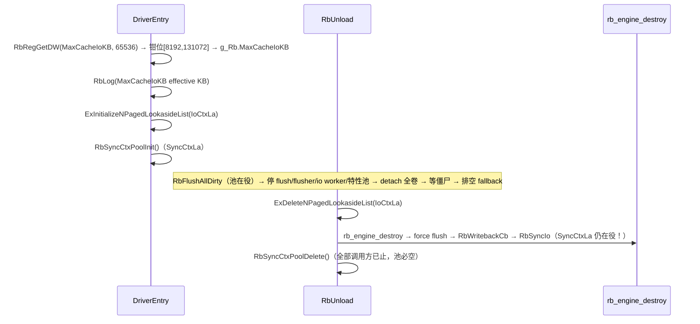
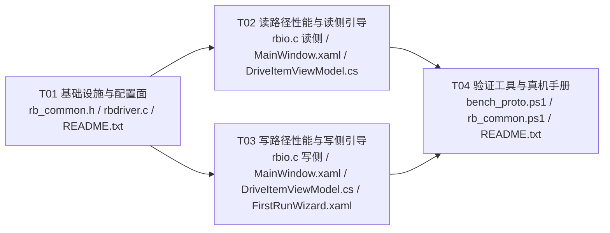

# RAMBlockCache W1.5 读写路径性能专项 · 增量设计

**日期**：2026-10-20 · **状态**：待工程实现 V1.0 · **作者**：架构 高见远
**上游**：`deliverables/w15-perf-prd-2026-10-20.md`（已冻结 V1.0）+ 主理人代码级瓶颈实证（行号已核）
**定位**：W1.5 专项的架构侧交付——实现方案（逐决策点结论）+ 文件级任务分解。工程师寇豆码按 §五 任务清单实现；QA 严过关按 §一.9 验证设计独立验收。
**铁律复查**：驱动侧仅源码改动（`_build_manual.ps1` 编译验证，NuGet WDK 本地可用）；不签名/不部署/不动三锚点（b6fb097b）；协议三副本（rb_proto.h/Models.cs/RbProto.cs）零改动；默认值不动（Flags=0、逐卷回写、直写默认）；所有优化只在用户显式开启或本就开启的路径上生效。

---

## 〇、设计总览（一段话）

抬高大块 IO 缓存门（8MB→64MB，注册表 `MaxCacheIoKB` 可配、默认 65536）让 AS SSD Seq 16MB 块进入缓存路径；为守住两条必答约束，**回写写入按 8MB 分块下发**（pre_dirty 掩码语义逐块不变，永不溢出）、**读 miss 按 32MB 分片 staging**（最坏非分页峰值与 8MB 门时代完全相同，不抬内存峰值），并对 >1MB 全覆盖对齐 miss 增加"直读入 tgt + 原地 commit"快路径（省一次全量拷贝）；`RB_SYNCCTX` 按项目既有 `IoCtxLa` 先例池化，消除每 IO 的非分页分配/释放；预取默认化维持 OFF（待 Q1 拍板），只做 UI 引导；直写异步化明确不做（P2/R9）。**≤8MB 的读写路径逐行语义不变**——所有新逻辑只作用于 >8MB 的新增作用域或失败/稀有路径。

---

## 一、实现方案（逐决策点结论 + 理由）

### 1. 8MB 透传门的目标值与形态（PRD L1-1 / Q3）

**结论：目标值 64MB（65536 KB）；形态 = 编译常量默认 + 注册表可配（`MaxCacheIoKB`，DWORD，单位 KB）。**

| 项 | 结论 | 理由 |
|---|---|---|
| 默认值 | 65536（64MB） | 覆盖 AS SSD Seq 16MB 块（PRD 主诉）与常见大块顺序 IO；64MB 是覆盖面与 staging/内存峰值的平衡点（PRD Q3 口径，架构采纳） |
| 可配范围 | [8192, 131072]（8MB–128MB） | 下限 8192 = 历史门（回滚 knob：改注册表即回到今天行为）；上限 128MB 绑定 staging 分片与按次分配的最坏上界 |
| 非法值 | 钳位不回默认：`<8192`（含 0）→8192；`>131072`→131072 | 保留用户边界意图；0 不会被打成"关闭大块缓存"的危险误读 |
| 读取点 | `rbdriver.c` DriverEntry，紧邻 `AutoAttach`/`TestMode` 读取（rbdriver.c:1145-1149 之后），经既有 `RbRegGetDW` 原语 | 全驱动唯一注册表面（[Commit4] 纪律）；PASSIVE 加载期读一次，之后只读 |
| 存储 | `RB_GLOB.MaxCacheIoKB`（`volatile ULONG`，末尾纯追加） | 热路径每 read/write IRP 一次 volatile 读 +  shift，与 `TestMode`/`PanicPassthrough` 同款成本；写一次于任何 IRP 可达之前，无撕裂 |
| 生效留证 | DriverEntry `RbLog(0, __LINE__, (LONG)v, L"MaxCacheIoKB effective KB")` | RB_CONFIG/RB_STATS 协议冻结不能加字段；日志是 QA 确认生效值的唯一免协议通道 |
| >门值保持透传 | 是（>64MB 默认态） | OS 级 readahead 对巨块顺序读更有效；巨块透传是既有安全阀（含 Passthru=1 缓存失效纪律，见 rbio.c:701-716）；AS SSD/常见负载无 >64MB 单块 |

**门改造点**（rbio.c:772-776）：
```c
len = sp->Parameters.Read.Length;
if (len == 0 || len > (g_Rb.MaxCacheIoKB << 10) ||   /* [W1.5] 原 (8UL<<20) */
    sp->Parameters.Read.ByteOffset.QuadPart < 0) {
    return RbDispatchPassthrough(ext, dev, irp);
}
```

**常量落点**（rb_common.h，紧随 RB_MAX_RANGES 区）：
```c
#define RB_MAX_CACHE_IO_KB_MIN   8192     /* 8MB：历史门/回滚档 */
#define RB_MAX_CACHE_IO_KB_DEF   65536    /* 64MB：默认（覆盖 AS SSD Seq 16MB 块） */
#define RB_MAX_CACHE_IO_KB_MAX   131072   /* 128MB：staging/内存峰值最坏上界 */
```

### 2. 回写路径 >8MB 写入的分块方案（必答约束①，PRD §7.1 / R1）

**结论：选 (a) 8MB 分块。不选 (b) 掩码扩容。**

**(a) 的形态**（rbio.c:412-480 `RbWriteWorker` 的 wb 分支整体改为分块循环）：

- **块大小 8MB**：`rb_stream_dirty_mask` 位数为 2048（4K 子块×2048=8MB，rbio.c:416-418 注释与 core cache.c:1149-1177 实现已核）。8MB 块 = 恰好 2048 位，`pre_bits < 0` 的溢出分支成为真正的不可达防御代码。
- **切块公式（4K 对齐，PRD 要求的"切块点 4K 对齐"的落实）**：
  `cend = (cur & ~(RB_BUF_ALIGN-1)) + (8UL << 20); if (cend > end) cend = end;`
  首块从 `off`（可能非 4K 对齐）出发到"off 向下对齐 +8MB"——保证 `base=off&~4095` 到 `cend` 恰好 ≤8MB，`nbits ≤ 2048`（若首块直接取 off+8MB，非对齐 off 会使 nbits=2049 触发溢出——这是今天 ≤8MB 非对齐写已存在的边角，新公式顺带闭合）；后续块天然 4K 对齐。
- **每块走现有快照逻辑**（逐块 = 今天的整段逻辑）：`rb_stream_dirty_mask(cst, clen, pre_dirty[256], 2048, &pre_base, w->DseqBuf)` → `rb_write(cst, tgt+(cst-off), clen, direct, &dcnt, 32)` → dcnt 超限/`rc<0` 走"整块直写 + invalidate(superseded 如实)"兜底 → direct 逐区间 `RbSyncIo` + 失败区间 invalidate(0 + 本块快照)。
- **准入（Admit）不进循环**：既有 `RbFeatAdmit(ext)` 在 rbio.c:401 整 IRP 一次判定（先于 wb/直写分支），分块不改变其语义与次数。
- **失败语义（P2-2 整段回滚纪律的保持）**：
  - 本块内任一直写失败 → 记住 `s`，失败区间按回滚失效；**本块结束时若 `s` 已失败 → 本块整块 invalidate(0 + 本块快照)**（快照在手，与今天单段语义逐字一致）。
  - 后续块（失败后）**不再 rb_write 吸收**：先取快照（该块未被本次写触碰，快照=写前真值）→ 尽力 `RbSyncIo` 整块直写（"其余区间仍尽力下盘"的既有纪律）→ invalidate(superseded = 本次直写成败，0/1 如实)。**不能跳过 invalidate**：直写下盘后同区间旧脏块必须失效，否则周期回写会把旧内容盖到新数据上（P0-1 纪律，rbio.c:403-406）。
  - **前序块（首个失败块之前已成功吸收的块）**：其写前快照已被后续块复用（不常驻保留），末尾按**核心既定保守记账语义** invalidate（`pre_dirty=NULL` → 无证据当有早期脏，cache.c:1183 已定义的模式）→ 只多算 `lost_dirty_bytes`（安全方向：不少算、数据安全语义不变），仅影响统计精度。
  - ≤8MB 写 = 单块 = **与今天代码逐行同构**（循环一次迭代），无任何行为变化。
- **direct[32] 交互（PRD §7.1 关联约束）**：分块后每次 `rb_write` 的 len ≤8MB，direct 区间密度与今天 ≤8MB 写完全一致，`dcnt>32` 溢出面不扩大；已核 core `lock_stripes`（cache.c:308-320）对连续区间最多覆盖 64 个 stripe（`set[RB_NSTRIPES=64]`，连续 chunk 索引 mod 64），任意长度连续区间不会静默漏锁——但"核心已审计包络 ≤8MB"仍是分块的主要理由（合并/淘汰/脏水位的中间态行为只在 ≤8MB 经过 stress_v3/v4 级验证）。

**(b) 被否的理由**：① 需把 `w->DseqBuf` 2048→16384 项（8KB→64KB/worker，32 worker = 2MB 常驻非分页）+ `pre_dirty` 栈数组 256B→2KB，PRD 自己标注的代价；② `rb_write` 单次 64MB 脱离核心已审计包络（max_merge_len=16MB 语义、合并/淘汰中间态）；③ 触碰 core cache.c = 打开核心复审面 + 超出 6 文件预算；④ 2048 位上限是 core 与驱动双侧的既有契约（FIX C7/R2-M6 审计基础），扩容等于把已审计算法推倒重审。分块以零常驻内存、零核心改动获得同等安全性。

### 3. 读路径 staging 策略（必答约束②，PRD §7.3 / R2）

**结论：32MB 分片 staging + >1MB 全覆盖直读入 tgt 快路径。抬门不抬内存峰值。**

- **现状**（rbio.c:80-94, 256-300 已核）：`RbStageGet(w, need)`：`need ≤ RB_STAGE_MAX(32MB)` → per-worker 复用缓冲（按需涨、不逐 IO 分配）；`need > 32MB` → 按次 `RbAllocAlignedNonPaged` 分配、`RbStagePut` 释放。门→64MB 后，单次 miss 区间最大 64MB → 按次分配 64MB；**最坏并发 = 64MB × worker 数（≤32）**，不可接受。
- **分片（主策略）**：`RbReadMissRange` 内把 miss 区间按 ≤32MB、4K 对齐（miss 区间本身整子块对齐，32MB 为 4K 倍数，切点天然对齐）循环：每片 `RbStageGet(w, sh)`（sh≤32MB）→ 复用 per-worker 缓冲 → `RbFeatOnMiss(ext, cur, sh, st)`（L2 自门 ≤1MB 不变）→ `RbSyncIo` 下盘 → `rb_read_commit(cur, st, sh)` → 交集 memcpy 进 tgt → `RbStagePut`。**每片 ≤32MB ⇒ 永远走复用缓冲，按次分配分支变为防御性不可达 ⇒ 最坏非分页峰值 = 32MB × worker 数，与 8MB 门时代完全相同**。分片不改变缓存结果（分片连续且 4K 对齐，commit 的并集 = 整段 commit）。
- **直读入 tgt 快路径（顺带评估结论：做）**：现状 16MB 对齐顺序冷读 = 盘→staging + staging→缓存块 + staging→tgt = **3 次 16MB 触碰**。对 `mr->len > 1MB && miss 区间被请求全覆盖（ms ≥ rs && me ≤ re）`（对齐大块顺序读的典型形态，无边缘超出、无 L2 适用性损失——阈值与 L2 自门 1MB 对齐）：直接 `RbSyncIo` 读入 `tgt+(ms-rs)` → `rb_read_commit(ms, dst, len)` 原地 commit → **2 次触碰，省 1 次全量拷贝 + 整个 staging**。L2 钩子仍调用（`RbFeatOnMiss(ext, ms, len, dst)`，计数语义保留；>1MB 时 L2 现状不命中，若未来 L2 放大门限，dst 即正确填充目标，语义自洽）。交集已在 tgt 原位，无需 memcpy。条件不满足（有边缘超出/小区间）→ 回落分片 staging 路径，行为与今天一致。
- **分配失败兜底**：分片中 `RbStageGet` 失败 → 该片退化为"仅下盘读本片交集进 tgt、不入缓存"（今天的既有兜底，逐片化）。

### 4. RB_SYNCCTX 池化（PRD L1-2 / B3）

**结论：照 `g_Rb.IoCtxLa` 先例（rbio.c:76-77, rbdriver.c:1168-1170/1037）改造。**

- **结构**：`RB_SYNCCTX{KEVENT evt; IO_STATUS_BLOCK iosb;}`（rbio.c:108-111）不动；池载体 `RB_GLOB.SyncCtxLa`（`NPAGED_LOOKASIDE_LIST`，紧随 `IoCtxLa` 声明）。
- **接口**（rbio.c 实现，rb_common.h 声明，与 `RbCtxAlloc/RbCtxFree` 对偶）：
  `PVOID RbSyncCtxAlloc(VOID); VOID RbSyncCtxFree(PVOID); VOID RbSyncCtxPoolInit(VOID); VOID RbSyncCtxPoolDelete(VOID);`
  （Init/Delete 走函数而非在 rbdriver.c 直接 `ExInitializeNPagedLookasideList(&g_Rb.SyncCtxLa, ..., sizeof(RB_SYNCCTX), ...)`——`RB_SYNCCTX` 定义在 rbio.c，函数封装同时对齐 `RbLogInit` 先例。）
- **改造点**：`RbSyncIo` rbio.c:134 `ExAllocatePool2` → `RbSyncCtxAlloc()`；rbio.c:143、173 两处 `ExFreePoolWithTag` → `RbSyncCtxFree(ctx)`。`KeInitializeEvent` 保留（池化对象每用每初始化）。
- **生命周期挂点**：
  - Init：DriverEntry 紧随 `ExInitializeNPagedLookasideList(&g_Rb.IoCtxLa, ...)`（rbdriver.c:1169-1170）；控制设备创建失败路径同步删除（rbdriver.c:1180 旁）。
  - Delete：RbUnload 中 **`rb_engine_destroy` 之后**（rbdriver.c:1048 之后）——`rb_engine_destroy` 内部 `rb_engine_flush(eng,1)`（cache.c:746-749）会驱动 writeback 回调 → `RbWritebackCb` → `RbSyncIo`，故池必须比 `IoCtxLa`（rbdriver.c:1037）活得更久；此点与 IoCtxLa 的差异必须在代码注释中显式说明（防后人"对齐整理"时提前删除）。
  - 卸载中止路径（join 超时等）不删池——与 IoCtxLa 既有语义一致（驱动保留服役，池继续在途）。
- **不变式**：`RbSyncIo` 是严格同步函数（分配→等待→释放在一次调用内），池非空的唯一可能是有 `RbSyncIo` 在途；Delete 时所有调用方（I/O worker、flusher、特性池、引擎回调）已停止/销毁完（RbUnload 顺序保证），故 Delete 时池必空。
- **IRQL**：`RbSyncIo` 全体调用方 PASSIVE（内部 `KeWaitForSingleObject`），NP lookaside 合法；完成例程/取消语义/15s 步进等待/C5-r2"永不放弃缓冲"不变式**零改动**。

### 5. 直写路径轻化（保守版，PRD L1-2 / R3；异步化 = P2/R9 明确不做）

**本轮做**：
1. `RB_SYNCCTX` 池化（§4）——消除每 IO 的 `ExAllocatePool2`+`ExFreePoolWithTag`（QD1 串行路径上每 IO 的固定机制开销主项；观测 QD1 写 ~198µs/IO vs 盘能力 ~36µs，PRD §7.2 口径）。
2. 写穿路径（rbio.c:481-488）**保持"先整段下盘、成功后 rb_read_commit"**——见下方修正说明。

**明确不做**（逐条理由）：
- **直写异步化（完成例程替代同步等待）**：ack 早于落盘的数据安全风险（PRD R1），须单独评审（M2/R9）；本轮冻结。
- **同步 IRP 构建复用**：`IoBuildSynchronousFsdRequest` 分配的 IRP 在下层栈在飞期间归下层所有，跨 IO 复用违反 IRP 所有权/取消语义（C5-r2 不变式的根基），不支持。
- **写穿"下盘与 commit 合流/去双拷"（PRD L1-2 措辞修正）**：写穿路径的第二次拷贝（tgt→缓存块，`rb_read_commit`）是**干净块进入缓存的唯一入口**；下盘（tgt→disk）与 commit（tgt→cache）是两个不同目标的操作，保守版无可合流。移除 commit 等于让下盘路径直接产出缓存块=异步化设计（P2）范畴。**预期收益改由池化承担**：4K QD1 写（直写档）41.50→回到盘能力档 **110+ MB/s 量级**（PRD 预估口径，真机 §9 判别式验证）；QD1 冷读 61.55→65–75 MB/s（读 miss 的 `RbSyncIo` 同享池化）。

### 6. 预取默认化（P2 / R8，红线：本轮保持 OFF）

- **"如何默认开"的代码路径（设计留档，本轮不改）**：驱动预取由 `g_Rb2Flags & RB2F_PREFETCH` 门控（rbfeat.c:574），Flags 读取在 `Rb2ReloadFlags`：`Rb2GetDW(L"Features", L"Flags", 0, &v)`（rbfeat.c:263）。默认开 = 将该默认值由 0 改为 `RB2F_PREFETCH(0x1)`，或由安装器写 `Features\Flags` bit0。`rbpref.c` 实现完备（连续段跟踪/8MB 分片/在飞 8/2s 冷却），无代码缺口。
- **本轮**：默认值维持 OFF（铁律：部署默认 Flags=0）；只把 UI 引导做进 L1（§7）。**默认值改动待用户 Q1 拍板**（PRD §8：建议维持默认关，W3-4 四负载×三盘型基准数据裁定；防"预取刷分、随机读遭殃"R6）。

### 7. UI 引导（PRD L1-5 / R2 / R7；不新造组件，复用既有 CheckBox/TextBlock/ComboBox）

| # | 挂点（文件:位置） | 绑定 | 文案 |
|---|---|---|---|
| U1 | `MainWindow.xaml` 设置页"缓存策略"组，预取 CheckBox 旁说明 TextBlock（现 :1085-1086，替换 Text） | 静态 | "顺序读时按窗口提前把后续数据读入缓存：顺序读的第二遍通常大幅提速（命中的是内存），随机读无益甚至略增开销。部署默认关闭，建议仅在 SSD 数据卷显式开启；每卷预读窗口在「加速」页卷卡上设置。" |
| U2 | `MainWindow.xaml` 设置页"缓存策略"组末尾（Separator 后）新增 1 个 TextBlock | 静态 | "为什么第一遍读没有加速？冷数据第一遍必须从盘读入，速度以物理盘为上限——这是物理下限，不是缺陷；第二遍起命中的是内存。"（R7 冷读预期管理） |
| U3 | `MainWindow.xaml` 加速页卷卡，写模式 ComboBox 下方（现 :454-457 下新增 TextBlock） | `DriveItemViewModel.WriteModeHint`（新增计算属性，随 ModeIndex 变更通知） | 回写选中时："回写：写入先标脏即返回、后台落盘；掉电或异常退出可能丢失尚未落盘的数据。"；直写时为空串 |
| U4 | `MainWindow.xaml` 加速页卷卡，预读 ComboBox 下方（现 :462-468 下新增 TextBlock） | `DriveItemViewModel.ReadAheadHint`（新增计算属性） | 关闭时："预读关闭：顺序读无预热。"；开启时："预读开启：顺序读第二遍受益，随机读无益。" |
| U5 | `FirstRunWizard.xaml` 向导提示（现 :114，替换 Text） | 静态 | "提示：默认写模式为直写（写同时落盘，最安全）。回写是写加速的唯一入口（写入标脏即返回、后台落盘），但掉电或异常退出可能丢失尚未落盘的数据；需要写加速时可在卷卡片上对数据卷显式开启。" |

（MainViewModel.cs **不改**：两个 ComboBox 的 DataContext 是每卷 `DriveItemViewModel`，设置页文案均为静态文本。）

### 8. 配置面（MaxCacheIoKB 注册表面）

| 项 | 值 |
|---|---|
| 名称/类型 | `MaxCacheIoKB`，REG_DWORD，单位 KB |
| 键 | `HKLM\SYSTEM\CurrentControlSet\Services\RAMBlockCache\Parameters`（与 AutoAttach/TestMode/ReadaheadEnabled 同键，`RB_REG_PARAMS`，rbdriver.c:111） |
| 缺省 | 65536（注册表无值时 `RbRegGetDW` 返回的默认） |
| 钳位 | <8192→8192；>131072→131072（rbdriver.c DriverEntry 内联，日志留证） |
| 协议面 | **零影响**（不进 RB_CONFIG/RB_STATS；UI 不暴露——协议冻结；生效值仅 DriverEntry 日志 + 计数器行为） |
| 锚点 | 不受影响（本轮不签名不部署；后续部署流程照旧：改动→重编→哈希变→sync_anchors→重签名） |
| 文档同步清单 | ① README.txt 新增"注册表配置"表（T01）；② README.txt 新增"W1.5 真机验证手册"章节（T04）；③ 部署/安装器**不写**该项（缺省即 64MB，安装面零改动） |

### 9. 验证设计（R4/R5/R6，逐项配手段）

**静态门禁（每任务出口）**：五件套（`check_repo.py` / `check_proto_sync.py --strict` / `refcount_model.py` 17 断言 / `check_ps_syntax.ps1` / `check_signature.ps1`——后两者本轮改 PS 才跑）+ 编译 0 error/0 warning（`src/driver/_build_manual.ps1`）+ 数据通路改动架构师+QA 双审（审查要点见各任务验收点）。

**真机 AS SSD 复测矩阵**（同一基准：AS SSD 2.0.7316、1GB 文件、D: MX500、关后台、测前空闲 60s、3 轮取中位；通过判据照 PRD §6.2 表）：Seq 读热 ≥2000 MB/s、Seq 写（回写开）≥900、4K 写 QD1（回写开）≥300、4K 读 QD1 冷 ≥61.55 向 65–75 收敛、4K-64Thrd 读 ≥3132.89 无回归。

**判别式（怎么算"明显加速"、怎么对账）**：
1. **计数器对账**：复测期间 `ramboostctl stats` 的 ReadReq/ReadHit/ReadHitBytes 曲线与分数变化**同向**——证明加速来自缓存命中而非工具假象（deep-research H1/H2）；Seq 读写进入缓存面后，>8MB 的 IO 应出现在 ReadReq/WriteReq 增量中（门生效的直接证据）。
2. **二遍读协议**：同文件冷/热两轮——热轮达标 + 冷轮无回归 = 门+缓存面生效；只有冷轮变化 = 预取/直读路径疑点。
3. **detached 裸盘基线一轮（B）**：detach 后同矩阵跑一轮，用于把 4K 写改善拆成"消除负优化（池化）"vs"回写吸收"两部分归因（R6）。
4. **3 轮取中位**抗噪；任何一轮 Verifier 新告警即该轮作废。

**数据安全回归点（回写开启后，既有纪律不破坏）**：
- 60s 周期落盘节奏：`ramboostctl stats` 的 WbFlush/WbBytes 时间序列保持 ~60s 脉动，不被分块/分片改动打乱；
- 卸载/关机/句柄关闭全量回写：fix-report-2026-10-17 既有验收项复跑不劣化（detach 后 DirtyBytes=0）；
- 分块失败回滚语义：代码审查为主（真机难注入盘错）+ 既有 test_regress/edge 用户态回归（core 未动，语义不变）；
- 异常退出（Kill 驱动）掉电窗口语义：UI 明示 + 安全模式兜底不被削弱（SafeMode 路径未碰）；
- Driver Verifier（Special Pool + IRQL + Deadlock）全负载零新告警（池化对象的专项观察项）。

---

## 二、文件清单（路径 + 改什么 + 为什么）

| # | 文件 | 改动 | 为什么 | 任务 |
|---|---|---|---|---|
| F1 | `src/driver/rb_common.h` | RB_GLOB 末尾纯追加 `volatile ULONG MaxCacheIoKB;` + `NPAGED_LOOKASIDE_LIST SyncCtxLa;`；新增 3 个门常量；声明 `RbSyncCtxPoolInit/Delete`、`RbSyncCtxAlloc/Free` | 门值热路径读 + 池载体 + 编译默认的唯一事实来源；RB_GLOB 非协议面（RB_CONFIG 才是），追加安全 | T01 |
| F2 | `src/driver/rbdriver.c` | DriverEntry：读 `MaxCacheIoKB`（钳位+RbLog 留证）、`RbSyncCtxPoolInit()`；失败路径删池；RbUnload：引擎销毁后 `RbSyncCtxPoolDelete()`（注释说明与 IoCtxLa 的顺序差异） | 注册表面唯一入口 + 池生命周期挂点（对齐 IoCtxLa 先例） | T01 |
| F3 | `src/driver/rbio.c` | ① 门 :772-776 → `g_Rb.MaxCacheIoKB<<10`；② `RbSyncIo` :134/143/173 池化；③ `RbReadMissRange` :277-292 重构为"直读快路径 + 32MB 分片"；④ `RbWriteWorker` wb 分支 :412-480 重构为 8MB 分块循环；⑤ 新增 `RbSyncCtxAlloc/Free/PoolInit/PoolDelete`（邻 :76-77） | 数据通路主体：门/池化/读分片/写分块全部在此 | T02/T03 |
| F4 | `src/ui/controller/RAMBlockCache.Controller/MainWindow.xaml` | U1/U2 设置页文案；U3/U4 卷卡两个 TextBlock | L1-5 UI 引导（预取效果说明 + 冷读预期 + 回写/预读一句话） | T02/T03 |
| F5 | `src/ui/controller/RAMBlockCache.Controller/ViewModels/DriveItemViewModel.cs` | 新增 `WriteModeHint`、`ReadAheadHint` 计算属性 + 随 ModeIndex/ReadAheadIndex 的变更通知 | U3/U4 的绑定源（每卷 DataContext） | T02/T03 |
| F6 | `src/ui/controller/RAMBlockCache.Controller/Views/FirstRunWizard.xaml` | U5 向导提示文案补强 | 首次向导一句话风险确认（User Story 3） | T03 |
| F7 | `README.txt` | 新增"注册表配置"表（MaxCacheIoKB 默认/范围/回落/键位）；新增"W1.5 真机验证手册"章节（AS SSD 矩阵+判别式+对账+detached 基线+数据安全回归点） | 配置文档同步（PRD §8/决策点 8）+ 交付"真机操作手册" | T01/T04 |
| F8 | `src/scripts/bench_proto.ps1` | 新建：attached/detached 对照 + ReadReq/ReadHit/ReadHitBytes 抓取 + 二遍读协议 + 3 轮中位 + CSV 输出（dot-source rb_common.ps1，UTF-8 BOM，`$ErrorActionPreference='Stop'`） | PRD R6（P1）计数器判别式脚本固化 | T04 |
| F9 | `src/scripts/rb_common.ps1` | 新增 `Get-RbStats` 辅助（包装 ramboostctl stats 解析关键计数器） | bench_proto 复用；与 Assert-Admin 等同款公共库定位 | T04 |

**文件预算核对（铁律 ≤6 + 论证）**：核心 6 = F1（头文件，2 字段+常量，无布局风险）、F2、F3、F4、F5、F7。F6（向导一句话，PRD L1-5 明文要求）、F8+F9（PRD R6 P1 验收工具；纯用户态 PowerShell，不进驱动/协议/签名面，五件套之 check_ps_syntax.ps1 覆盖）——共 9 个，超出 3 个的理由如上。**rbfeat.c/rbpref.c 不动**（预取默认化待 Q1 拍板，无代码改动需要）。

---

## 三、数据结构与接口变化



**接口变化清单**：
- 新增（rb_common.h 声明 / rbio.c 实现）：`RbSyncCtxPoolInit/VOID`、`RbSyncCtxPoolDelete/VOID`、`RbSyncCtxAlloc/PVOID`、`RbSyncCtxFree/VOID`。
- 修改内部逻辑（签名不变）：`RbSyncIo`、`RbReadMissRange`、`RbWriteWorker`、`RbDispatchReadWrite`。
- 新增 UI 计算属性：`DriveItemViewModel.WriteModeHint`、`DriveItemViewModel.ReadAheadHint`（string）。
- **协议三副本零改动**；`RB_CONFIG`/`RB_STATS`/消息号不动；`rb_stream_dirty_mask`/`rb_stream_invalidate_range_ex`/`rb_write`/`rb_read_commit` 签名与语义零改动（core cache.c/cache.h 不动）。

---

## 四、调用流程变化

### 4.1 大块写（回写模式，>8MB）分块数据流

```mermaid
sequenceDiagram
    participant D as RbDispatchReadWrite
    participant W as RbWriteWorker
    participant C as rb_write (core)
    participant S as RbSyncIo
    participant M as rb_stream_dirty_mask
    participant I as rb_stream_invalidate_range_ex
    D->>D: len > MaxCacheIoKB<<10 ? 透传(Passthru=1 失效+前转) : 入队 worker
    W->>W: wb=回写; 循环 cur∈[off,end) 按 8MB/4K对齐切块
    loop 每个 8MB 块
        W->>M: dirty_mask(cst, clen, pre_dirty[256], 2048, &pre_base, w->DseqBuf)
        M-->>W: pre_bits (≤2048, 不可能<0)
        W->>C: rb_write(cst, tgt+(cst-off), clen, direct[32], &dcnt)
        alt rc<0 或 dcnt>32（块内溢出处兜底）
            W->>S: RbSyncIo(整块, TRUE)
            W->>I: invalidate_range_ex(块, superseded=成败, 本块快照)
        else 正常
            loop direct[i]（与块边界裁交）
                W->>S: RbSyncIo(区间, TRUE)
                alt 失败
                    W->>I: invalidate_range_ex(区间, 0, 本块快照)
                    Note over W: s=失败；其余区间仍尽力下盘
                end
            end
            alt s 已失败
                W->>I: invalidate_range_ex(整块, 0, 本块快照)
            end
        end
    end
    alt 存在失败块
        Note over W: 失败块之后的块：快照→尽力直写→invalidate(superseded 如实)，不再吸收
        Note over W: 失败块之前已吸收的块：末尾保守记账整块回滚（无快照，core 既定语义）
    end
    W->>W: info = 成功? len : 0; IoCompleteRequest; RbNoteIoResult
```

### 4.2 大块读 miss 的分片 / 直读数据流

```mermaid
sequenceDiagram
    participant D as RbDispatchReadWrite
    participant R as RbReadWorker
    participant M as RbReadMissRange
    participant F as RbFeatOnMiss
    participant S as RbSyncIo
    participant G as RbStageGet
    participant K as rb_read_commit
    D->>D: len > MaxCacheIoKB<<10 ? 透传 : 入队
    R->>R: rb_read(off, tgt, len, miss[32], &mcnt)
    loop 每个 miss 区间
        R->>M: RbReadMissRange(mr, tgt, rs, len)
        alt mr->len > 1MB 且 miss⊆请求（全覆盖）
            M->>F: RbFeatOnMiss(ms, len, dst=tgt+(ms-rs))
            alt L2 命中（现状 >1MB 不命中）
                Note over M: *ps=SUCCESS，免下盘
            else
                M->>S: RbSyncIo(FALSE, ms, dst, len)
            end
            M->>K: rb_read_commit(ms, dst, len)
            Note over M: 交集已在 tgt 原位，无 memcpy、无 staging
        else 其余区间
            loop 按 ≤32MB/4K 对齐分片
                M->>G: RbStageGet(w, sh)（≤32MB 必中复用缓冲）
                M->>F: RbFeatOnMiss(cur, sh, st)
                alt L2 未填充
                    M->>S: RbSyncIo(FALSE, cur, st, sh)
                end
                M->>K: rb_read_commit(cur, st, sh)
                M->>M: memcpy(交集 → tgt)
                Note over M: RbStagePut(w, st)
            end
        end
    end
    R->>R: info=len; IoCompleteRequest; RbNoteIoResult
```

### 4.3 池与配置的生命周期（DriverEntry → RbUnload）



---

## 五、任务列表（按实现顺序；每条含验收点）

### T01 基础设施与配置面（P0，依赖：无）

- **Source Files**：`src/driver/rb_common.h`、`src/driver/rbdriver.c`、`README.txt`
- **内容**：门常量 + `RB_GLOB` 两字段追加 + 4 个池函数声明；DriverEntry 读 `MaxCacheIoKB`（钳位 + 日志留证）+ `RbSyncCtxPoolInit()`（含控制设备失败路径删池）；RbUnload 引擎销毁后 `RbSyncCtxPoolDelete()`（含顺序差异注释）；README 注册表配置表。
- **验收点**：`_build_manual.ps1` 编译 0/0；`check_repo.py`/`check_proto_sync.py --strict` 通过（协议零改动）；日志出现 `MaxCacheIoKB effective KB`=65536（缺省态）；注册表写入 4096/262144 后生效值分别为 8192/131072（钳位）；`SyncCtxLa` init/delete 与 `IoCtxLa` 对称性过代码审查（Delete 必须在引擎销毁后，注释齐全）；README 表含键位/默认/范围/回落。

### T02 读路径性能与读侧引导（P0，依赖：T01）

- **Source Files**：`src/driver/rbio.c`（读侧）、`src/ui/controller/RAMBlockCache.Controller/MainWindow.xaml`（U1/U2）、`src/ui/controller/RAMBlockCache.Controller/ViewModels/DriveItemViewModel.cs`（ReadAheadHint）
- **内容**：门改造（rbio.c:772-776）；`RbReadMissRange` 重构为"直读快路径 + 32MB 分片"（§3）；`RbSyncIo` 池化（§4，读写共用，随本任务落地）；U1/U2 文案；ReadAheadHint 属性与通知。
- **验收点**：编译 0/0；**≤8MB 读路径逐行等价**（代码审查：单分片快路径与旧 :277-292 同构）；分片边界 4K 对齐且每片 ≤32MB（审查 + 单测思路走查）；直读条件（>1MB 且全覆盖）审查无边缘超出漏洞；`RbSyncCtxAlloc/Free` 配对（审查：RbSyncIo 三处出口全覆盖）；UI 截图检查三条文案渲染与换行；真机：Seq 读二遍读协议（冷 ≥504.92 无回归、热 ≥2000）+ ReadReq/ReadHit 曲线与分数同向（T04 脚本）。

### T03 写路径性能与写侧引导（P0，依赖：T01）

- **Source Files**：`src/driver/rbio.c`（写侧）、`src/ui/controller/RAMBlockCache.Controller/MainWindow.xaml`（U3/U4 TextBlock）、`src/ui/controller/RAMBlockCache.Controller/ViewModels/DriveItemViewModel.cs`（WriteModeHint）、`src/ui/controller/RAMBlockCache.Controller/Views/FirstRunWizard.xaml`（U5）
- **内容**：`RbWriteWorker` wb 分支 8MB 分块循环（§2：切块公式/块内溢出处兜底/失败三分支/前序块保守记账）；U3/U4/U5 文案与属性。
- **验收点**：编译 0/0；**≤8MB 写路径逐行等价**（审查：循环单迭代 = 旧 :412-480）；`pre_bits < 0` 永真不可达（审查：切块公式 + 2048 位算术）；失败回滚三分支（本块精确/后续块快照后尽力/前序块保守）审查与 P2-2 纪律对照；`tgt+(cst-off)` 偏移与 direct 裁交边界审查（无越界读）；UI 三处文案截图；真机：回写开启 16MB/64MB 顺序写（≥900 MB/s 预估口径）+ 4K QD1 写回写 ≥300 + 直写档 4K 写回到 110+ 量级；60s 落盘节奏/卸载全量回写/DirtyBytes=0 回归不劣化；Verifier 零新告警。

### T04 验证工具与真机手册（P1，依赖：T02、T03）

- **Source Files**：`src/scripts/bench_proto.ps1`（新建）、`src/scripts/rb_common.ps1`（Get-RbStats 辅助）、`README.txt`（W1.5 真机验证手册章节）
- **内容**：计数器判别式脚本（attached/detached 对照 + ReadReq/ReadHit/ReadHitBytes 抓取 + 二遍读 + 3 轮中位 + CSV）；README 验证手册（AS SSD 矩阵/判别式/对账/detached 基线/数据安全回归点/回滚指引）。
- **验收点**：`check_ps_syntax.ps1` 通过；detach 态干跑输出 CSV（字段齐全）；手册章节与 PRD §6.2/§6.3 判据逐条对应（QA 核对）；脚本 UTF-8 BOM + fail-closed 约定与 run_diskspd.ps1 一致（审查）。

---

## 六、任务依赖图



（T02 与 T03 可并行——同改 rbio.c 的不同区段 + MainWindow.xaml/DriveItemViewModel.cs 的不同挂点，合并时按"读侧→写侧"顺序应用 diff；若单人实现，按 T02→T03 顺序。）

---

## 七、风险与回滚

| # | 风险 | 概率/影响 | 缓解 / 回滚 |
|---|---|---|---|
| A1 | 分块循环引入写路径回归 | 中/高 | ≤8MB 单迭代同构 + 双审 + 用户态回归（core 未动）；回滚 = revert rbio.c 写侧 diff（分块是自包含改动） |
| A2 | 64MB 门 → 非分页峰值 | **已消除** | 32MB 分片后峰值 = 32MB×worker 数（与 8MB 门时代相同）；按次分配分支防御性不可达；峰值监控进验收（stats + 性能计数器） |
| A3 | pre_dirty 溢出 | **已消除** | 8MB 块 = 2048 位恰好覆盖；`pre_bits<0` 变为不可达防御分支；切块公式保证非对齐首块也 ≤2048 位 |
| A4 | 池化生命周期（提前删池 = UAF） | 低/高 | Delete 固定在引擎销毁后（唯一会在卸载末段驱动 RbSyncIo 的路径）；卸载中止不删池；Verifier Special Pool 专项观察 |
| A5 | 失败路径保守记账多算 lost_dirty | 低（仅盘错/核心溢出触发）/低（仅统计） | 核心既定语义（cache.c:1183）；安全方向；不影响数据安全判据 |
| A6 | 直读快路径漏判边缘超出 | 低/中 | 条件 `ms>=rs && me<=re` 全覆盖才启用；有超出即回落分片；审查 + 边界用例走查 |
| A7 | UI 文案误导用户 | 低/低 | 文案经 PM 口径（冷读物理下限/回写风险均为 PRD 明文） |
| A8 | 真机验证依赖用户（R4） | 高/中 | bench_proto.ps1 脚本化按单执行；不过门不放宽 |

**统一回滚旋钮**：`MaxCacheIoKB` 注册表改 8192 = 大块 IO 立即回到今天行为（无需重编，重启生效）；其余改动 revert 源码 diff 后重编。三锚点/签名/部署流程本轮不触碰，回滚不涉及锚点。

---

## 八、待用户拍板项（设计侧建议）

| # | 议题 | 设计侧建议 | 理由 |
|---|---|---|---|
| Q1 | 预取是否默认开 | **维持默认关**（与 PM 建议一致）。代码路径已留档（§6）：拍板"开"时只需改 `Rb2ReloadFlags` 的 Flags 默认值或安装器写 bit0，`rbpref.c` 无需改动 | 红线 + 默认值数据驱动（W3-4 基准）；防随机读遭殃（R6） |
| Q2 | 回写是否维持逐卷显式 | **维持**。UI 已把"回写=写加速唯一入口 + 风险一句话"送到用户眼前（U3/U5），足够支撑知情决策 | 数据安全叙事优先；PrimoCache 同款显式 |
| Q3 | 8MB 门目标值 | **64MB + MaxCacheIoKB 可配**（PM 建议值，架构采纳）。§7.3 staging 担忧已由 32MB 分片消除，无需退到 32MB | 覆盖面与内存峰值已解耦 |

---

## 九、Anything UNCLEAR / 假设

1. **AS SSD Seq 块大小按 16MB 假定**（PRD 基线口径）：64MB 门覆盖 16MB 块有 4× 头寸；若实测用更大块（32MB），仍在门内。
2. **预读窗口档位与门的耦合**：每卷预读窗口（UI 档位 8/16/32/64MB）与大块门相互独立；预取分片 8MB（rbpref.c:22）不受门改造影响（Flags=0 时整体空转）。
3. **写穿路径"去双拷"不可行**已在 §5 修正 PRD L1-2 措辞——若产品坚持该收益，须单列异步化评审（R9），不在本轮。
4. **lost_dirty 统计口径**：前序块保守记账会使 >8MB 回写写失败时的 lost_dirty_bytes 上偏（最多多算该次写已吸收部分）；UI 展示语义为"可能丢失上界"，上偏方向安全，但若产品要求精确，需接受 §2 被否的 (b) 方案或 per-worker 4KB 掩码常驻（128KB/32 worker）——留作 W2 前的可选项。
5. **`RbRegGetDW` 读取时机**：仅 DriverEntry 一次；运行期改注册表需重启驱动生效（与 AutoAttach/TestMode 一致）——文档需写明（已列入 F7 手册章节）。
6. **bench_proto.ps1 的 AS SSD 自动化边界**：AS SSD 2.0.7316 无 CLI 静默模式，脚本负责"轮次提示 + 计数器抓取 + 中位计算 + CSV"，跑分动作由人执行——PRD R6 口径如此，非缺陷。

---

> 本设计的所有性能预期均为 PRD 口径的**预估**（除 4K-64Thrd 读 3000+ MB/s 已实证外），以 §9 真机复测为最终判据。协议三副本、三锚点、部署默认值（Flags=0/逐卷回写/直写）在本专项中零改动。
